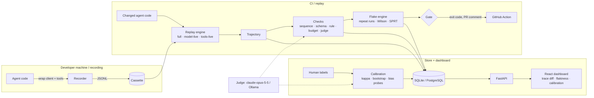

# PLAN.md — Replay: record-and-replay regression testing for LLM agents

Single source of truth for this project. Tick a milestone only when its
definition of done is met and CI is green. Last updated: 2026-10-08 (plan).

## Goal

**Problem.** Teams shipping LLM agents cannot test them the way they test other
software. Every run is different (sampling, tool results that change, clocks),
so a passing test proves little and a failing test might be noise. Teams either
skip tests, hand-mock each tool (brittle, misses drift), or run live against the
API on every PR (slow, expensive, still flaky). When a judge model is used to
score outputs, nobody checks whether the judge agrees with humans, so CI gates
on a number nobody has validated.

**Users.** Developers of tool-using agents built on the Anthropic SDK (or any
Python agent that can wrap its model and tool calls), who want a PR check that
says "this change broke the agent" and means it.

**What Replay does.**

1. **Record** a real agent run: every model call, tool call, clock read and
   random draw, with usage, cost and latency, into a JSONL *cassette*.
2. **Replay** it with *cut points* you choose: everything from the cassette
   (`full`, zero network, bit-stable, tests the orchestration code), or the
   model live with tools mocked from the cassette (`model-live`, tests prompt
   and model changes against a frozen world), or the reverse (`tools-live`).
3. **Check** the trajectory: tool-call sequence and arguments, structured-output
   schema, Python rule predicates, cost and latency budgets against a baseline,
   and a rubric-driven LLM judge.
4. **Gate CI statistically.** A scenario is not pass/fail from one run. In
   `model-live` mode Replay re-runs it, estimates the pass probability with a
   Wilson interval, stops early with a sequential test when the verdict is
   clear, and distinguishes *flaky* from *failing*.
5. **Calibrate the judge.** Judge checks are *advisory* until the judge has been
   measured against human labels on a golden set: Cohen's kappa with a bootstrap
   confidence interval, repeat-run self-consistency, and bias probes (position,
   verbosity, self-preference). Only a calibrated judge may fail a build.
6. **Show it.** A React dashboard with run history, trace viewer, aligned trace
   diffs between baseline and candidate, flakiness trends and the calibration
   report. Shipped as `pip install agent-replay`, a GitHub Action, and a Docker
   Compose dashboard.

**What makes it impressive.** Several small open-source projects now do
VCR-style replay of agent runs (`pytest-agentreplay`, `replayproof`, `chronicle`,
`pytest-agent-trace`). None of them measures the two things that decide whether
an agent test suite is trustworthy: *is the judge right* and *is the failure
real*. Replay's hard core is exactly that, with numbers the repo re-runs:
judge-human kappa with CIs, judge accuracy on an adversarial judge benchmark
(LLMBar), flake rates with intervals, model calls saved by sequential testing,
and a mutation study showing which injected regressions each check type
catches. Every number rests on a small, independently tested statistics
module.

## Architecture

### Components

| Component | Language / libs | Responsibility |
|---|---|---|
| `agent_replay.record` | Python 3.12, `anthropic` 1.x, `ollama` | Wrap the Anthropic / Ollama clients and tool functions; emit envelopes to a cassette. Capture `now()` and `random()` through helpers. |
| `agent_replay.cassette` | pydantic 2 | Cassette schema v1 (JSONL): header + envelopes with `kind`, `name`, `fingerprint`, request, response, usage, cost, latency, span ids. Canonical JSON for fingerprints. |
| `agent_replay.replay` | Python | Replay engine: cut-point modes, fingerprint match with cursor fallback, unrecorded-call policies (`strict`, `fallback`, `synth`), streaming and async support. |
| `agent_replay.checks` | Python, `jsonschema`/pydantic | `tool_sequence`, `required_tools`, `forbidden_tools`, `max_tool_calls`, `arg_schema`, `output_schema`, `rule`, `budget` (cost, tokens, p95 latency vs baseline), `judge`. |
| `agent_replay.judge` | `anthropic` (claude-opus-5-5), Ollama fallback | Rubric judge with structured outputs; response cache keyed by fingerprint; provider pluggable via `REPLAY_JUDGE_PROVIDER`. |
| `agent_replay.stats` | Python, stdlib only  | Cohen's kappa (unweighted and quadratic-weighted), bootstrap CI, Wilson interval, sequential gate (SPRT). |
| `agent_replay.flake` | Python, `anyio` | Repeated `model-live` runs with concurrency and rate limits; feeds `stats`; flaky vs failing classification. |
| `agent_replay.calibrate` | Python | Golden-set labelling CLI, judge-vs-human agreement, self-consistency, bias probes, LLMBar harness. |
| `agent_replay.diff` | Python | Trace alignment (Needleman-Wunsch over tool-call sequences with per-step cost) producing an aligned diff. |
| `agent_replay.store` | SQLAlchemy 2.1, SQLite (local) / PostgreSQL 16 (server), Alembic | Runs, envelopes, check results, baselines, labels. Same models for both backends. |
| `agent_replay.cli` | Typer, Rich | `replay record | run | ci | flake | calibrate | label | diff | serve | baseline`. |
| `server/` | FastAPI 0.143, uvicorn | REST + SSE API over the store for the dashboard; structured logging (structlog). |
| `dashboard/` | React 19, TypeScript strict, Vite 8, TanStack Query 5, Tailwind 4, Vitest | Runs, run detail, trace viewer, trace diff, flakiness trend, calibration report. |
| `action.yml` | GitHub composite action | `uses: TheAsianFish/agent-replay@v1`: installs, runs `replay ci`, posts a PR comment, uploads the report, fails on regression. |
| `examples/retail_agent` | Python | Demo agent on τ-bench retail tasks and tools (MIT, vendored subset) with objectively checkable outcomes (final DB state). |

### Data flow



### Key design decisions (alternatives considered)

1. **Intercept at the SDK boundary, not the HTTP transport.** `replay.wrap(Anthropic())`
   returns a proxy whose `messages.create/parse/stream` (sync and async) are
   recorded; tools are wrapped with `@replay.tool` or `replay.tools(...)`.
   *Alternative:* an httpx transport that records raw HTTP, as VCR does. Rejected
   because `anthropic` 1.x runs on `httpx2` while other SDKs use `httpx`, so one
   transport cannot cover both, and SDK-level interception gives typed messages,
   usage and streaming accumulation for free. Any other provider can be covered
   with the generic `@replay.model_call` decorator.
2. **Cut-point replay rather than stub-everything.** Recording every
   non-deterministic boundary and choosing per run which ones to serve from the
   cassette follows the idea published as "cut-point replay" (Chronicle,
   arXiv:2609.20625). `full` mode tests orchestration code with zero model calls
   and is bit-stable; `model-live` mode is the mode that catches prompt and model
   regressions and is where flakiness lives. *Alternative:* record only model
   decisions (langchain-replay style) and always run tools live. Rejected: tools
   that hit real systems make CI non-hermetic.
3. **Fingerprint matching with cursor fallback and explicit unrecorded-call
   policy.** A replayed call is matched by a canonical-JSON hash of the request
   with volatile fields removed; if none matches, the engine falls back to the
   next unconsumed envelope of the same kind and name and marks the step
   `approximate`. Tool calls the cassette never saw follow a policy: `strict`
   fails the run, `fallback` calls the real tool, `synth` returns a schema-valid
   stub. *Alternative:* strict cursor replay only. Rejected because a live model
   reorders calls often enough to make strict replay useless in `model-live`.
4. **Flakiness is a statistics problem, not a retry loop.** A scenario's result
   is a pass-probability estimate with a Wilson lower bound; the gate compares the
   bound to a threshold. A sequential probability ratio test stops repeating
   as soon as the verdict is clear, which is where the model-call savings come
   from. *Alternative:* fixed `k` runs and majority vote. Kept as the measured
   baseline.
5. **Judge checks are advisory until calibrated.** A judge check can only fail a
   build if a calibration report for that rubric shows kappa's lower CI bound at
   or above `REPLAY_JUDGE_MIN_KAPPA` (default 0.6). *Alternative:* trust the
   judge. Rejected; it is the whole point of the project.
6. **Structured outputs for the judge, no forced tool choice.** The judge uses
   `output_config.format` (JSON schema) and `claude-opus-5-5`. `tool_choice: any`
   is rejected by that model, and prefill is gone, so schema-constrained output
   is the only robust path. Rubric text goes first in the prompt so prompt
   caching applies across traces.
7. **One SQLAlchemy model set, two backends.** SQLite in `.replay/` for the CLI
   with no setup; PostgreSQL for the shared dashboard. *Alternative:* Postgres
   only. Rejected: the CLI must work in a fresh CI job.
8. **Trace diff by sequence alignment.** Baseline and candidate trajectories are
   aligned with a Needleman-Wunsch dynamic programme where substituting a step
   costs more when tool names differ than when only arguments differ. This gives
   "inserted a verification call" rather than "everything after step 3 moved".
9. **Pluggable providers, offline tests.** `anthropic` and `ollama` adapters
   share one protocol. Every test runs with a deterministic fake model and
   committed cassettes; nothing in `pytest` touches the network.

## Evaluation

All numbers in README.md come from `make eval` / `make bench` and are recorded in
RESULTS.md with dataset, method, command and raw output. Anything needing an
API key is built, run on what the runner can do, and listed under "To measure"
with the exact command.

### Datasets

| Id | Dataset | Source | Labels | Used for |
|---|---|---|---|---|
| D1 | **Golden traces**: ~120 recorded runs of `examples/retail_agent` on τ-bench retail tasks | Recorded with an API key (`replay record`), committed under `eval/golden/` | (a) objective: final DB state equals expected state (τ-bench reward); (b) human: pass/fail labels per rubric criterion with `replay label` (target 100+ traces, ~2 hours) | Judge calibration (kappa vs human and vs objective), rubric iteration |
| D2 | **LLMBar** (419 pairwise instances, Natural + Adversarial, gold labels, MIT) | `princeton-nlp/LLMBar` on GitHub / Hugging Face, downloaded by `make data` | Gold preference 1/2 | Judge accuracy and position-bias probe on an adversarial benchmark with published numbers to compare against |
| D3 | **Flake suite**: 30 scenarios from D1, replayed `model-live` 20 times each | Generated by `make bench-flake` (needs key) | Pass/fail per run from objective + sequence checks | Flake rate with CIs, SPRT savings vs fixed k |
| D4 | **Mutation suite**: 25+ scripted mutations of `examples/retail_agent` (skip a verification tool, swap an argument, drop the confirmation step, change output field, loosen a guard) | `eval/mutations/` in the repo, runs offline in `full` and `model-live-from-cassette` modes | Known-bad by construction | Detection rate per check type; cut-point vs stub-everything baseline |
| D5 | **Synthetic cassettes** from the fake model | Generated deterministically in tests | n/a | Unit and integration tests, replay fidelity benchmark |

### Metrics and how each number is measured

| Claim | Metric | Method | Command | Needs key |
|---|---|---|---|---|
| Judge agrees with humans | Cohen's kappa (unweighted, pass/fail) per rubric criterion, with 95% bootstrap CI (2000 resamples), plus raw agreement and confusion matrix; majority-class baseline reported alongside | D1 human labels vs judge verdict, judge run 3× per trace to also report self-consistency kappa | `make eval-judge` | yes |
| Judge is robust | Accuracy on LLMBar Natural and Adversarial subsets, with and without position swap; position-bias rate = fraction of pairs where swapping order flips the verdict | D2, both orderings | `make eval-llmbar` | yes |
| Replay catches regressions | Mutation detection rate per check type and per mode; false-alarm rate on 5 benign refactors | D4, offline | `make eval-mutations` | no |
| Flakiness is quantified | Per-scenario pass rate with Wilson 95% interval; suite flake rate; single-run false-pass and false-fail rates relative to the 20-run estimate | D3 | `make bench-flake` | yes |
| Sequential testing saves calls | Model calls used by SPRT gate vs fixed k=20 at the same error targets (alpha=beta=0.05), on D3 and on a simulated Bernoulli grid (offline) | D3 for the real number; simulation offline | `make bench-sprt` | partial |
| Recording is cheap, replay is fast | Recorder overhead per boundary (µs, median and p95) and wall-clock full replay vs recorded live duration | D5 and D1 | `make bench-replay` | no |
| Stats are correct | Property tests: `stats.cohens_kappa` matches scikit-learn `cohen_kappa_score` and `wilson_interval` matches statsmodels on random inputs (dev deps only) | Hypothesis | `make test` | no |

Baselines kept in the repo: raw agreement (vs kappa), fixed-k majority vote
(vs SPRT), stub-everything replay (vs cut-point), single-run pass/fail (vs
interval gate). A small local model through Ollama is the labelled offline
judge baseline when available; it is never presented as the headline judge.

## Release

**How users get it.**

- `pip install agent-replay` (PyPI; name verified free on 2026-10-08). SDK
  (`agent_replay`) and CLI (`replay`). Python ≥ 3.12. Built with `uv`, published
  by a GitHub Actions workflow using PyPI trusted publishing, guarded by
  `if: github.repository == 'TheAsianFish/agent-replay' && startsWith(github.ref, 'refs/tags/v')`.
- `uses: TheAsianFish/agent-replay@v1` GitHub Action (composite, `action.yml`
  in the repo root). Fails the job on regression and comments a Markdown
  summary on the PR. A `v1` moving tag is documented in RELEASE.md.
- `docker compose up` for the dashboard (FastAPI + PostgreSQL + static React
  build). One image, multi-stage Dockerfile.
- Optional hosted demo (read-only dashboard seeded with D1 and the mutation
  results) described in RELEASE.md with exact steps for Fly.io or Render.

**Maintainer steps** (listed in RELEASE.md):
create the PyPI project and trusted-publisher binding; add `ANTHROPIC_API_KEY`
as a repository secret for the manual-dispatch `eval-live` workflow; record D1
and label it (`make record-golden`, `replay label`); tag `v1.0.0`; optionally
publish the Action to the Marketplace and deploy the demo.

## Statistics core

`agent_replay/stats.py` (stdlib only) holds the statistics every headline
number depends on:

```python
def cohens_kappa(a: Sequence[int], b: Sequence[int], *, weights: Literal[None, "linear", "quadratic"] = None) -> float
def bootstrap_ci(stat: Callable[[Sequence[int], Sequence[int]], float], a, b, *, n_resamples: int = 2000, alpha: float = 0.05, seed: int = 0) -> tuple[float, float]
def wilson_interval(successes: int, trials: int, *, confidence: float = 0.95) -> tuple[float, float]
class SequentialGate:  # Wald SPRT on Bernoulli outcomes
    def __init__(self, p_fail: float, p_pass: float, *, alpha: float = 0.05, beta: float = 0.05, max_runs: int = 20) -> None
    def update(self, passed: bool) -> Literal["continue", "pass", "fail"]
```

A naive `stats_baseline.py` (raw agreement, normal-approximation interval,
fixed-k gate) ships first behind the same interface. `tests/test_stats.py`
covers hand-computed cases, edge cases (empty input, constant raters, k=0,
k=n) and Hypothesis property tests against scikit-learn and statsmodels as
oracles; `eval/sprt_sim.py` plots expected runs against the true pass rate.
`REPLAY_STATS_IMPL=baseline|core` selects the implementation.

## Risks

| Risk | Impact | Mitigation |
|---|---|---|
| Crowded space: several 2026 OSS tools do VCR-style agent replay | Looks like a clone in a 5-minute look | README leads with the measured calibration and flakiness numbers and the mutation study; prior art cited honestly in design decisions |
| `model-live` replay diverges from the cassette (model reorders or invents tool calls) so mocks miss | Mode is useless in practice | Fingerprint + cursor fallback, `approximate` flag, three unrecorded-call policies, `synth` stubs from tool JSON schema; measured in D3 |
| Headline numbers need an API key the CI runner lacks | Claims without measurements | Harness + offline parts (mutations, SPRT simulation, replay bench, stats tests) run in CI; key-dependent commands listed under "To measure"; never write an unmeasured number |
| Human labelling burden (~100 traces) | Calibration never gets measured | `replay label` TUI makes it ~1 minute per trace; objective τ-bench labels give a second, free reference; rubric kept to 3 criteria |
| Judge cost during evaluation | API spend | Judge cache by fingerprint; prompt caching; cost estimate printed before each eval run; Ollama fallback for development |
| Anthropic SDK churn (httpx2, forced tool choice removed, thinking always on) | Breakage, stale patterns | Pin `anthropic>=1.12,<2`; adapters isolated in `record/anthropic.py`; CONTRIBUTING.md records the API facts |
| Dashboard scope creep | M5 balloons | Five pages, read-only, no auth; everything else is roadmap |
| τ-bench data licensing / size | Repo bloat | MIT; vendor only the retail domain data and tool functions with attribution |
| Replay of thinking-enabled conversations | Recorded assistant turns with thinking blocks are model-bound | `full` mode never contacts the API; `model-live` never injects recorded assistant turns; documented limitation |

## Milestones

- [ ] M1: Scaffolding, CI and a thin vertical slice — `uv` project with ruff, mypy `--strict`, pytest, Hypothesis; GitHub Actions running lint, type-check and tests; `Makefile` targets; cassette schema v1; Anthropic SDK wrapper and `@replay.tool`; `replay record` and `replay run --mode full` on a toy agent driven by a deterministic fake model; the `tool_sequence` check; MIT LICENSE; README quickstart that works. Done when a committed cassette replays offline, the check passes, a mutated toy agent fails it, and CI is green.
- [ ] M2: Replay engine and checks library — modes `full`, `model-live`, `tools-live`; fingerprint matching with cursor fallback and the `approximate` flag; unrecorded-call policies `strict | fallback | synth`; clock and random capture; sync, async and streaming; Ollama adapter; checks `required_tools`, `forbidden_tools`, `max_tool_calls`, `arg_schema`, `output_schema`, `rule`, `budget`; SQLite store; `replay ci` with exit codes and JSON + Markdown reports; `examples/retail_agent` on vendored τ-bench retail data with fake-model cassettes committed. Done when every mode and policy has integration tests, the example agent records and replays, and `replay ci` fails on a seeded regression.
- [ ] M3: Judge, cost and the stats interface — `judge` check with rubric YAML, `claude-opus-5-5` through structured outputs, Ollama fallback, fingerprint cache, "advisory until calibrated" semantics; pricing table and cost/latency baselines (`replay baseline`); `stats.py` interface with `NotImplementedError` bodies, `stats_baseline.py`, `tests/test_stats.py` (hand cases, edge cases, oracle property tests), `eval/sprt_sim.py`. Done when judge checks run offline against a fake judge in tests, cost deltas gate correctly, and the stats tests pass against the baseline where applicable and are marked expected-fail for the unimplemented module.
- [ ] M4: Flakiness engine and mutation study — `replay flake` running repeated `model-live` replays with bounded concurrency and rate limiting; Wilson gate and SPRT early stop through the stats interface; flaky vs failing classification; `eval/mutations/` with 25+ mutations and 5 benign refactors; `make eval-mutations` and `make bench-sprt` (simulation) run offline in CI and write RESULTS.md. Done when RESULTS.md holds measured mutation detection rates per check type and per mode, and simulated SPRT savings, with commands and raw output.
- [ ] M5: Dashboard — PostgreSQL + Alembic migrations sharing the SQLite models; FastAPI API with structured logging; React 19 + TypeScript strict dashboard (runs, run detail, trace viewer, aligned trace diff from `diff.py`, flakiness trend, calibration report page reading stored reports); Vitest and Playwright smoke test; Docker Compose; `replay serve`. Done when `docker compose up` shows the example data, API tests and UI tests pass in CI, and screenshots are in `docs/`.
- [ ] M6: Judge calibration — `replay label` TUI, golden-set format, `replay calibrate` (kappa per criterion with bootstrap CI, agreement, confusion matrix, majority baseline, self-consistency across 3 judge runs, position / verbosity / self-preference probes), LLMBar harness (`make eval-llmbar`), calibration gating wired into `judge` checks, calibration page populated. Done when the full pipeline runs end to end on a fake judge offline with tests, and RESULTS.md lists the exact key-requiring commands under "To measure" with cost estimates; if D1 has been recorded and labelled, the measured kappa is in RESULTS.md.
- [ ] M7: GitHub Action and release readiness — `action.yml` composite action with PR comment and artifact upload, example consumer workflow, `v1` tag procedure; PyPI build and guarded trusted-publishing workflow; Dockerfile and Compose finalised; RELEASE.md with every step and secret the maintainer must add; README complete (what/why, demo GIF placeholder with capture instructions, quickstart, Mermaid architecture, design decisions, results table from RESULTS.md, roadmap); CHANGELOG. Done when `uv build` produces a wheel that installs in a clean venv, the Action runs against the example repo workflow in CI (dry mode), and RESULTS.md is complete with every measured and to-measure number.
