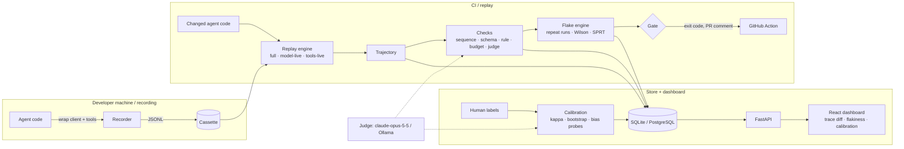

# PLAN.md — Replay: record-and-replay regression testing for LLM agents

Single source of truth for this project. Tick a milestone only when its
definition of done is met and CI is green. Last updated: 2026-10-30 (evolution round 5).

## Goal

**Problem.** Teams shipping LLM agents cannot test them the way they test other
software. Every run is different (sampling, tool results that change, clocks),
so a passing test proves little and a failing test might be noise. Teams either
skip tests, hand-mock each tool (brittle, misses drift), or run live against the
API on every PR (slow, expensive, still flaky). When a judge model is used to
score outputs, nobody checks whether the judge agrees with humans, so CI gates
on a number nobody has validated.

**Users.** Developers of tool-using agents built on the Anthropic SDK (or any
Python agent that can wrap its model and tool calls), who want a PR check that
says "this change broke the agent" and means it.

**What Replay does.**

1. **Record** a real agent run: every model call, tool call, clock read and
   random draw, with usage, cost and latency, into a JSONL *cassette*.
2. **Replay** it with *cut points* you choose: everything from the cassette
   (`full`, zero network, bit-stable, tests the orchestration code), or the
   model live with tools mocked from the cassette (`model-live`, tests prompt
   and model changes against a frozen world), or the reverse (`tools-live`).
3. **Check** the trajectory: tool-call sequence and arguments, structured-output
   schema, Python rule predicates, cost and latency budgets against a baseline,
   and a rubric-driven LLM judge.
4. **Gate CI statistically.** A scenario is not pass/fail from one run. In
   `model-live` mode Replay re-runs it, estimates the pass probability with a
   Wilson interval, stops early with a sequential test when the verdict is
   clear, and distinguishes *flaky* from *failing*.
5. **Calibrate the judge.** Judge checks are *advisory* until the judge has been
   measured against human labels on a golden set: Cohen's kappa with a bootstrap
   confidence interval, repeat-run self-consistency, and bias probes (position,
   verbosity, self-preference). Only a calibrated judge may fail a build.
6. **Show it.** A React dashboard with run history, trace viewer, aligned trace
   diffs between baseline and candidate, flakiness trends and the calibration
   report. Shipped as `pip install agent-replay`, a GitHub Action, and a Docker
   Compose dashboard.

**What makes it impressive.** Several small open-source projects now do
VCR-style replay of agent runs (`pytest-agentreplay`, `replayproof`, `chronicle`,
`pytest-agent-trace`). None of them measures the two things that decide whether
an agent test suite is trustworthy: *is the judge right* and *is the failure
real*. Replay's hard core is exactly that, with numbers the repo re-runs:
judge-human kappa with CIs, judge accuracy on an adversarial judge benchmark
(LLMBar), flake rates with intervals, model calls saved by sequential testing,
and a mutation study showing which injected regressions each check type
catches. Every number rests on a small, independently tested statistics
module.

## Architecture

### Components

| Component | Language / libs | Responsibility |
|---|---|---|
| `agent_replay.record` | Python 3.12, `anthropic` 1.x, `ollama` | Wrap the Anthropic / Ollama clients and tool functions; emit envelopes to a cassette. Capture `now()` and `random()` through helpers. |
| `agent_replay.cassette` | pydantic 2 | Cassette schema v1 (JSONL): header + envelopes with `kind`, `name`, `fingerprint`, request, response, usage, cost, latency, span ids. Canonical JSON for fingerprints. |
| `agent_replay.replay` | Python | Replay engine: cut-point modes, fingerprint match with cursor fallback, unrecorded-call policies (`strict`, `fallback`, `synth`), streaming and async support. |
| `agent_replay.checks` | Python, `jsonschema`/pydantic | `tool_sequence`, `required_tools`, `forbidden_tools`, `max_tool_calls`, `arg_schema`, `output_schema`, `rule`, `budget` (cost, tokens, p95 latency vs baseline), `judge`. |
| `agent_replay.judge` | `anthropic` (claude-opus-5-5), Ollama fallback | Rubric judge with structured outputs; response cache keyed by fingerprint; provider pluggable via `REPLAY_JUDGE_PROVIDER`. |
| `agent_replay.stats` | Python, stdlib only  | Cohen's kappa (unweighted and quadratic-weighted), bootstrap CI, Wilson interval, sequential gate (SPRT). |
| `agent_replay.flake` | Python, `anyio` | Repeated `model-live` runs with concurrency and rate limits; feeds `stats`; flaky vs failing classification. |
| `agent_replay.calibrate` | Python | Golden-set labelling CLI, judge-vs-human agreement, self-consistency, bias probes, LLMBar harness. |
| `agent_replay.diff` | Python | Trace alignment (Needleman-Wunsch over tool-call sequences with per-step cost) producing an aligned diff. |
| `agent_replay.store` | SQLAlchemy 2.1, SQLite (local) / PostgreSQL 16 (server), Alembic | Runs, envelopes, check results, baselines, labels. Same models for both backends. |
| `agent_replay.cli` | Typer, Rich | `replay record | run | ci | flake | calibrate | label | diff | serve | baseline`. |
| `agent_replay.server` | FastAPI 0.143, uvicorn | Read-only REST API over the store for the dashboard (`replay serve`); structured logging (structlog). |
| `dashboard/` | React 19, TypeScript strict, Vite 8, TanStack Query 5, Tailwind 4, Vitest | Runs, run detail, trace viewer, trace diff, flakiness trend, calibration report. |
| `action.yml` | GitHub composite action | `uses: TheAsianFish/agent-replay@v1`: installs, runs `replay ci`, posts a PR comment, uploads the report, fails on regression. |
| `examples/retail_agent` | Python | Demo agent on τ-bench retail tasks and tools (MIT, vendored subset) with objectively checkable outcomes (final DB state). |

### Data flow



### Key design decisions (alternatives considered)

1. **Intercept at the SDK boundary, not the HTTP transport.** `replay.wrap(Anthropic())`
   returns a proxy whose `messages.create/parse/stream` (sync and async) are
   recorded; tools are wrapped with `@replay.tool` or `replay.tools(...)`.
   *Alternative:* an httpx transport that records raw HTTP, as VCR does. Rejected
   because `anthropic` 1.x runs on `httpx2` while other SDKs use `httpx`, so one
   transport cannot cover both, and SDK-level interception gives typed messages,
   usage and streaming accumulation for free. Any other provider can be covered
   with the generic `@replay.model_call` decorator.
2. **Cut-point replay rather than stub-everything.** Recording every
   non-deterministic boundary and choosing per run which ones to serve from the
   cassette follows the idea published as "cut-point replay" (Chronicle,
   arXiv:2609.20625). `full` mode tests orchestration code with zero model calls
   and is bit-stable; `model-live` mode is the mode that catches prompt and model
   regressions and is where flakiness lives. *Alternative:* record only model
   decisions (langchain-replay style) and always run tools live. Rejected: tools
   that hit real systems make CI non-hermetic.
3. **Fingerprint matching with cursor fallback and explicit unrecorded-call
   policy.** A replayed call is matched by a canonical-JSON hash of the request
   with volatile fields removed; if none matches, the engine falls back to the
   next unconsumed envelope of the same kind and name and marks the step
   `approximate`. Tool calls the cassette never saw follow a policy: `strict`
   fails the run, `fallback` calls the real tool, `synth` returns a schema-valid
   stub. *Alternative:* strict cursor replay only. Rejected because a live model
   reorders calls often enough to make strict replay useless in `model-live`.
4. **Flakiness is a statistics problem, not a retry loop.** A scenario's result
   is a pass-probability estimate with a Wilson lower bound; the gate compares the
   bound to a threshold. A sequential probability ratio test stops repeating
   as soon as the verdict is clear, which is where the model-call savings come
   from. *Alternative:* fixed `k` runs and majority vote. Kept as the measured
   baseline.
5. **Judge checks are advisory until calibrated.** A judge check can only fail a
   build if a calibration report for that rubric shows kappa's lower CI bound at
   or above `REPLAY_JUDGE_MIN_KAPPA` (default 0.6). *Alternative:* trust the
   judge. Rejected; it is the whole point of the project.
6. **Structured outputs for the judge, no forced tool choice.** The judge uses
   `output_config.format` (JSON schema) and `claude-opus-5-5`. `tool_choice: any`
   is rejected by that model, and prefill is gone, so schema-constrained output
   is the only robust path. Rubric text goes first in the prompt so prompt
   caching applies across traces.
7. **One SQLAlchemy model set, two backends.** SQLite in `.replay/` for the CLI
   with no setup; PostgreSQL for the shared dashboard. *Alternative:* Postgres
   only. Rejected: the CLI must work in a fresh CI job.
8. **Trace diff by sequence alignment.** Baseline and candidate trajectories are
   aligned with a Needleman-Wunsch dynamic programme where substituting a step
   costs more when tool names differ than when only arguments differ. This gives
   "inserted a verification call" rather than "everything after step 3 moved".
9. **Pluggable providers, offline tests.** `anthropic` and `ollama` adapters
   share one protocol. Every test runs with a deterministic fake model and
   committed cassettes; nothing in `pytest` touches the network.

## Evaluation

All numbers in README.md come from a command in this repo (`make eval` /
`make bench` for the offline ones) and are recorded in RESULTS.md with dataset,
method, command and raw output. Anything needing an
API key is built, run on what the runner can do, and listed under "To measure"
with the exact command.

### Datasets

| Id | Dataset | Source | Labels | Used for |
|---|---|---|---|---|
| D1 | **Golden traces**: ~120 recorded runs of `examples/retail_agent` on τ-bench retail tasks | Recorded with an API key (`replay record`), committed under `eval/golden/` | (a) objective: final DB state equals expected state (τ-bench reward); (b) human: pass/fail labels per rubric criterion with `replay label` (target 100+ traces, ~2 hours) | Judge calibration (kappa vs human and vs objective), rubric iteration |
| D2 | **LLMBar** (419 pairwise instances, Natural + Adversarial, gold labels, MIT) | `princeton-nlp/LLMBar` on GitHub, vendored in `eval/data/llmbar` at a pinned commit (`make data-llmbar` re-fetches and verifies) | Gold preference 1/2 | Judge accuracy and position-bias probe on an adversarial benchmark with published numbers to compare against |
| D3 | **Flake suite**: 30 scenarios from D1, replayed `model-live` 20 times each | Generated by `make bench-flake` (needs key) | Pass/fail per run from objective + sequence checks | Flake rate with CIs, SPRT savings vs fixed k |
| D4 | **Mutation suite**: 25+ scripted mutations of `examples/retail_agent` (skip a verification tool, swap an argument, drop the confirmation step, change output field, loosen a guard) | `eval/mutations/` in the repo, runs offline in `full` and `model-live-from-cassette` modes | Known-bad by construction | Detection rate per check type; cut-point vs stub-everything baseline |
| D5 | **Synthetic cassettes** from the fake model | Generated deterministically in tests | n/a | Unit and integration tests, replay fidelity benchmark |

### Metrics and how each number is measured

| Claim | Metric | Method | Command | Needs key |
|---|---|---|---|---|
| Judge agrees with humans | Cohen's kappa (unweighted, pass/fail) per rubric criterion, with 95% bootstrap CI (2000 resamples), plus raw agreement and confusion matrix; majority-class baseline reported alongside | D1 human labels vs judge verdict, judge run 3× per trace to also report self-consistency kappa | `make eval-judge` (labels with `replay label`; D1 from `make record-golden`) | yes |
| Judge is robust | Accuracy on LLMBar Natural and Adversarial subsets, with and without position swap; position-bias rate = fraction of pairs where swapping order flips the verdict | D2, both orderings | `make eval-llmbar` | yes |
| Replay catches regressions | Mutation detection rate per check type and per mode; false-alarm rate on 5 benign refactors | D4, offline | `make eval-mutations` | no |
| Flakiness is quantified | Per-scenario pass rate with Wilson 95% interval; suite flake rate; single-run false-pass and false-fail rates relative to the 20-run estimate | D3 | `make bench-flake` | yes |
| Sequential testing saves calls | Model calls used by SPRT gate vs fixed k=20 at the same error targets (alpha=beta=0.05), on D3 and on a simulated Bernoulli grid (offline) | D3 for the real number; simulation offline | `make bench-sprt` | partial |
| Recording is cheap, replay is fast | Recorder overhead per boundary (µs, median and p95) and wall-clock full replay vs recorded live duration | D5-style synthetic calls and the six live retail recordings (D1 proper once recorded) | `make bench-replay` | no |
| Stats are correct | Property tests: `stats.cohens_kappa` matches scikit-learn `cohen_kappa_score` and `wilson_interval` matches statsmodels on random inputs (dev deps only) | Hypothesis | `make test` | no |

Baselines kept in the repo: raw agreement (vs kappa), fixed-k majority vote
(vs SPRT), stub-everything replay (vs cut-point), single-run pass/fail (vs
interval gate). A small local model through Ollama is the labelled offline
judge baseline when available; it is never presented as the headline judge.

## Release

**How users get it.**

- `pip install agent-replay` (PyPI; name verified free on 2026-10-08). SDK
  (`agent_replay`) and CLI (`replay`). Python ≥ 3.12. Built with `uv`, published
  by a GitHub Actions workflow using PyPI trusted publishing, guarded by
  `if: github.repository == 'TheAsianFish/agent-replay' && startsWith(github.ref, 'refs/tags/v')`.
- `uses: TheAsianFish/agent-replay@v1` GitHub Action (composite, `action.yml`
  in the repo root). Fails the job on regression and comments a Markdown
  summary on the PR. A `v1` moving tag is documented in RELEASE.md.
- `docker compose up` for the dashboard (FastAPI + PostgreSQL + static React
  build). One image, multi-stage Dockerfile.
- Optional hosted demo (read-only dashboard seeded with D1 and the mutation
  results) described in RELEASE.md with exact steps for Fly.io or Render.

**Maintainer steps** (listed in RELEASE.md):
create the PyPI project and trusted-publisher binding; add `ANTHROPIC_API_KEY`
as a repository secret for the manual-dispatch `eval-live` workflow; record D1
and label it (`make record-golden`, `replay label`); tag `v1.0.0`; optionally
publish the Action to the Marketplace and deploy the demo.

## Statistics core

`agent_replay/stats.py` (stdlib only) holds the statistics every headline
number depends on:

```python
def cohens_kappa(a: Sequence[int], b: Sequence[int], *, weights: Literal[None, "linear", "quadratic"] = None) -> float
def bootstrap_ci(stat: Callable[[Sequence[int], Sequence[int]], float], a, b, *, n_resamples: int = 2000, alpha: float = 0.05, seed: int = 0) -> tuple[float, float]
def wilson_interval(successes: int, trials: int, *, confidence: float = 0.95) -> tuple[float, float]
class SequentialGate:  # Wald SPRT on Bernoulli outcomes
    def __init__(self, p_fail: float, p_pass: float, *, alpha: float = 0.05, beta: float = 0.05, max_runs: int = 20) -> None
    def update(self, passed: bool) -> Literal["continue", "pass", "fail"]
```

A naive `stats_baseline.py` (raw agreement, normal-approximation interval,
fixed-k gate) ships first behind the same interface. `tests/test_stats.py`
covers hand-computed cases, edge cases (empty input, constant raters, k=0,
k=n) and Hypothesis property tests against scikit-learn and statsmodels as
oracles; `eval/sprt_sim.py` plots expected runs against the true pass rate.
`REPLAY_STATS_IMPL=baseline|core` selects the implementation.

## Risks

| Risk | Impact | Mitigation |
|---|---|---|
| Crowded space: several 2026 OSS tools do VCR-style agent replay | Looks like a clone in a 5-minute look | README leads with the measured calibration and flakiness numbers and the mutation study; prior art cited honestly in design decisions |
| `model-live` replay diverges from the cassette (model reorders or invents tool calls) so mocks miss | Mode is useless in practice | Fingerprint + cursor fallback, `approximate` flag, three unrecorded-call policies, `synth` stubs from tool JSON schema; measured in D3 |
| Headline numbers need an API key the CI runner lacks | Claims without measurements | Harness + offline parts (mutations, SPRT simulation, replay bench, stats tests) run in CI; key-dependent commands listed under "To measure"; never write an unmeasured number |
| Human labelling burden (~100 traces) | Calibration never gets measured | `replay label` TUI makes it ~1 minute per trace; objective τ-bench labels give a second, free reference; rubric kept to 3 criteria |
| Judge cost during evaluation | API spend | Judge cache by fingerprint; prompt caching; cost estimate printed before each eval run; Ollama fallback for development |
| Anthropic SDK churn (httpx2, forced tool choice removed, thinking always on) | Breakage, stale patterns | Pin `anthropic>=1.12,<2`; adapters isolated in `record/anthropic.py`; CONTRIBUTING.md records the API facts |
| Dashboard scope creep | M5 balloons | Five pages, read-only, no auth; everything else is roadmap |
| τ-bench data licensing / size | Repo bloat | MIT; vendor only the retail domain data and tool functions with attribution |
| Replay of thinking-enabled conversations | Recorded assistant turns with thinking blocks are model-bound | `full` mode never contacts the API; `model-live` never injects recorded assistant turns; documented limitation |

## Evolution round 1 (2026-10-21)

Every v1 milestone is merged. This round asks what is worth proving next,
starting from the directions set on 2026-10-20: make Replay real on a popular
open-source agent, get live data from a small open model through Ollama, show
the Action failing a real PR and the dashboard in a recorded walkthrough, and
grow like a product that real agent teams adopt, with free tools only.

### Where the project stands (measured in this round)

- `make check`: ruff and mypy clean; 1085 passed, 22 skipped, 58 xfailed in
  90 s. The xfails are `agent_replay/stats.py`, still a specification, so no
  judge criterion can gate and the SPRT savings stay unmeasured.
- `make eval` (43 s) and `make bench` (17 s) reproduce every committed result
  byte for byte; `make ui-check` passes 97 Vitest tests after `npm ci`.
- **The strict configuration fails a healthy task on every real run.** In all
  25 live `model-live` runs of `transfer_swapped_refunds` (20 Haiku, 5 Opus,
  `eval/results/m4_flake_*.json`) the `transfer_to_human_agents` call is an
  `approximate` step, because its free-text `summary` is worded differently
  each run; 24 of the 25 passed every check. So the "8/8 tool bugs with
  `fail_on_approximate`" row costs more than the 1/5 benign false alarm the
  mutation study shows: on live traffic it fails 1 of 6 tasks 100% of the
  time. The flag compares the *request bytes* of the next model call, which
  is the wrong signal for tool bugs; the roadmap's drift check compares the
  tool's *result*.
- **A local model drives the unchanged agent through the Anthropic SDK.**
  Ollama 0.40.6 serves an Anthropic-compatible `/v1/messages` (tools,
  `tool_result`, streaming, `system`, `output_config.effort` supported;
  `tool_choice`, `cache_control` and `count_tokens` not). With
  `Anthropic(base_url="http://localhost:11434", api_key="ollama")` and a
  subclass that only changes `model`, `replay run --mode model-live` recorded
  and checked the retail agent on this 4-vCPU runner with no change to the
  wrapper. qwen2.5:3b: 53 prompt tok/s, 15.5 generation tok/s; runs of 37,
  79 and 94 s; 0/3 passed (it skipped lookups or asked the user a question).
  qwen2.5:7b: 59 and 180 s; 0/2 passed `tool_sequence` in `exact` mode, yet
  on `lookup_latest_order_total` it answered the correct total ($829.43) after
  fetching one order instead of Opus's three. The exact sequence check
  measures agreement with the recorded path, not correctness; a local-model
  suite needs `in_order` sequences and the ground-truth rules.
- **The matcher serves a recording for a different argument.** Two of the
  3b runs called a tool with an argument the cassette never saw (a guessed
  user id) and were served the recorded result as `approximate`, because it
  was the only envelope of that kind and name at that level. The fake model
  never exercised this; a real one does on the first run.
- **The first real framework does not record.** pydantic-ai 2.58.0 (MIT,
  released several times a week) accepts an injected
  `AsyncAnthropic` through `AnthropicProvider(anthropic_client=...)`, so
  `replay.wrap()` can sit on it, but it calls
  `client.beta.messages.create(..., stream=..., betas=[...])` and
  `client.beta.messages.count_tokens`, and the wrapper refuses the `beta`
  surface. smolagents, mini-swe-agent, aider, OpenHands and crewai go through
  litellm or the `openai` SDK, which Replay has no adapter for;
  langchain-anthropic uses the anthropic SDK with a configurable base URL.
- An unpriced model's calls cost `None`, which `replay flake` reports as
  `$0.0000`; a local-model report would print a measured-looking zero.
- The Action's comment path has run only against a fake HTTP layer and in
  dry-run CI; no real PR has ever carried its comment.

### What comes next, and why

**M8: the Action on a real failing PR, and a recorded dashboard walkthrough**
(question 3; steer item 3). *Hypothesis:* the composite Action posts exactly
one sticky comment on a real pull request that seeds a regression and fails
the check, with no path the fake-HTTP tests missed. *Measured as:* the PR URL
and comment permalink in RESULTS.md, a screenshot in `docs/screenshots/`,
and a walkthrough video of runs, aligned diff and flakiness pages recorded
with Playwright from `make demo-data`, replacing the terminal GIF. The
regression PR is closed once the evidence is captured; the comment stays.

**M9: dogfood on pydantic-ai through Ollama** (question 1, first half; steer
items 1 and 2). *Hypothesis:* once the wrapper records the beta messages
surface, a pydantic-ai tool-using agent records on a local model and replays
in `full` with 0 approximate steps and in `model-live` against the same
model, with no change to the framework. *Measured as:* a committed cassette
naming the model (qwen2.5:7b), `make eval-pydantic-ai` running `replay ci` in
both modes, and a RESULTS.md section listing every surface that broke on
first contact and how it was fixed. Replaying that cassette across upstream
releases, to catch a real regression, is the second half, planned for round 2
once the example exists. The live number is the 10-run `model-live` flake
result per scenario on qwen2.5:7b, the first non-Anthropic live data.

**M10: a tool-result drift check** (steer item 1, "report tool-bug detection
honestly"; the roadmap item). *Hypothesis:* comparing each live tool's result
in `tools-live` with the recorded envelope's response catches the three
read-only tool bugs that only `fail_on_approximate` catches today, without
the JSON-layout false alarm, since those refactors return identical values.
*Prediction:* `tools-live+drift` 8/8 tool bugs, 0/5 false alarms, 0 drift on
the six live cassettes replayed `tools-live`; `drops_error_flag` still
survives. *Measured as:* a sixth column in `make eval-mutations` beside the
v1 columns, byte-stable in CI.

**M9 as built (2026-10-26).** Done as specified, with these changes and why:
qwen2.5:7b never produced a passing recording of the cancellation task (0 of
15 attempts; it cancels without the lookup), so the qwen suite's third
scenario serves its tools from the fake-model recording and runs qwen2.5:7b
live against them; recording keeps the first attempt per task that passes the
checks and logs every attempt, since a cassette is a run someone checked. The
example's tools raise pydantic-ai's `ModelRetry` (a `ValueError` crashed a
run), and the answer rules check the flight and the booking reference after a
recording passed with the wrong flight. Six Replay surfaces broke on first
contact and are fixed (RESULTS.md, M9): the beta surface, the offline
stand-in's `base_url`, rebuilt beta streams, `with_options`, `count_tokens`,
and the async client teardown in `replay ci`. Result: 10/10, 2/10 and 0/10
passes over 10 `model-live` runs, 1 approximate step in 30 runs.

### Review of this round (2026-10-21)

Re-ran: `make check` (1085 passed, 22 skipped, 58 xfailed), `make eval` and
`make bench` (tree unchanged afterwards), the 25 `transfer_swapped_refunds`
outcomes in `eval/results/m4_flake_{haiku,opus}.json` (25/25 with one
approximate step, 24/25 passed; every other scenario 0/25 approximate), the
mutation table (the three read-only tool bugs are caught only by
`no_approximate_steps`; `drops_error_flag` is an agent mutation), the wrapper's
refusal of `beta`, pydantic-ai 2.58.0's `client.beta.messages.create` call and
`AnthropicProvider(anthropic_client=...)`, and a tool round trip through
Ollama 0.40.6's `/v1/messages` with qwen2.5:3b (tool_use, then tool_result,
then end_turn, 13 s for the first call). The 3b/7b pass counts above have no
committed log; they motivate M9 and no number from them enters RESULTS.md.

Changed: M9 now ends in a measured live result (a 10-run `model-live` flake
per scenario on qwen2.5:7b, committed raw), not only a recorded run. M8 states
what happens when the build environment has no GitHub credentials (the regression
PR is one maintainer command, and the milestone stays open until its evidence
is in), and its definition of done records the failing check and its wall time.
M9 integrates a framework with a pydantic-ai agent written here, not yet a
third-party agent; catching a real upstream regression stays round 2's
first item.

### Considered and not chosen this round

- **Q4, the verdict-stability curve on a local model.** Deferred to round 2:
  one run takes 1 to 3 minutes on 4 cores and does not parallelise, the
  retail suite's exact sequences and Opus latency baselines fail a local model
  for the wrong reasons, and the model that passes has to be found first (M9
  does that). The offline part, resampling the committed Haiku outcomes at
  run prefixes, comes with it.
- **Q2, the mutation study on a real model.** Deferred: 12 of the 32
  mutations wrap the fake model's policy and cannot run against a real one,
  the 8 tool bugs cannot act in `model-live`, so only the 12 agent mutations
  apply, and the result is uninterpretable without the baseline pass rate
  from Q4.
- **A scale benchmark (long runs, many runs, bytes per turn).** Deferred to
  round 2 in a reframed form: the suspected quadratic matcher is not one
  (queues are per kind and name), but cassette bytes do grow quadratically
  with turns because each model envelope carries the whole history.
- **A distance threshold on approximate matches.** Rejected: the argument
  distance of a one-field change is the same for the legitimate reworded
  summary and for the guessed user id, so no threshold separates them. The
  successor is per-tool identifying arguments, after M10.
- **An `openai` SDK adapter.** Not yet: pydantic-ai gets to the first real
  framework through the SDK Replay already wraps. The adapter becomes the
  question when the dogfood wants a second framework.

## Evolution round 2 (2026-10-27)

M8 to M10 are merged. This round asks again what is worth proving next, from
the directions of 2026-10-20: each milestone ends in a measured result on
real, non-mocked runs where a question needs one, free tools only, and Replay
grows like a product real agent teams adopt (real workloads at scale,
robustness on messy traces, the failure modes teams hit), with depth over
feature count.

### Where the project stands (measured in this round)

- `make check` after `make setup`: ruff and mypy clean; 1238 passed, 22
  skipped, 58 xfailed in 102 s (the xfails are still `agent_replay/stats.py`).
  `make eval` (70 s) and `make bench` (19 s) leave the tree unchanged.
- **Cassette bytes are quadratic in turns, and the store copies them.** A
  40-line script recorded a fake-model agent that calls one tool a turn (a
  250-byte result, a 3.5 KB system prompt) and replayed it in `full`: 5 turns
  30 KB, 10 turns 73 KB, 50 turns 888 KB, 100 turns 3.1 MB, 200 turns 11.4 MB
  (57 KB a turn, against 6 KB at 5 turns); recording took 2.7 s and the
  replay 1.6 s at 200 turns with every step `exact`. Every model envelope
  carries the whole conversation (the fingerprint is the request minus
  `metadata` and `stream`), and model envelopes are 91 to 94% of the
  committed retail cassettes. `make demo-data` writes 480 runs (4,422 steps)
  into a 39.1 MB SQLite file of which 34.6 MB is `StepRow.request` and
  `response`, and `GET /runs/{id}` returns every step in full. The retail and
  pydantic-ai examples are 3 to 6 turns; a coding agent runs 50 to 100. These
  numbers come from a throwaway script and enter RESULTS.md only once
  `make bench-scale` reproduces them (M13).
- **A cassette survives five upstream releases unchanged.** The committed
  pydantic-ai cassettes, recorded on pydantic-ai-slim 2.61.0, replay in
  `full` on 2.58.0, 2.59.0, 2.60.0 and 2.62.0 with 6/6 scenarios passing and
  0 approximate steps (`uv pip install "pydantic-ai-slim[anthropic]==X"`,
  then `UV_NO_SYNC=1 make eval-pydantic-ai-offline`). Round 1's "replay across
  upstream releases to catch a regression" has a flat answer in this window:
  the framework did not change what it sends for this agent, so there is no
  regression to catch and the matrix is a table of zeros.
- **The frozen world touched 2 of 30 local-model runs.** Classifying every
  failed run in `eval/results/m9_flake_qwen.json` by cause:
  `book_earliest_flight` failed 6 times because the model answered without
  booking, once with `UnrecordedCallError` (a `convert_currency` call the
  recording never made) and once with the booking served `approximate` for
  different arguments (so `writes_match` failed); `cancel_refundable_booking`
  failed 10 times for the model's own reasons. Whether `model-live` on a
  frozen world misreports a real pass rate is still unmeasured; the prior
  from these counts is "rarely".
- **A wrong-argument read is invisible to every non-strict configuration.**
  The matcher serves the oldest unused recording of the same tool when no
  fingerprint matches (`Session._take`), so an agent that reads the wrong
  order gets the right order's recorded result in `full` and `model-live`,
  and in `tools-live` the live tool's different result makes the next model
  step `approximate`, served the recorded reply, and the ground-truth rules
  pass. Only `fail_on_approximate` sees it, and round 1 measured that flag
  failing a healthy task in 25 of 25 live runs. The same mechanism served the
  approximate booking above.
- The five benign refactors in the mutation study send byte-identical
  requests except `compact_tool_json` (17 approximate steps), so the
  false-alarm column has never been tested against a legitimately different
  trajectory.
- The committed flake reports (Haiku 120 runs, Opus 30, qwen2.5:7b 30) keep
  every run's outcome in order, so the question "how many runs does a verdict
  need" has an offline half that needs no model.

### What comes next, and why

**M11: identifying arguments, and paths that differ without being worse**
(question 1 and the round-1 hazard; steer: failure modes real teams hit).
*Question:* can a suite name the arguments that identify a recording, so a
call for an entity the cassette never saw is `unrecorded` and the policy
decides, without re-breaking the reworded `transfer_to_human_agents` summary;
and which check types raise a false alarm when a correct agent takes another
path? *Hypothesis:* the two new mutations `guesses_user_id` and
`reads_wrong_order` are caught 0/2 in the five non-strict configurations
today (the replay hands the right recording to the wrong call) and 2/2 in
`full`, `model-live` and `tools-live+drift` with `identify` keys, while the
five benign refactors stay at 0/5 (1/5 strict) and the six live cassettes
still pass with their summary step `approximate`. Of five correct-but-different
path variants of the fake policy run in `model-live`, the exact
`tool_sequence` fails 4/5, the ground-truth rules 0/5; under `strict` the
repeated lookup and the verifying read end as `unrecorded`, under `fallback`
0 do. *Measured as:* two new tables in `make eval-mutations`, byte-stable.

**M12: is the failure the model's or the frozen world's, and how many runs
does a verdict need** (question 4; steer item 2). *Question:* does
`model-live` on a frozen world report the pass rate the agent has with
`fallback` tools, and at what number of runs does the gate's verdict stop
changing? *Hypothesis:* at most 2 of 20 `strict` runs per scenario end for a
world reason (an unrecorded call or an approximate step), `fallback` changes
the pass count by at most 1 in 20, and `cheapest_fare_in_euros` fails at
least once in its 40 new runs (20 per arm; the committed 10/10 is not
100%). Offline, drawing run subsets without replacement from each report's
recorded outcomes, five runs agree with the all-runs fixed-threshold verdict
in at least 95% of draws on every scenario. That is close to arithmetic: 13
of the 15 committed scenarios pass 0% or 100% of their runs, and the other two
(`transfer_swapped_refunds` 19/20 on Haiku, `book_earliest_flight` 2/10) sit
far from the 0.75 threshold (the fixed-k rule the committed reports ran,
`(p_fail + p_pass) / 2`). So the curve's finding is how far these pass rates
sit from the threshold, and RESULTS.md says so rather than presenting a "runs
needed" figure as general. A single run's false-pass rate is the
observed pass rate by construction, so it is reported, not hypothesised. The
offline curve uses the fixed-threshold gate and counting only; `stats.py`
stays untouched. *Measured as:* `make eval-pydantic-ai-arms` (qwen2.5:7b
through Ollama, locally or from `ollama.yml`, never on PRs; raw reports
committed, every run classified by cause) and `make eval-verdict-curve`
(offline, seeded, byte-stable).

**M13: cassette bytes at scale, and the cheapest fix that the numbers
justify** (steer item 3: large cassettes, long runs, measured storage).
*Question:* what does a 100-turn run cost in cassette bytes, load and replay
time and store bytes, and does a stdlib compressor already recover what a
shared-prefix encoding would? *Hypothesis:* bytes fit an exponent near 2 in
turns. gzip collapses once one envelope outgrows DEFLATE's 32 KB window,
because it can no longer see the previous envelope's copy of the prefix. xz
(stdlib `lzma`, with a window of megabytes) keeps recovering more as runs
grow. A shared-prefix encoding (each model request stored as what it appends
to the previous one) beats xz by less than 3×, so no schema change is
justified. `full` replay stays under 3 s at 200 turns, and compression does
not change load time (parsing stays quadratic). The tool results and the
system prompt are seeded, non-repeating text, because repeated filler
flatters every compressor: the review's pilot measured gzip at 32× at 200
turns on repeated characters and 3.2× on seeded text. The decision rule is
fixed before the run: transparent compressed cassettes with the best stdlib
codec that recovers at least 10× at 100 turns, and cassette v2 with the
prefix encoding only if it beats that codec by more than 3×. *Measured as:* `make bench-scale` (sizes byte-stable, timings
machine-dependent like `bench-replay`) and the chosen fix with tests.

### Review of this round (2026-10-27)

Re-ran:
- `make check`: 1238 passed, 22 skipped, 58 xfailed in 93 s.
- The committed pydantic-ai cassettes on pydantic-ai-slim 2.58.0 and 2.62.0
  (`uv pip install`, then `UV_NO_SYNC=1 make eval-pydantic-ai-offline`): 6/6
  pass with 0 approximate steps on each, with the installed version checked.
- The cause of every failed run in `eval/results/m9_flake_qwen.json`: 6
  answered without booking, 1 `UnrecordedCallError` on `convert_currency`, 1
  approximate booking that failed `writes_match`, and 10
  `cancel_refundable_booking` failures with no world cause. That is 2 of 30
  runs touched by the frozen world.
- `Session._take`'s fallback to the oldest unused envelope of the same tool.
- The five refactors' approximate counts in `eval/results/mutations.json`:
  only `compact_tool_json` has any (17).
- `.replay/demo.db` after `make demo-data`: 39.1 MB, 480 runs, 4,422 steps,
  34.56 MB of it step request and response.
- A scale script of my own (one tool call a turn, a 3.5 KB system prompt):
  35 KB at 5 turns, 2.9 MB at 100 and 10.6 MB at 200, every step `exact`;
  `full` replay took 0.6 s at 100 turns and 2.0 s at 200. With repeated
  filler, gzip recovered 21× to 59×. With seeded random text it recovered 33×
  at 50 turns (largest line 28 KB), 4.3× at 100 (52 KB) and 3.2× at 200
  (100 KB), while xz recovered 51×, 94× and 177×. These pilot numbers do not
  enter RESULTS.md until `make bench-scale` reproduces them.

Changed:
- M13's hypothesis and decision rule now name the DEFLATE window, add xz from
  the standard library and require non-repeating content. As written, gzip
  would most likely have missed its 5× bar at 100 turns on realistic text,
  and the rule would then have justified a cassette v2 that a stdlib codec
  makes unnecessary.
- M13's CI check asserts raw and prefix-encoded sizes exactly. It records
  compressed sizes with the zlib and liblzma versions, because those can
  differ by a few bytes between builds.
- M11 no longer adds a reason to every approximate step. That needs a store
  column, a migration and dashboard work, and it answers no question here, so
  cutting it keeps M11 one PR.
- M11's `identify` keys also go on the pydantic-ai suites, so M12's `strict`
  arm can tell another entity's recording apart from the model's own failure.
- M12 names its two scenarios and samples subsets without replacement.
- M12's offline curve is now framed as close to arithmetic on the committed
  reports (13 of 15 scenarios at 0% or 100%). The single-run false-pass rate
  is no longer a hypothesis, because it equals the observed pass rate by
  construction. The real measurement in M12 is the per-arm qwen2.5:7b runs.
- The 40 new `cheapest_fare_in_euros` runs are both arms' 20. They pool with
  the committed 10 only if the arms do not differ.
- M13 also measures the committed real recordings (the six live retail
  cassettes and the qwen2.5:7b ones), so a synthetic workload is not the only
  evidence for the fix it chooses.

Remaining concern: M11 and M13 are measured mostly on fake-model runs. M11's
real-run test is the six live cassettes plus M12's `strict` arm, which runs
with its `identify` keys on qwen2.5:7b. M13 is a storage benchmark, so
synthetic turns are the right instrument there, and the real recordings check
it. M12 depends on M11's `identify` keys and is built after it.

### Considered and not chosen this round

- **Replay across upstream releases as a milestone.** Measured flat (above):
  four other releases replay the 2.61.0 cassettes exactly. The matrix rides
  along as a row in M13's results; a weekly run would spend CI minutes to
  print zeros.
- **A split identity (history fingerprint for matching, context fingerprint
  as "drift").** Rejected: a system-prompt edit is exactly the change that
  makes a recorded model reply stale, and relabelling those steps `exact`
  hides it. The reporting half, a reason on every approximate step
  (`context`, `history`, `arguments`), was cut from M11 in review: it needs a
  store column and dashboard work and answers no question this round.
- **Six kinds of benign tool noise with `ignore_fields`.** Four of the six
  are readable off `drift.py` (key order never drifts, timestamps and ids are
  what `ignore_fields` is for, JSON floats have one form); the two it cannot
  express (result order, a transient error then a retry) are a small change
  without a milestone's worth of question. Left for a later round.
- **A fully live third arm in M12.** The recording attempts in
  `eval/results/m9_qwen_recording.json` already are record mode with checks;
  20 runs per arm cannot resolve a one-run difference. M12 keeps `strict`
  against `fallback` and reports the cause counts, which are exact per run.
- **Parallel scenarios in `replay flake` and parallel replay throughput.**
  One Ollama server serves one request at a time on this hardware, and `full`
  replay of a 200-turn run takes 1.6 s; nothing measured says throughput is
  the limit.
- **A store fix in M13 up front** (not copying an `exact` step's request).
  Deferred until `bench-scale` says store bytes are the pain, since it needs
  an Alembic revision on both backends and the dashboard's diff reads.
- **An `openai` SDK adapter.** Still not the question: nothing measured this
  round needs a second framework.

## Evolution round 3 (2026-10-28)

M11 to M13 are merged and the thirteen planned milestones are done. This
round asks again what a product adopted by real agent teams needs proven
next, from the directions of 2026-10-20: a measured result on real,
non-mocked runs where the question needs one, free tools only, long runs and
messy traces, and the failure modes teams hit, with depth over feature count.

### Where the project stands (measured in this round)

- `make check` after `make setup`: ruff and mypy clean; 1352 passed, 22
  skipped, 58 xfailed in 67 s (the xfails are still `agent_replay/stats.py`).
  `make eval` (76 s), `make bench` (69 s) and `make ui-check` leave the tree
  unchanged.
- **Every frozen-world number comes from short runs of the recording model.**
  `eval/results/m12_arms_qwen.json` holds 80 `model-live` runs of 3-to-6-turn
  scenarios: 143 served tool steps, 140 `exact`, 3 `unrecorded` (all under
  `strict`, the invented `get_booking` reference), 0 `approximate`, and the
  `identify` keys fired 0 times. The frozen world ended 2.1% of served tool
  calls (3/143). If divergence were independent per call, a run would survive
  9 served calls 83% of the time and 20 calls 65%; nothing measured says it
  is independent, and a model that has left the recorded path once has
  reason to leave it again. No committed recording is longer than 6 turns
  (M13, "Not done"), so the compounding is unmeasured.
- **`model-live` has been measured only against the change it is not for.**
  The Goal says `model-live` "tests prompt and model changes against a frozen
  world", yet M9 and M12 ran the recording model (qwen2.5:7b) with the
  recording prompt. The one time another model ran against a cassette (round
  1, qwen2.5:3b, uncommitted) it guessed a user id on its first run. Whether
  a swapped model or an edited prompt leaves the recorded path so often that
  the mode degrades to "re-record" is the question the headline use case
  rests on, and it has no number.
- **Load time is garbage collection, not parsing.** RESULTS.md M13 says that
  parsing 13 MB of JSON costs far more than decompressing and that loading is
  superlinear in turns. Timing `Cassette.loads` on this runner (4 vCPU):
  100 turns (3.7 MB) 0.124 s with the collector on and 0.015 s with
  `gc.disable()`; 200 turns (13.1 MB) 0.248 against 0.068; 400 turns
  (49.6 MB) 1.100 against 0.271. With the collector off, load is close to
  linear in bytes (4.0 to 5.5 ms per MB). `full` replay at 200 turns took
  1.155 s against 0.670 s. Peak RSS was 604 MB for the 50 MB cassette, 12× its
  bytes, which bounds how many long replays `--concurrency` can keep in
  flight. A review experiment, `gc.freeze()` after load with no pause around
  agent code, cut replay by 24%. The published explanation is wrong and the
  fix is a few bounded lines.
- **A recording that dies writes nothing.** `Session._emit` appends to a
  list and `runner.record` calls `finish().dump()` once at the end (M1 notes:
  "Ctrl-C during a live recording discards the partial cassette"). M9 needed
  15 recording attempts at about 40 s each; a 100-turn Opus run is minutes
  and megabytes lost on a kill, and a footer-less file fails to load as "cut
  short" rather than replaying what it has.
- **The run store's by-reference fix is worth less than the roadmap says.**
  M13 measured model envelopes at 94% to 98.5% of the synthetic cassettes'
  bytes and 85.9% to 94.5% of the eight committed real recordings'
  (`model_share` in `eval/results/bench_scale_sizes.json`). In `model-live`,
  the mode the dashboard exists for, those steps are live and must be stored
  in full, so storing `exact` steps by reference saves the tool share, 5.5%
  to 14% on the real recordings. It saves 85% and more only in `full`, where
  every step is exact and the diff has nothing to show.
- **qwen2.5:7b issues parallel tool calls in one turn**
  (`eval/results/m9_first_contact/cheapest_fare_in_euros.jsonl` has
  `search_flights` and `convert_currency` together), and `replay-qwen.toml`
  caps scenarios at 8 tool calls and 6 model calls. A long task of
  independent reads would collapse to a few turns; a long chain needs each
  call's argument to come from the previous result.
- No Ollama, API key or GitHub credentials in this environment; the
  local-model work runs locally or from `ollama.yml` (180-minute limit), as
  M9 and M12 did.

### What comes next, and why

**M14: long recordings that survive their process, and a load linear in
bytes** (steer: long multi-turn runs, the failure modes real teams hit).
*Question:* can a long recording survive a kill, and is load time bounded by
parsing or by the collector? *Hypothesis:* appending each envelope to
`<out>.partial` as it completes costs under 1% of the median recorded model
latency per envelope on `make bench-replay`'s boundaries, and the finalised
file is byte-identical to today's `dump`; a process killed with SIGKILL after
envelope k leaves k envelopes that `Cassette.load` reads as interrupted (a
load-time property: the v1 footer and its `ok`/`error` status are unchanged)
and that replay in `full` and diff against the next attempt, while `replay ci`
refuses an interrupted cassette and names the fix, so a suite never passes on
a truncated recording. The partial is flushed per envelope, not fsynced: it
survives the process dying, not the machine losing power. A
collector pause scoped to `Cassette.loads` (never around agent code) makes
load within 1.3× linear in bytes from 100 to 400 turns, and `gc.freeze()`
after load, reported rather than gated, cuts `full` replay at 200 turns by at
least 20%. *Measured as:* `make bench-scale` with a 400-turn row, load with
the collector on and off and peak RSS per run, and the same load timings on
the committed real recordings; the append overhead in microseconds per
envelope beside the in-memory baseline; a subprocess kill test in `tests/`; RESULTS.md M13's parsing sentence corrected beside the new numbers.
Offline.

**M15: does `model-live` survive the change it exists to test?** (question
1's "model swap"; steer item 2). *Question:* when the live model or the prompt
is not the one that recorded the cassette, how often does the frozen world
end the run rather than the model's own failure, and does the gate still
report the model's pass rate? *Arms*, 20 `model-live` runs each of
`cheapest_fare_in_euros` and `book_earliest_flight` on the qwen2.5:7b
cassettes through Ollama: (a) qwen2.5:3b under `strict` and under `fallback`;
(b) qwen2.5:7b with the recording prompt minus its guard line ("give a tool
only values from the message or earlier results", added in M9) under
`strict`; (c) the control, qwen2.5:7b with the recording prompt under
`strict`; and (d) 10 runs of `book_earliest_flight` at `temperature=0`, after
two committed probe calls show that Ollama's `/v1/messages` honours the
parameter. *Hypotheses:* (a) 3b fails the 0.75 gate on both scenarios (at
most 14 of 20) and its `fallback` pass count is within 2 of its `strict`
count per scenario, so the verdict is the model's and not the world's, while
its world-caused endings under `strict` exceed 7b's 3 of 40; (b) at least one
run ends `unrecorded` or by identity on a guessed argument (the first real
firing of M11's keys; 0 in 80 runs so far), and the fare gate's outcome is
stated either way; (c) the control's pass counts fall inside the 95% binomial
interval of the pooled M12 rates (16 to 20 of 20 on the fare, 4 to 13 on the
booking); (d) the 10 temperature-0 trajectories are identical in their tool
steps, and the single-run verdict they imply is set beside the 17/40 shipped
rate: either way, one deterministic run is not the pass rate. *Measured as:*
`make eval-pydantic-ai-swap` (`eval/pydantic_ai.py` with `--model`,
`--prompt-variant` and `--temperature` arms, an `ollama.yml` input; about
170 runs, about 100 minutes; never on pull requests), the raw report
`eval/results/m15_swap_qwen.json` with every run's cause, the harness tested
offline against the fake model, and `agent.py` taking its model from
`REPLAY_OLLAMA_MODEL`.

**M16: does frozen-world divergence compound on a long chain?** (steer: long
multi-turn runs; the M12 and M13 "Not done" items). *Question:* on a real run
of 9 or more served tool calls, is the chance of leaving the recorded path
per call the 2% measured on short runs and independent per call, or does it
cluster? *Built:* a task whose every argument comes from the previous result,
so parallel calls cannot shorten it: bookings in the fixed world carry a
`rebooked_from` reference, and `trace_rebooking_chain` asks for the origin of
an 8-link chain and the total paid in EUR (8 sequential `get_booking` and 1
`convert_currency`, at least 10 model turns); raised limits in both suites; a
fake-model cassette; a qwen2.5:7b recording (up to 5 attempts, the fake-model
world if none passes, as M9 did for the cancellation); `eval/pydantic_ai.py
--arms strict,fallback` recording per-step status sequences, not only
counts. Existing bookings' tool results stay byte-identical (the chain is new
records), so every committed cassette still replays with 0 approximate steps
and the pydantic-ai `tools-live --fail-on-tool-drift` run shows 0 drift.
*Hypotheses:* the decision test is clustering: under `fallback`, where a world
touch does not end the run, the share of world steps that follow an earlier
world step in the same run is at least 3× the base rate; if fewer than 5
world steps occur in the arm, clustering is reported as not measurable, not
as refuted. Under `strict`, the count of runs ending on the world is reported
with its interval beside the independence prediction (3/143 per call gives
17% at 9 calls, about 3.5 of 20); 20 runs cannot tell 3 from 5, so that count
is descriptive, not a test; the identify keys fire at least 5 times in 40
runs (a chain of references is where a model mis-copies one); the survival
curve, the share of runs with no world step by served-call index, is
committed beside `(1 − 3/143)^n`. If a qwen2.5:7b recording passes, it is the
first committed real cassette past 6 turns and `make bench-scale` reports its
bytes per turn and codec ratios as a row (M9 never got a passing qwen
recording of the cancellation in 15 attempts, so this is not assumed); no
gzip-collapse claim is made for it, since qwen's requests grow by about
0.6 KB per turn (`growth_per_turn_bytes`) and stay far under 32 KB. *Measured as:*
`make eval-pydantic-ai-long` (Ollama, an `ollama.yml` input; 15 runs per arm
if the recording shows over 150 s per run), raw report
`eval/results/m16_long_qwen.json`; offline, the new scenario replays in
`full` with 0 approximate steps in `make eval`.

Order: M14 first (offline, and it protects the long recordings M16 makes),
then M15 (it adds the harness flags M16 reuses), then M16.

### Considered and not chosen this round

- **The run store by reference** (the roadmap's "next storage problem").
  Refuted before it starts: live model steps are 85.9% to 94.5% of the real
  recordings' bytes (94% to 98.5% of the synthetic ones') and must be stored
  in full in `model-live`, so the saving is 5.5% to 14% there and 85%+ only
  in `full`; a week of migration, hydration and
  dashboard work for a number that is arithmetic. The roadmap paragraph is
  corrected.
- **An evaluation of the aligned diff.** Near-tautological on the committed
  runs: failing `book_earliest_flight` runs lack `book_flight`, so a
  tool-row distance separates them by the checks' own definitions, and the
  edit-script cases (inserted, removed, repeated, names never cross) already
  exist as tests in `tests/test_diff.py`. One `replay diff` of an M15 run
  goes into RESULTS.md as a note instead.
- **Temperature 0 as its own milestone.** Falsifiable in one direction only
  and implied by byte-identity; kept as a 10-run arm of M15.
- **An `openai` SDK adapter and a third-party coding agent.** Still
  deferred: it becomes the question only if M16 shows the frozen world
  failing on long runs and a coding agent is the next workload. smolagents'
  `OpenAIModel` builds its own `openai` client in `create_client()` and
  mini-swe-agent goes through litellm, so the adapter would need a subclass
  or a litellm hook, not a drop-in client.
- **Parallel replay throughput.** Still nothing measured says it is the
  limit: `full` replay of 200 turns is 1.2 s, and the bound this round found
  is the collector and 12× RSS per in-flight run, which M14 measures.
- **Pausing the collector around replay.** Rejected: it would pause it
  around the agent's own code. M14 pauses it only inside `Cassette.loads`
  and reports `gc.freeze()` after load.

### Review (2026-10-28)

Re-run on this branch: `make check` (1352 passed, 22 skipped, 58 xfailed);
the M12 step counts from `m12_arms_qwen.json` (143 served tool steps, 140
exact, 3 unrecorded, 0 identity, 0 fallback); `(1 − 3/143)^9` = 0.826; the
M15 control intervals (16 to 20 and 4 to 13 of 20 at 37/40 and 17/40); the
collector pilot (200 turns 0.395 s on and 0.079 s off, 400 turns 1.198 s and
0.309 s; 6 to 7.7 ms per MB off on a loaded runner) and `gc.freeze()` cutting
`full` replay at 200 turns from 1.027 s to 0.772 s (25%). All three
milestones are kept, with these changes: the run-store saving is restated
from the real recordings' model share (85.9% to 94.5%, not the synthetic 94%
to 98.5%); M14's interrupted state is a load-time property, so the v1 footer
does not gain a status value, and `replay ci` refuses a truncated cassette;
M16 keeps existing bookings byte-identical, makes clustering the decision
test with a minimum of 5 world steps, reports the `strict` count against
independence instead of testing "at least 4 of 20" (20 runs cannot separate
it from the 3.5 predicted), and no longer assumes a passing qwen recording.

## Evolution round 4 (2026-10-29)

M14 to M16 are merged and the sixteen planned milestones are done. This is
the last planning round, so the question is narrower than before: is there
anything left that the product claims and has not measured, or that the last
rounds' results left open, that one more milestone can settle with free tools?
Adding nothing was an acceptable answer; two things cleared the bar.

### Where the project stands (measured in this round)

- `make check` after `make setup`: ruff and mypy clean; 1429 passed, 22
  skipped, 58 xfailed in 135 s (the xfails are still `agent_replay/stats.py`).
  `make eval` (2 min 3 s) and `make bench` (4 min 47 s) leave the tree
  unchanged; `make ui-check` is green in 21 s after `npm ci`. On this runner
  (4 CPUs, Xeon Platinum 8370C) `make bench-replay` gives the six live
  recordings a 300× `full` replay (170 ms against 51 s of live calls, 258×
  with checks) and an append cost of at most 75 µs per envelope (0.0042% of
  the 1775 ms median model call); both are inside the ranges RESULTS.md
  already reports for other machines.
- **One of the three unrecorded-call policies has never been measured.**
  `synth` (a schema-valid stub for a call the recording lacks, `Policy` in
  `agent_replay/session.py`, built by `Tool._synth` in
  `agent_replay/record/tools.py`) has shipped since M2 and appears in no
  mutation-study configuration (`CONFIGS` in `eval/mutation_study.py` holds
  six, none with `synth`) and in no Ollama arm. Its hazard is the inverse of
  the one M15 found for `strict`: `strict` ends a run on the model's wrong
  argument and the cause column calls it the world's; `synth` answers the
  wrong argument with a plausible value (`0.0` for `convert_currency`, `{}`
  for a retail `Record`, an empty `Booking` for the pydantic-ai tools), the
  run continues, and whatever the model does with the stub is blamed on the
  model. Whether a stub ever reaches an answer, and whether it can produce a
  pass, is unmeasured.
- **The one swap arm whose conclusion rests on inference has no twin.**
  M15's rule, written after the 3b arms, is that a `strict` cause column is
  read beside a `fallback` arm. The no-guard arm (qwen2.5:7b, the recording
  prompt minus its guard line) was run under `strict` only: 2 / 20 and 2 / 20,
  with 23 identity endings. RESULTS.md M15 says each guessed amount is one
  the ground truth rules out, so the endings are the model's; but the
  counterfactual (what the fare gate reports when the guessed amount is
  converted for real) was never run.
- **One mutation has survived every configuration for five rounds because
  no recording can show it.** `drops_error_flag` (`DropsErrorFlag` in
  `eval/mutations/agents.py` strips `is_error` from the agent's tool results)
  is `—` in all six columns of every mutation table since M4. Scanning every
  committed retail cassette, no tool envelope records an error and no agent
  tool result carries `is_error: true` (the only committed `is_error: true`
  is a pydantic-ai validation retry in `eval/results/m9_first_contact/`,
  outside the study): the six retail tasks all succeed on the
  recorded path, so the mutation has nothing to act on. Its 0 / 6 is a
  dataset artefact, and the retail fake policy already handles a failed
  lookup (`found.is_error` in `examples/retail_agent/fake_model.py` answers
  "I couldn't find your account"), so a task that exercises it needs no new
  policy code.
- **The local judge has never produced a number, and would not fit the
  cap.** `OllamaJudge` (`agent_replay/judge/providers.py`) and `replay
  calibrate --provider ollama` exist, and the 21 retail golden items carry
  objective labels. But a judge prompt here is the rubric (4,836 characters)
  plus a transcript (4,238 on average, 10,099 at most) plus about 300 output
  tokens, and the committed qwen2.5:7b envelopes put a 214-token prompt with
  38 output tokens at 28 s on 4 CPU cores. Twenty-one verdicts are one to two
  hours; the position and verbosity probes (63 calls) do not fit the
  180-minute `ollama.yml` cap, and 21 items give an interval about 20 points
  wide either way. `OllamaJudge` also sets no `num_ctx`, so a pilot has to
  confirm Ollama's default window holds the whole prompt before any such
  number is trusted.
- **The frozen world has been measured flat twice** (M12: 3 world steps in
  143 served calls, all decisions; M16: 1 in 321, with 320 of 320 chained
  references copied exactly). A chain whose links carry a labelled decoy
  would be copied the same way, and a chain whose decoys must be read makes
  every decoy read `unrecorded` by construction, so the "world rate" would
  measure recording coverage. No design without arithmetic (which qwen2.5:7b
  failed 39 of 40 times) forces a choice the model cannot read off the
  result.
- No Ollama, API key or GitHub credentials in this environment; the
  local-model arms run locally or from `ollama.yml`, as M9 to M16 did.

### What comes next, and why

**M17: `synth`, measured for the first time, and the no-guard arm's twins**
(steer: the failure modes real teams hit; M15's open arm). *Question:* does
a schema-minimal stub keep a diverged run alive to a true verdict, or
manufacture a world that the cause column then blames on the model? And
does the no-guard arm's `strict` verdict survive its `fallback` twin?
*Offline:* a seventh configuration `model-live+synth` in
`eval/mutation_study.py`, in every table the six existing ones appear in
(the 32 mutations, the 5 benign refactors, the 2 identity mutations, the 5
correct-but-different paths). *Hypotheses, offline:* the 12 model mutations
are caught as in `model-live+fallback` within one (they rarely make a call
the recording lacks); the two identity mutations are caught 2 / 2, but as a
run error or a wrong answer from the stub rather than by ground truth; the
path variants fail a ground-truth rule or end in a run error under `synth`
at least once (`repeats_order_lookup` reads a field from a `{}` stub), where
`fallback` failed only `tool_sequence` (4 / 5) and no ground-truth rule
(0 / 5); the refactors stay 0 / 5. *Live:* `eval/pydantic_ai.py` with
`--prompt-variant no_guard --arms fallback,synth`, 20 `model-live` runs per
arm of `cheapest_fare_in_euros` and `book_earliest_flight` on the qwen2.5:7b
cassettes (M11 `identify` keys on), as `make eval-pydantic-ai-no-guard`, an
`ollama.yml` input, about 80 runs and 55 minutes, never on pull requests.
*Hypotheses, live:* under `fallback` the fare passes at most 6 / 20 (the
guessed amounts, converted for real, still fail `answer_states`), so the
M15 attribution stands; 15 / 20 or more would mean the `strict` arm's
verdict was the world's and M15's conclusion is withdrawn in RESULTS.md;
7 to 14 is reported as a partial attribution, with the passing runs'
answers beside the `strict` endings they replace. Under `synth`, the fare pass count is at most `fallback`'s, at least 10 of
the 20 fare runs state a figure that comes from the stub (0.00 EUR or a
total that only `0.0` explains), and no run with a stubbed step passes; a
pass with a stubbed step is the manufactured world and is reported as such
with its transcript. Every run is classified by cause as in M15, a stubbed
step counted as a world step as in M16, and the harness is tested offline
against the fake model. *Measured as:* `make eval-mutations` (CI python job,
about 25 s more, byte-stable) and `make eval-pydantic-ai-no-guard`, raw
report `eval/results/m17_no_guard_qwen.json`; RESULTS.md holds the seventh
column beside the six, the two live arms beside M15's no-guard row, and the
README's unrecorded-call section says what `synth` is for from the numbers;
every earlier number unchanged.

**M18: a task where a tool legitimately fails** (the mutation study's one
blind spot). *Question:* is `drops_error_flag`'s 0 / 6 the checks' failure or
the dataset's, and which replay modes can see a lost error flag at all?
*Built:* a seventh retail task beside the six vendored ones (hand-written,
marked as not from τ-bench: `tasks.json` holds exactly the six and `_load`
keys on `tau_bench_index`), in which the user gives a wrong zip code so
`find_user_id_by_name_zip` returns an error and the correct reply is that
the account was not found with no write made; ground truth for it; a
fake-model cassette carrying the first retail `is_error: true` tool
result; the task in its own `eval/mutation_study.py` section, as
`IDENTITY_MUTATIONS` is, so the 32-mutation, 5-refactor, identity and path
tables stay byte-identical (`tests/test_mutations.py` checks
`mutations.json` byte for byte). *Hypotheses:* `drops_error_flag` is caught
in at least 2 of the 7 configurations on the new task; the prediction is
`model-live`, `model-live+fallback` and `tools-live+strict` (the fake model,
given the error text as an ordinary result, uses it as a user id, which is
a call the recording lacks or an approximate model step), and it survives
`full` and `tools-live+drift`, because the flag lives in the agent's message
to the model, which `full` replays and the drift check never reads; the
configurations where it survives are named with that reason. Every other
agent mutation on the new task is reported in the same table, and the task
passes every configuration unmutated. *Live (review addition, so the
milestone ends on a real model as the v2 steer requires):* the fake model
branches on `is_error`, but the error text the agent sends is
`Error: user not found` (`error_result` in `examples/retail_agent/agent.py`),
which a real model can read without the flag. So the real question is
whether a lost flag is a regression at all for a model that reads text. The
task is recorded on qwen2.5:7b through Ollama (the retail agent's
`Anthropic` client with `base_url`, as the pydantic-ai example does; up to 3
attempts, logged, the attempt's `usage.input_tokens` recorded so a prompt cut
by Ollama's context window is caught rather than trusted), then 10
`model-live` runs unmutated and 10 with `drops_error_flag` under `fallback`,
as `make eval-retail-error-qwen` (an `ollama.yml` input, never on pull
requests). *Hypothesis, live:* the mutant's runs reply "not found" with no
write in at least 8 of 10, within 2 of the unmutated arm: for a model that
reads the text the mutation is near-equivalent, and the fake-model catch is
the fake policy's dependence on the flag. Fewer than 6 of 10 means the flag
matters to a real model and is reported as such. If no recording passes in 3
attempts the live arms run against the fake-model cassette and say so.
*Measured as:* `make eval-mutations` (CI python job, about 15 s more,
byte-stable) and `make eval-retail-error-qwen`, raw report
`eval/results/m18_error_qwen.json`; RESULTS.md gets the table and the two
live arms with wall time and CPU, and the README results row for the
mutation study gains the new task's line; "To measure" gains `replay record`
of the task with `claude-opus-5-5` (one run, about $0.10).

Order: M17 first (its offline half and live half are independent, so the
Ollama run can be scheduled while M18 is built), then M18.

*M17 result (2026-10-30):* every hypothesis held, with one reading changed.
Offline, `model-live+synth` caught the 12 model mutations as `fallback` did,
the identity mutations 2 / 2 by `run_error:KeyError`, raised 0 / 5 refactor
false alarms, and failed the correct `repeats_order_lookup` path on the ground
truth in 4 of 6 scenarios, as `strict` does; every earlier cell is unchanged.
The identity mutations' ground-truth failures follow the stub's crash, so
"rather than by ground truth" became "the ground truth fails after the run
error". Live, the no-guard fare passed 2 / 20 under `fallback` (M15's
attribution stands) and 0 / 20 under `synth`, with 11 of 20 answers stating the
stub's 0.00 EUR and 0 passes with a stubbed step. No pass in any of the three
policies had an off-recording step, so the 0 against 2 is sampling, not the
stub (RESULTS.md, M17).

*M18 result (2026-10-30):* `drops_error_flag` is caught in 4 of 7
configurations once a recording holds a failed tool, so v1's 0 / 6 was the
dataset's. On qwen2.5:7b through Ollama the mutant is not a regression (9 / 10
against 8 / 10 "not found" with no write), because Ollama drops `is_error`
before the prompt is built (RESULTS.md, M18).

### Review of this round (2026-10-29)

Re-ran `make check` and the evidence above: `CONFIGS` holds six
configurations and none uses `synth`; the `synth` stubs are as stated
(`convert_currency` 0.0, retail `Record` `{}`, `find_user_id_by_name_zip`
`""`, `get_booking` a blank booking); M15's no-guard arm is 2 / 20 and
2 / 20 with 18 + 5 = 23 identity endings; `drops_error_flag` is `—`
everywhere. Three corrections. M17's path-variant hypothesis said
`fallback` had 0 / 5 false alarms; it had 4 / 5 (`tool_sequence`) and 0 / 5
on the ground-truth rules, so the hypothesis now targets the ground-truth
rules and run errors. M17's live rule left 7 to 14 of 20 unread; it is now a
partial attribution. M18 was offline only, against the v2 steer that every
new milestone end on real runs; it gains a qwen2.5:7b recording and two
10-run `model-live` arms that ask whether a dropped flag matters to a model
that reads the error text, and its "first committed `is_error: true`" is now
the first retail one (a pydantic-ai first-contact recording already has
one).

### Considered and not chosen this round

- **An offline audit of the 62 committed `strict` endings** (M12 3, M15 58,
  M16 1) relabelled from task ground truth. Already answered in prose:
  RESULTS.md M15 states that every identity ending named a flight or amount
  the ground truth rules out, M12's three are invented `get_booking`
  references, and M15 control run 6 is the one genuine world path, so the
  table would be 61 model and 1 world before a line is written. The open
  half, the no-guard `fallback` twin, is in M17.
- **The local judge through the calibration pipeline.** Cut on time, not on
  worth (above): 21 verdicts alone fit the cap with no probes and no margin,
  and the result would be an interval 20 points wide on 21 items. The path
  that would make it a milestone: set `num_ctx` on `OllamaJudge`, run a
  timed 3-call pilot, then 21 verdicts with a Clopper-Pearson interval,
  probes deferred. It stays under "To measure" as an informative row that
  never gates.
- **A chain with a chosen argument at every link** (M16's "not done"). Cut:
  a labelled decoy is one more field qwen copies, decoys that must be read
  are `unrecorded` by construction, and the likely result is a third "not
  measurable" after M12 and M16. M15 already measured where the model
  computes: the identify keys stop the guessed amount.
- **Tool-interface changes as mutations, with a `tool_schema_drift` check.**
  Cut: `tools`, `system` and `max_tokens` are in the model fingerprint (only
  `metadata` and `stream` are not), so a schema edit makes every model step
  `approximate` in `full` and `fail_on_approximate` already fails all six
  at its known 1 / 5 false-alarm cost; a served tool call never runs the
  function, so "`full` detects at most 1 of 6" is construction, not
  measurement; and the check is the per-step `context` reason round 2 cut
  from M11. Three of the six (an optional argument, an added result field, a
  required argument the model fills) are not regressions, and "re-record"
  is already what `no_approximate_steps` says.
- **Stale-but-`exact` reads** (a re-read after a write served the pre-write
  recording). `Session._take` does serve the oldest exact match, but no
  committed cassette has two tool envelopes with one fingerprint, so the
  count on the 290 committed qwen runs is 0 by construction; it is M10's
  stateful-read limit seen from `model-live`, and a `stale` note needs a
  `Step` field, store JSON and dashboard types. A unit test on `_take` and a
  sentence in the README are the right size.
- **Five more benign refactors that change request bytes** (reworded tool
  descriptions, reordered tools, prompt whitespace, `max_tokens`, a
  `metadata` field). Cut for the reason round 2 cut the six kinds of tool
  noise: the outcomes are readable off `_UNIDENTIFYING_FIELDS` in
  `agent_replay/record/anthropic.py` (`metadata` gives 0 approximate steps,
  the other four give approximate model steps), so the column would be 4 / 5
  by construction.
- **A second framework, an `openai` adapter, parallel replay throughput,
  the run store by reference, dashboard authentication and live updates.**
  Unchanged from rounds 1 to 3: nothing measured this round makes any of
  them the question.

## Evolution round 5 (2026-10-30)

M17 and M18 are merged and the eighteen planned milestones are done. This is
the fifth and last planning round, and adding nothing was the default. One
thing cleared the bar: the project's second question, written on day one and
deferred in round 1, can now be answered with free tools, and every outside
reading of the results has named its absence as the biggest remaining
weakness of the headline table.

### Where the project stands (measured in this round)

- `make check` after `make setup` (Python 3.12.16, uv 0.13.6; 4 vCPU AMD
  EPYC 7763): ruff and mypy clean. The first `pytest` run: 1 failed, 1501
  passed, 22 skipped, 58 xfailed in 139 s (the xfails are still
  `agent_replay/stats.py`). The failure is
  `tests/test_pydantic_ai_no_guard.py::test_a_pass_with_a_stubbed_step_is_reported_with_its_answer`:
  the lucky-guess fake's `synth` arm printed `0/1 passed (1 synth)` where the
  test expects one pass with a stubbed step. It passes 3 of 3 times alone,
  19 of 19 in its file, 91 of 91 across the six pydantic-ai test files, and a
  second full run passed 1502 in 127 s. The M18 build notes record one
  `make check` failure that did not reproduce either, so the test is
  order- or timing-dependent, about one full run in three here. The raw
  report the harness writes (`no_guard.json` under pytest's basetemp) holds
  the failed run's `error` and is the place to look; the test should print
  it on failure. **The gate is not green until this is fixed**, so it is the
  first commit of the next PR.
- `make eval` (2 min 26 s) and `make bench` (4 min 47 s) leave the tree
  unchanged. `make bench-replay` on this machine: the six live recordings
  replay in `full` at 294× (249× with checks) and the append costs at most
  85 µs per envelope (0.0048% of the 1775 ms median model call), inside the
  ranges RESULTS.md reports. `make bench-scale`: a 400-turn cassette loads in
  0.47 s with the collector paused against 0.66 s with it on, and replays in
  6.5 s (5.6 s frozen).
- **The mutation study's one open question is still the model.** Every
  number in the headline table (RESULTS.md M4, M10, M11, M17, M18) comes from
  the scripted fake model. Its own per-mutation matrix says three of the ten
  agent-mutation catches in `model-live` are the fake crashing on a
  conversation it cannot parse (`truncates_tool_results` and
  `unregisters_product_tool` by `run_error:JSONDecodeError`,
  `mismatches_tool_use_ids` by `run_error:KeyError`), and `strips_policy`
  survives every configuration except `tools-live+strict`'s byte comparison
  because the fake never reads the prompt. M18 then showed a fake-model
  catch (`drops_error_flag`, 4 of 7 configurations) to be no regression at
  all on qwen2.5:7b. Project question 2, the mutation study on a real open
  model in `model-live`, was deferred in round 1 for three reasons. Two still
  hold and bound the scope: the 12 model mutations wrap the fake's policy and
  the 8 tool bugs cannot act in `model-live`, so only the 12 agent mutations
  apply. The third, no real-model baseline to read a detection against, is
  gone: M12 to M18 built the unmutated-arm-beside-mutant pattern with a
  cause per run and a prompt bound (`eval/retail_error.py`), and
  `examples/retail_agent/ollama.py` runs the retail agent unchanged on
  qwen2.5:7b (M18's recording passed on its first attempt; 15 to 29 s per
  three-call run with the 2,876-token policy cached). `OllamaDropsErrorFlag`
  in `eval/mutations/agents.py` is the two-line mixin that turns any agent
  mutation into an Ollama arm. Two things stand in the way and are cheap:
  `_CopiedLoop.run` (the base of `strips_policy` and `truncates_history`)
  hard-codes `model=MODEL`, so those two cannot run on Ollama until the loop
  takes the model from the agent; and Ollama's converted `role: tool`
  message carries a `tool_call_id` that qwen2.5's chat template never
  renders, so `mismatches_tool_use_ids` is predicted invisible on this stack
  exactly as `is_error` was, which M18's three-call probe settles before any
  run is spent.
- **Which task.** The round-1 pilot (PLAN.md, round 1) is the only evidence:
  qwen2.5:7b answered `lookup_latest_order_total` correctly ($829.43) after
  fetching one order where Opus fetched three, and failed only the exact
  sequence; its suite entry already has no `tool_sequence` check (ground
  truth, forbidden tools and the `$829.43` pattern). Of the 12 agent
  mutations, eight can act on a read-only task; `wrong_write_argument`,
  `repeats_write_calls`, `unregisters_product_tool` and `drops_error_flag`
  have nothing to act on there. One task is what the 180-minute cap holds
  (below); a second is not promised.
- **The context window, read off the committed recordings.** The six live
  Opus recordings' final prompts are 5,988 to 9,098 Claude tokens (input +
  cache read + cache creation at the last call; the lookup task 6,158), and
  qwen2.5 tokenises the retail policy at 2,876 tokens against Claude's 4,463
  (0.64×). So a qwen run on Opus's path would send about 3,830 to 5,820
  tokens, and two of the six tasks (the return at about 4,760 and the
  exchange at about 5,820) exceed the 4,096-token slot Ollama 0.40.11 starts
  qwen2.5:7b with (M18's server trace: `n_ctx_slot = 4096, n_keep = 4`). The
  lookup task sits 155 tokens under it on Opus's three order reads, before
  the model's own output, which shares the slot. A prompt over the slot is
  shifted silently, and with `n_keep = 4` the policy is what goes. So the
  arms run with the server started at `OLLAMA_CONTEXT_LENGTH=8192`, its log
  kept, and every request's `n_tokens` read into the report as M18 did;
  the largest prompt per run is then a number the report carries for free,
  and the question "would the default window have cut it" is answered by
  reading, not inferred.
- **Parallel tool calls do not reorder on this machine.** Six of the seven
  Opus recordings hold 2 to 4 `tool_use` blocks in one reply, the trajectory
  orders tool steps by start, and `diff.py` on three `get_order_details`
  steps against the same three rotated gives distance 2.0 (one added, one
  removed row). But 2,000 trials each of `ThreadPoolExecutor` (4, 8 and 40
  workers) and asyncio's default executor with three instant tasks started
  0 out of order, the retail agent executes blocks sequentially, and no
  committed pydantic-ai recording has a parallel reply. The variance source
  is the model's own block order across runs, which no committed report
  keeps.
- **A replayed SDK error is not the SDK's error.** No committed cassette
  holds a model-call error (0 of 27). `rebuild_exception`
  (`agent_replay/errors.py`) makes a hybrid that passes
  `isinstance(e, anthropic.RateLimitError)` and carries the class-level
  `status_code`, but has no `.response`, `.body` or `.request_id`, so an
  agent that reads `e.response.headers["retry-after"]` takes a different
  path in replay than it did live. The SDK's own retries (a 529 then a 200)
  sit inside one envelope whose latency includes the backoff, by
  construction of wrapping `messages.create`. Both are settled by reading;
  the first is a fidelity bug to fix when `errors.py` is next touched, with
  an `httpx2.MockTransport` injected through `Anthropic(http_client=...)`
  as the offline fixture (it does drive the real SDK's retry loop here,
  unlike `respx`).
- No Ollama, API key or GitHub credentials in this environment; the
  local-model arms run locally or from `ollama.yml`, as M9 to M18 did.

### What comes next, and why

**M19: the agent mutations on a real model** (project question 2; the steer's
"failure modes real teams hit"; the one caveat every reading of the headline
table has carried). *Question:* on a model that reads the prompt and the tool
results, which of the mutations the scripted model catches are regressions,
and by which check? *Built, offline:* `examples/retail_agent/replay-qwen.toml`,
the retail suite's ground-truth checks for a local model (no exact sequences;
the M11 `identify` keys; cassettes in `cassettes/qwen/`); `eval/retail_error.py`
generalised to a task and a list of agent mutations (`--task`, `--mutations`,
the M18 arms unchanged as its default), with the Ollama seam in `_CopiedLoop`
so every agent mutation can run on Ollama; the harness tested offline against
the fake model (the fake plays qwen, byte-stable). *Live:* `make
record-retail-lookup-qwen` (`lookup_latest_order_total` on qwen2.5:7b, up to 3
attempts, logged with each attempt's input tokens as M18's) and `make
eval-retail-mutations-qwen` (an `ollama.yml` input, never on pull requests):
the server started with `OLLAMA_CONTEXT_LENGTH=8192` and its log kept, with
the `n_ctx_slot` line and every request's `n_tokens` read into the report; a
three-call id probe (the same tool result with its matching `tool_use_id`,
a mismatched one and a three-word control, after a warm-up, as M18's flag
probe); 10 `model-live` runs under `fallback` of the unmutated agent, then 5
runs each of the eight agent mutations that can act on a read-only task:
`skips_order_lookup`, `first_tool_only`, `truncates_tool_results`,
`max_turns_too_low`, `returns_empty_answer`, `mismatches_tool_use_ids`,
`strips_policy`, `truncates_history`; the other four named as unable to act.
Every run is classified by cause as in M15 and by the checks that failed, with
its tool calls, answer, seconds and largest prompt. *Detection rule, fixed
before the run:* the arms resolve only if the unmutated agent passes at least
8 of 10 (M18's trivial task managed 8); a mutation is *caught* at 1 of 5
passes or fewer, *survives* at 4 of 5 or more, and is *unresolved* between.
If the unmutated agent passes fewer than 8, the result is "not resolvable on
qwen2.5:7b for this task", written as such, and that is an acceptable end.
*Hypotheses, per mutation, with the mechanism:* caught by the answer rule or
ground truth, not by a crash: `skips_order_lookup` (the order read answers
"lookup skipped", so no total), `truncates_tool_results` (120 characters cut
the order JSON before its total), `truncates_history` (the last four messages
no longer hold the request), `max_turns_too_low` (the lookup needs four turns:
`run_error:RuntimeError`, as on the fake) and `returns_empty_answer` (the
control: caught by construction on any model). Survive: `first_tool_only`
and `mismatches_tool_use_ids` because they cannot act (qwen reads one order
per reply, and both only change a reply with two or more `tool_use` blocks;
each run records its most blocks in one reply, so "survived" and "never
acted" are told apart, and the probe's token counts with and without a
mismatched id say whether the id would reach the model if they did), and
`strips_policy` (a read-only task's ground truth does not depend on the
policy, so a policy regression needs a task the policy decides).
*The comparison column is the scripted model on this task, not the suite
column.* The suite-wide `model-live` column catches 7 of these 8, but the
scripted model's verdict on `lookup_latest_order_total` alone (its
`failed_scenarios` in `eval/results/mutations.json`, re-checked with `replay
ci examples/retail_agent/replay.toml --mode model-live --agent
eval.mutations.agents:<mutation> --client
examples.retail_agent.fake_model:make_client`) catches 5:
`skips_order_lookup`, `truncates_tool_results` (by
`run_error:JSONDecodeError`: the fake crashes parsing the cut result),
`max_turns_too_low`, `returns_empty_answer` and `truncates_history`. It
survives the same three predicted to survive on qwen. So the prediction is
agreement on all eight verdicts, and the claim this milestone can make or
lose is about the *mechanism*: on this task the scripted model has exactly one
crash catch (`truncates_tool_results`), and on qwen it is predicted to
become a ground-truth catch (the model reads a cut string instead of a parser
failing), with every qwen catch by the answer rule, ground truth or
`run_error:RuntimeError` and none by a parse crash. Any verdict that differs
from the scripted model's on this task is the finding and is shown with its
transcript; a caught `strips_policy` or a surviving `truncates_tool_results`
would be the surprise. On the window: the largest
prompt in the 50 runs is reported with the count of runs over 4,096 (expected
0 if qwen reads one order, several if it reads three); either way the arms
ran uncut. *Budget:* recording at most 3 attempts (one cold load of about
135 s), the probe, 10 + 8 × 5 = 50 runs at 60 to 120 s: 60 to 110 minutes,
inside the cap with margin; a second task does not fit one job and is not
promised. *Measured as:* `make eval-retail-mutations-qwen`, raw report
`eval/results/m19_retail_mutations_qwen.json`; RESULTS.md holds the real-model
row beside the scripted model's `model-live` verdict on the same task for the
same eight mutations, each hypothesis answered, the probe and the window numbers, wall
time and CPU; the README results row for the mutation study gains the line;
every earlier number unchanged.

Before it, as the next PR's first commit: the flaky harness test above,
fixed at its cause, with the test printing the run's error on failure.

### Considered and not chosen this round

- **A `max_input_tokens` check and a six-task window sweep** (two windows,
  12 runs). Its own arithmetic refutes its headline before a run: two of six
  tasks exceed 4,096 on Opus's path, not four, and qwen's paths are shorter.
  On Ollama `usage.input_tokens` is net of the prompt cache (M18), so the
  check would read a true number on Anthropic cassettes only. Folded into
  M19 as the 8192 start, the kept log and the largest-prompt column; the
  check is built if a prompt is ever found cut.
- **The first real recording past 6 turns** (M16's chain without the EUR
  conversion qwen failed 39 of 40 times). All five M16 attempts walked the
  eight links with exact references, so the recording and a pass rate are
  foregone and no hypothesis can fail; the frozen world is measured flat
  twice. Inventory, not a question; a rider at the end of an Ollama job if
  anyone wants the `bench-scale` row.
- **Order-free `tool_sequence` within a turn, and a turn-aligned diff.**
  The reorder never happens on this machine (above), the retail agent is
  sequential, and `in_order` enforces the listed order too, so the offline
  "flip rate" would be 0 and the diff's 2.0 on a rotation is construction.
  A `Trajectory.turns()` helper with a unit test is a small change, not a
  milestone.
- **Messy traces through a mocked transport** (529 then 200, retries
  exhausted, a timeout, a stream cut, a 400). Both hypotheses are settled
  by reading (above), the cassette's `ErrorInfo` is `extra="forbid"` so new
  fields are a v3 with a frozen v2 module, store and dashboard types, and
  the only real event available free is an Ollama timeout, which is M14's
  killed recording again. The `.response` fidelity gap is noted as a bug;
  the transport fixture is ordinary coverage when `errors.py` changes.
- **The local judge** (re-checked: about 2.5 minutes a verdict from the
  committed qwen token rates, 21 verdicts and one position probe about
  110 minutes, no self-consistency, intervals 20 points wide, kappa needing
  `stats.py`). Still cut on what it would say, not on time alone.
- **A second retail task in M19.** Two tasks are two jobs; the plan says
  one and names the second as not promised rather than halving the runs.
- **An `openai` adapter, parallel replay throughput, the run store by
  reference, dashboard authentication and live updates.** Unchanged from
  rounds 1 to 4.

### Review of this round (2026-10-30)

The evidence was re-run and holds: `make check` (1502 passed, 22 skipped, 58
xfailed), the six live recordings' final prompts (5,988 to 9,098 tokens, the
lookup task 6,158, most `tool_use` blocks in one reply 2 to 4), `_CopiedLoop`'s
hard-coded `MODEL`, `OllamaDropsErrorFlag`, the lookup suite entry (no
`tool_sequence`) and the 120-character cut falling before the order's
`payment_history`. One claim did not hold as the hypothesis used it: "the
scripted model's `model-live` column catches 7 of 8" counts all six tasks. On
`lookup_latest_order_total` alone it catches 5, and the three predicted to
survive on qwen are exactly the three the scripted model already survives
there, so "at least 2 of the 8 it catches are not regressions for qwen" could
not fail as written, and of "the two crash catches" only
`truncates_tool_results` crashes on this task. M19's hypothesis and
definition of done now compare against the on-task verdict, predict agreement
on all eight, put the claim on the mechanism (the one crash catch becoming a
check catch), and record each run's most `tool_use` blocks in one reply so
that a mutation that never acted is not reported as a survival. M19 stays
the round's one milestone.

## Milestones

- [x] M1: Scaffolding, CI and a thin vertical slice — `uv` project with ruff, mypy `--strict`, pytest, Hypothesis; GitHub Actions running lint, type-check and tests; `Makefile` targets; cassette schema v1; Anthropic SDK wrapper and `@replay.tool`; `replay record` and `replay run --mode full` on a toy agent driven by a deterministic fake model; the `tool_sequence` check; MIT LICENSE; README quickstart that works. Done when a committed cassette replays offline, the check passes, a mutated toy agent fails it, and CI is green.
  - *M1 notes (2026-10-09).* Built as planned. A few decisions refine the plan:
    (a) replay matching in M1 uses a per-(kind, name) cursor and compares
    fingerprints to label each step `exact` or `approximate`; M2 adds the search
    by fingerprint across the queue and the unrecorded-call policies.
    (b) Before freezing v1, the schema gained `ErrorInfo.module`, so replay can
    re-raise the original exception class. `span_id`/`parent_span_id` are
    populated now, so nested calls are recorded and served through their parent.
    (c) Unknown cassette fields stay rejected (`extra="forbid"`): any additive
    field is a schema bump with a migration, matching the "never change v1"
    rule. (d) `replay run --strict` fails on `approximate` steps, a cheap guard
    until M2's checks land. (e) Streaming, `messages.parse`, `client.beta` and
    async clients raise inside a session instead of going live unrecorded; M2
    records them. (f) Not done: `@tool` on methods (no descriptor support yet),
    and Ctrl-C during a live recording discards the partial cassette.
    (g) Review follow-ups: the trajectory is ordered by call start on both
    record and replay (envelopes stay in finishing order), so parallel tools
    that finished out of order still pass their own cassette; replay decode
    failures, non-finite floats and invalid Unicode are fatal like unrecorded
    calls; sets are recorded in a deterministic order; unrecorded client
    surfaces fail on call, not on `hasattr`. Known limitation for M2: a tool
    that fans out to worker threads from inside another tool records the inner
    calls as top-level (the parent span is not carried into the workers), so
    such a cassette replays with those calls left over.
- [x] M2: Replay engine and checks library — modes `full`, `model-live`, `tools-live`; fingerprint matching with cursor fallback and the `approximate` flag; unrecorded-call policies `strict | fallback | synth`; clock and random capture; sync, async and streaming; Ollama adapter; checks `required_tools`, `forbidden_tools`, `max_tool_calls`, `arg_schema`, `output_schema`, `rule`, `budget`; SQLite store; `replay ci` with exit codes and JSON + Markdown reports; `examples/retail_agent` on vendored τ-bench retail data with fake-model cassettes committed. Done when every mode and policy has integration tests, the example agent records and replays, and `replay ci` fails on a seeded regression.
  - *M2 notes (2026-10-09).* Built as planned, with these refinements:
    (a) **One engine.** Recording and the three replay modes are one
    `Session` class; `SERVED_KINDS[mode]` is the cut point. Clock and random
    calls are served in every replay mode. Every session emits its own
    cassette, so `replay run --save` turns a `model-live` run into a new
    recording.
    (b) **Matching.** A served call takes the first unconsumed envelope with
    the same kind, name and fingerprint (`exact`), else the oldest one at the
    same nesting level (`approximate`): a call made inside a live tool never
    takes a top-level recording as an approximation, or the reverse. Nested
    envelopes are servable only when every ancestor's kind runs live in the
    mode.
    (c) **Policies.** `synth` builds the smallest value that validates against
    the tool's return type. It cannot invent a model reply, so an unrecorded
    model call under `synth` fails as under `strict`. `fallback` without a
    live client fails with a message naming `--client`.
    (d) **Schema v2.** v2 adds the `clock` and `random` kinds. v1 is read
    through frozen v1 models plus a migration; the live toy cassette stays in
    v1 as the proof.
    (e) **Streaming.** Streams are recorded as the final message and rebuilt
    into the SDK's own `MessageStream`, so recording buffers the stream.
    `stream` is not fingerprinted. `messages.parse` records what goes on the
    wire. `client.beta` and the raw-response surfaces still raise.
    (f) **Ollama** records `chat` only (streams as chunk lists, merged for a
    plain call). `keep_alive` and `stream` are not fingerprinted; `options`
    are.
    (g) **Thread fan-out** (the M1 limitation) is fixed for code that submits
    through `ContextThreadPoolExecutor`. A plain `ThreadPoolExecutor` still
    records fanned-out calls top-level; this is documented and tested. With
    several sessions active, a call from a plain pool worker fails all of
    them rather than passing through, which matters for M4's concurrent
    replays.
    (h) **`replay ci`** suites are TOML (stdlib `tomllib`, no new dependency).
    There is a `--cassette-dir` override, and the Markdown summary goes to
    `$GITHUB_STEP_SUMMARY`. Exit codes: 0 passed, 1 regression, 2 broken
    suite, which includes a scenario that could not run at all (missing
    cassette, unimportable agent, bad check, no client); reports carry
    `ran` per scenario and the cassette that was replayed. The store records
    suites, runs, steps and checks. The `budget` check takes absolute limits
    and only bites outside `full` + `strict`; baselines are M3.
    (i) **The retail example** vendors six τ-bench test tasks, single-turn,
    with τ-bench's ground truth as `rule` checks. Committed are fake-model
    cassettes and six live `claude-opus-5-5` recordings, all of which reached
    the expected database; see RESULTS.md for cost and the one model-live run.
    The review before merge fixed eight defects, all with regression tests:
    ambiguous worker-thread calls running live, a swallowed no-client
    fallback passing, cancelled calls leaving no envelope, synth failures
    escaping or producing invalid stubs, tracebacks on bad CLI input, Ollama
    stream/plain mismatches, and two meanings of `envelope_seq`. It also
    covered five claims a mutation sweep showed were untested. A second
    review pass fixed three more: a nested call under a `fallback` parent
    taking a top-level envelope as an approximation, config errors exiting
    1 instead of 2, and reports naming the suite's cassette rather than the
    one replayed; it added tests for the `fail_on_approximate` boundary,
    `choice` length and the tools-live policies.
    (j) **Known limitations.** Retail cassettes are large (60–120 KB each),
    because `system` and `tools` repeat in every model envelope; a
    deduplicated layout would be a v3 with a migration. A `with` block
    around a stream inside a recording drains it on entry. `@tool` on methods
    is still unsupported.

- [x] M3: Judge, cost and the stats interface — `judge` check with rubric YAML, `claude-opus-5-5` through structured outputs, Ollama fallback, fingerprint cache, "advisory until calibrated" semantics; pricing table and cost/latency baselines (`replay baseline`); `stats.py` interface with `NotImplementedError` bodies, `stats_baseline.py`, `tests/test_stats.py` (hand cases, edge cases, oracle property tests), `eval/sprt_sim.py`. Done when judge checks run offline against a fake judge in tests, cost deltas gate correctly, and the stats tests pass against the baseline where applicable and are marked expected-fail for the unimplemented module.
  - *M3 notes (2026-10-09).* Built as planned, with these refinements:
    (a) **Advisory results.** `CheckResult` gained `advisory`; a failed
    advisory check is reported (CLI `ADVISORY FAIL`, a Markdown "Advisory"
    list, the store's new column, added in place to older local databases)
    but never fails a scenario.
    (b) **Judge.** `agent_replay/judge/`: a YAML rubric (1 to 10 criteria,
    content fingerprint), a transcript built from the run's top-level tool
    calls and output (never the agent's model turns; values clipped at 2000
    characters), and providers behind one protocol: Anthropic, Ollama, a fake
    and `module:factory`. The Anthropic judge uses `messages.create` with the
    JSON-schema `output_config` that `messages.parse` would send, because in
    SDK 1.12 `parse` raises on a refused or truncated answer and hides
    `stop_reason`. Default effort is `low`; the judge id carries provider,
    model and effort.
    (c) **Gating.** Per criterion: a criterion gates only when a calibration
    report matches the rubric fingerprint, the judge id and the judge prompt
    version, and its kappa lower bound is at least `REPLAY_JUDGE_MIN_KAPPA`.
    A judge error is advisory when nothing gates and fails closed otherwise.
    M3 defines the report format; M6 produces reports.
    (d) **Cache.** Content-addressed on judge id, rubric, transcript and
    prompt version. With `REPLAY_JUDGE_OFFLINE=1` a miss raises
    `JudgeCacheMiss` and `replay ci` exits 2, so a stale committed cache
    cannot pass unnoticed (the review found the first version made a miss
    advisory). The live retail suite commits its verdicts.
    (e) **Baselines.** `replay baseline` replays a suite without checks
    (no chicken-and-egg for relative limits) and stores per-scenario medians
    of cost, tokens, model calls and p95 latency. `budget` gained four
    `*_increase_pct` limits; a zero baseline allows only zero; a limit
    without latency samples is skipped and named. `REPLAY_PRICES_FILE`
    extends the price table.
    (f) **Statistics.** `stats.py` is the specification with
    `NotImplementedError` bodies; `stats_baseline.py` (raw agreement,
    normal-approximation bootstrap, Wald, fixed-k majority) runs behind the
    same `StatsImpl` protocol, selected by `REPLAY_STATS_IMPL` (default
    `baseline` until core exists). Tests compare against scikit-learn and
    statsmodels; core tests are `xfail(raises=NotImplementedError)`, so a
    wrong implementation fails for real. `make bench-sprt` simulates the
    gate (baseline only for now).
    (g) **Measured.** On a live `model-live` run, the 25% cost limit passed
    the agent and failed all six tasks of a `no_prompt_cache` mutant (+76%
    to +155% cost, tokens unchanged). The uncalibrated judge agreed with the
    deterministic checks on 23/24 runs (wiring test, not calibration).
    M3 API spend $1.41.
    (h) **Review fixes.** An independent review found six defects, all fixed
    with tests: offline cache misses passing as advisory, calibration
    ignoring the prompt version, spend figures that did not reconcile with
    the artefacts, a baseline file naming the wrong suite, an absolute
    latency limit passing silently without samples, and the Markdown checks
    column counting advisory failures as passed.
    (i) **Known limitations.** A baseline records its mode and policy but
    `replay ci` does not compare them with the scenario's (a `model-live`
    baseline used by a `full` run compares live cost with recorded cost).
    `PROMPT_VERSION` is bumped by hand when the judge prompt changes. With
    one run per scenario, p95 latency moved by up to 36% between runs, too
    noisy to gate tightly before M4's repeats.
    (j) **Independent review.** Fixed on the branch: older stores opened by
    two processes at once could fail on the duplicate column; a cached
    verdict copied under another key was served on its file name alone; the
    stats error tests matched on wording the spec never promised (the spec
    now names the argument); the gate simulation's shared outcome stream did
    not hold for an early-stopping gate; reports took a `$GITHUB_SHA` that
    was not a commit of the checkout; two figures were rounded twice.
- [x] M4: Flakiness engine and mutation study — `replay flake` running repeated `model-live` replays with bounded concurrency and rate limiting; Wilson gate and SPRT early stop through the stats interface; flaky vs failing classification; `eval/mutations/` with 25+ mutations and 5 benign refactors; `make eval-mutations` and `make bench-sprt` (simulation) run offline in CI and write RESULTS.md. Done when RESULTS.md holds measured mutation detection rates per check type and per mode, and simulated SPRT savings, with commands and raw output.
  - *M4 notes (2026-10-10).* Built as planned, with one plan change and
    these refinements:
    (a) **Plan change: SPRT savings wait for `stats.py`.** The definition of
    done asks for simulated SPRT savings, but the SPRT is the statistics core
    (`agent_replay/stats.py`), which is deliberately still a specification.
    M4 ships everything around it: `make bench-sprt` now computes the
    yardstick the savings are measured against (the smallest fixed-sample
    test meeting α = β = 0.05 for 0.6 vs 0.9 needs 24 runs, exact binomial,
    checked against scipy) and prints the SPRT's expected runs as a fraction
    of it as soon as `core` runs. Until then the number is under "To measure",
    and everything else in the definition of done is met.
    (b) **`replay flake`** (`agent_replay/flake.py`). Scenarios run one
    after another; the runs of a scenario run on threads, at most
    `--concurrency` places ahead of the last outcome fed to the gate, and
    outcomes are fed in run order (completion order would let fast failures
    bias the test). Runs in flight at the decision finish and are reported
    `counted=False`. `--gate sprt` uses `SequentialGate`; `--gate wilson`
    runs a fixed number and checks the interval's lower bound. Both go
    through `stats_impl`, and the report names the method that actually ran
    (with `baseline`, a fixed-k majority and Wald intervals).
    `--runs-per-minute` spaces run starts; the SDK retries 429s itself.
    Concurrency defaults to 4, or 1 when tools run for real.
    Classification is `passing` / `flaky` / `failing` / `broken`, separate
    from the gate's decision. Per-run seeds reach client factories that take
    a `seed`, so simulated flakiness is reproducible at any concurrency.
    Runs go to the run store; a flake-level table is left to M5.
    (c) **Mutation study** (`eval/mutations/`, `eval/mutation_study.py`): 32
    mutations (12 agent, 12 model, 8 tool) and 5 benign refactors, five
    configurations (`full`, `tools-live`, `model-live`, `model-live` with
    `fallback`, and `tools-live` with `fail_on_approximate`), byte-stable
    JSON checked in CI. Model regressions are
    simulated by wrapping the fake model's policy, tool bugs by swapping a
    tool behind the same name and schema (`RetailAgent.tools`).
    (d) **State check.** `rule:db_matches_ground_truth` (τ-bench's reward)
    joined the retail suites. It applies only when every tool call ran for
    real. `RetailAgent.run` now resets the database first, as τ-bench does
    per task.
    (e) **Measured.** Stub-everything (`full`) caught 7/32 mutations and
    none of the model or tool ones (20 of the 32 live in a component it never
    runs); `model-live` caught 12/12 model regressions, `tools-live` 5/8 tool
    bugs; 0/5 benign refactors failed in those configurations. Failing on
    `approximate` steps (`tools-live+strict`) caught all 8 tool bugs and the
    stripped policy, at the price of 1/5 false alarms (the JSON-layout
    refactor).
    Live `replay flake`: Haiku 5.5 passed 119/120 runs (one policy breach on
    the refund-swap task), Opus 5.5 30/30. M4 API spend $1.175.
    (f) **Review fixes,** each with a test that fails on the old code: the
    first scheduler bounded only the runs still executing, so a slow first
    run let every later run start even when the gate would decide after one
    (the window now counts finished-but-unfed runs); an agent using a plain
    thread pool failed every run at concurrency above 1 and was reported as
    failing (now `broken`, via a dedicated `UnattributedCallError`, naming the
    fix); `tools-live` and `fallback` runs raced the example's shared database
    at the default concurrency (they now default to one at a time, with a
    warning when forced higher); an unexpected exception in one run dropped
    the others' results and left the stored suite unfinished (it now makes the
    scenario `broken` and keeps the rest). The mutation study now lists every
    configured check type, so `forbidden_tools` shows its 0/32.
    (g) **Known limitations.** One mutation survives every configuration:
    `drops_error_flag` is equivalent to the original on this suite (no
    recording has a failing tool). The three tool bugs that change only a
    tool's output, and the stripped policy, are caught only by failing on
    `approximate` steps, which also fails a benign JSON-layout refactor; a
    drift check that compares a live tool's result with the recorded one
    (rather than the next model request's bytes) is on the roadmap. Three
    `model-live` catches are the fake model crashing on a corrupted
    conversation. `rule:db_matches_ground_truth` cannot apply in
    `model-live`, where served tool calls never touch the database. Tools with
    process-global state must not be forced above `--concurrency 1` in
    `tools-live`. The `parallel_tools` benign refactor orders its trajectory
    by thread start, which Python does not guarantee; it has been stable in
    every study run so far, and CI would show a change as a diff in the
    committed results. `make bench-flake` (D3) waits for the larger golden
    set in M6.
- [x] M5: Dashboard — PostgreSQL + Alembic migrations sharing the SQLite models; FastAPI API with structured logging; React 19 + TypeScript strict dashboard (runs, run detail, trace viewer, aligned trace diff from `diff.py`, flakiness trend, calibration report page reading stored reports); Vitest and Playwright smoke test; Docker Compose; `replay serve`. Done when `docker compose up` shows the example data, API tests and UI tests pass in CI, and screenshots are in `docs/`.
  - *M5 notes (2026-10-10).* Built as planned, with these changes and refinements:
    (a) **Plan change: the server lives in the package.** It is
    `agent_replay/server/` rather than a top-level `server/`, so `replay serve`
    and `pip install 'agent-replay[server]'` ship it. The dashboard build goes to
    `agent_replay/server/static/` (untracked; bundling it in the wheel is M7).
    (b) **Plan change: REST without SSE.** The dashboard shows finished runs,
    so TanStack Query's refetch is enough; live updates are on the roadmap.
    (c) **Migrations.** Alembic revisions `0001` (the M2 to M4 schema) and
    `0002` (flake reports, flake scenarios, calibration reports), applied on
    every open under a lock: `BEGIN IMMEDIATE` on SQLite, a transaction-scoped
    advisory lock on PostgreSQL. DDL runs inside that transaction on both
    backends, so a failed migration rolls back. Pre-Alembic stores gain their
    missing column and are stamped `0001`. Tests compare the models with the
    migrated schema on both backends, run eight concurrent first opens (and
    fail when the lock is removed), and cover downgrade, rollback and a store
    from a newer version.
    (d) **Stored reports.** `replay flake` now stores its report (the
    flake-level table M4 left to M5); `replay db add-calibration` stores a
    calibration report until `replay calibrate` (M6) writes them itself.
    (e) **Diff.** `diff.py` aligns top-level steps with Needleman-Wunsch (0
    identical; 0.5 + 0.5·d for the same call with different arguments, d the
    fraction of top-level request keys that differ, model calls compared on
    their last message; 1 per gap; different names never pair). It is
    available as `replay diff` and `/api/diff`.
    (f) **Demo data.** `make demo-data` runs the repo's own `replay ci` and
    `replay flake` commands (about 480 runs). The demo calibration report
    compares the judge with the deterministic verdicts, not human labels, and
    says so in its `method`.
    (g) **Known limitations.** The API has no authentication (read-only,
    trusted network). Stores are large (about 40 MB for the demo) because
    model requests are stored whole. The diff page fetches the two full
    runs. The demo calibration shows raw agreement in the kappa column until
    `REPLAY_STATS_IMPL=core` exists. The new CI jobs (PostgreSQL, dashboard,
    Playwright, Compose) were run locally step for step; their first GitHub run
    is on the PR.
    (h) **Review fixes,** each with a test that fails on the old code: an
    in-memory store shared one SQLite connection between the server's worker
    threads (concurrent requests corrupted rows or crashed the process; its
    sessions now take turns); timestamps with a non-UTC offset were stored
    shifted on SQLite (normalised to UTC on write); store errors echoed the
    database password (redacted); a half-made pre-migration store got a
    misleading error; the flake trend reversed scenario order within a report;
    `replay flake` lost its verdict when storing the report failed; server
    errors now answer with a JSON 500 carrying the request id, a malformed
    `X-Request-ID` is replaced, and odd paths no longer 500 the dashboard
    fallback; the diff told a `null` value from an absent key, named the first
    earlier message that differs instead of equal message counts, and
    survived backticks in Markdown; the dashboard kept both sides of a long
    changed value readable, recovered from an offset past the end, dropped
    empty filter params, rounded durations and costs before choosing a unit,
    thinned trend labels and showed cycles in a trace; Compose binds to
    loopback by default (`REPLAY_BIND`); the demo seed returns usage errors
    instead of raising. The dashboard's tests grew from 57 to 84, the Python
    suite from 873 to 888.
- [x] M6: Judge calibration — `replay label` TUI, golden-set format, `replay calibrate` (kappa per criterion with bootstrap CI, agreement, confusion matrix, majority baseline, self-consistency across 3 judge runs, position / verbosity / self-preference probes), LLMBar harness (`make eval-llmbar`), calibration gating wired into `judge` checks, calibration page populated. Done when the full pipeline runs end to end on a fake judge offline with tests, and RESULTS.md lists the exact key-requiring commands under "To measure" with cost estimates; if D1 has been recorded and labelled, the measured kappa is in RESULTS.md.
  - *M6 notes (2026-10-14).* Built as planned, with these changes and refinements:
    (a) **Golden sets** (`agent_replay/calibrate/golden.py`). A directory with
    `items.jsonl` (judge transcripts, keyed by their fingerprint, so runs the
    judge would see identically are one item with several sources) and an
    append-only `labels.jsonl` (last line wins per item, criterion, source and
    labeller). A human label carries its criterion's fingerprint, so editing
    one criterion invalidates only its labels. `replay golden add` replays a
    suite *without* its judge and writes objective labels for the whole run
    (`_overall`: finished and every other check passed), since a deterministic
    check does not answer one rubric question. A verdict that differs from an
    earlier build's for the same transcript is reported as a conflict, never
    written. `eval/golden/retail` (`make golden`): 21 items from 24 runs.
    (b) **`replay label`.** A Rich prompt loop (no curses, so it is tested
    through stdin). Labelling is blind: it never shows the judge's verdict, the
    objective label or the run's variant, which would anchor the labeller and
    inflate agreement. Every answer is appended and fsynced at once, so quitting
    or Ctrl-C loses nothing; `b` re-asks the previous question (the new answer
    wins), notes stay with the question they were typed at.
    (c) **`replay calibrate`** (`agent_replay/calibrate/calibrate.py`). Sample 0
    is the verdict a `judge` check would use; it is compared with the reference
    per criterion (kappa with a bootstrap CI, raw agreement, the always-majority
    baseline, the confusion matrix) and for the whole run. Repeats are cached
    under their own keys (sample 0 keeps the M3 key, so committed caches still
    hit) and give self-consistency (unanimous share, mean pairwise kappa). It
    prints a call count and cost estimate before any call (2.3 characters per
    token and 289 output tokens a call, both measured on the committed retail
    verdicts), stops at `--max-cost-usd`, refuses an offline run with missing
    verdicts before calling anything, and gives up if the first three calls all
    fail. Statistics go through `stats_impl`; the report records which ran and
    its `method` says what the numbers are.
    (d) **Probes, as built.** *Position*: a pointwise judge has no answer order to
    swap, so the probe reverses the rubric's criterion order; pairwise position
    bias is measured on LLMBar. *Verbosity*: a fixed, content-free paragraph
    appended to the final output; flips to pass are the bias. *Self-preference*:
    judge leniency (false-pass rate) on runs driven by the judge's own model
    against other models, which needs a golden set with both (D1 records Opus
    and Haiku runs for that reason).
    (e) **Plan change: the gate is stricter.** A criterion gates only when the
    report (i) compares with human labels, (ii) was computed with
    `REPLAY_STATS_IMPL=core` (the baseline puts raw agreement in the kappa
    column; a report that does not name its statistics does not gate either),
    and (iii) has at least `REPLAY_JUDGE_MIN_ITEMS` (default 20) labelled items
    for that criterion, besides the M3 conditions and kappa's lower bound. The
    review showed why: two agreeing items give the bootstrap interval [1, 1].
    The M5 demo report had a criterion "gating" on raw agreement; it cannot now.
    (f) **LLMBar** (D2) is vendored (580 KB, MIT, pinned commit, checksums)
    rather than downloaded by `make data`, so a dry run counts calls on the real
    data and the offline heuristic floors are reproducible; `make data-llmbar`
    re-fetches and verifies it. `agent_replay/judge/pairwise.py` is a pairwise
    judge (structured outputs, cached, offline mode) for the harness and for
    later A/B comparisons.
    (g) **Measured offline.** The real judge's committed verdicts agree with the
    objective labels on 20 of 21 golden items (majority baseline 71%; one false
    pass). On LLMBar the shorter-output heuristic scores 82.0% on Adversarial and
    the longer 18.0%, the floor for any real judge's number. M6 API spend $0.
    (h) **Not measured (no key, no human labels, no `stats.py`):** judge-human
    kappa, self-consistency and probes on real verdicts, D1, and the real judge
    on LLMBar. The commands and cost estimates are in RESULTS.md, "To measure"
    ($1.30, $2.19 and $12.73).
    (i) **Review fixes,** each with a test that fails on the old code: no item
    floor (a two-item report could gate), the statistics check written as a
    blacklist, a misleading summary for advisory reports, four mutants of the
    metrics (confusion orientation, partial repeats in self-consistency, the
    majority tie, the give-up rule) that no test caught, the cost estimate
    assuming a cacheable system prompt under 512 tokens, notes lost on `b`,
    labels colliding across sources, and report paths that changed with the
    working directory.
    (j) **Known limitations.** Human-human agreement (the ceiling for
    judge-human kappa) needs two labellers and is not computed; `calibrate`
    takes one labeller. The verbosity probe has one perturbation. On the
    21 retail items a criterion clears the 20-item floor only if at most one
    item is skipped, and the interval is wide; D1 is the set meant to gate.
- [x] M7: GitHub Action and release readiness — `action.yml` composite action with PR comment and artifact upload, example consumer workflow, `v1` tag procedure; PyPI build and guarded trusted-publishing workflow; Dockerfile and Compose finalised; RELEASE.md with every step and secret the maintainer must add; README complete (what/why, demo GIF placeholder with capture instructions, quickstart, Mermaid architecture, design decisions, results table from RESULTS.md, roadmap); CHANGELOG. Done when `uv build` produces a wheel that installs in a clean venv, the Action runs against the example repo workflow in CI (dry mode), and RESULTS.md is complete with every measured and to-measure number.
  - *M7 notes (2026-10-16).* Built as planned, with these changes and refinements:
    (a) **The Action** (`action.yml`, logic in the stdlib-only
    `action/replay_action.py`) is composite and runs in the consumer's own
    Python, because the agent under test imports only there. `install: action`
    (the default) pip-installs the Action's own checkout, so `@v1` runs exactly
    the tagged code and works before any PyPI release; a pip spec or `skip` are
    the alternatives. One sticky comment per suite, found by a hidden marker
    that must start the body (paged through all comments); a failure to comment
    is a warning, since a fork's token is read-only and the replay verdict is
    what gates. Inputs reach the shell only through `env:`. `dry-run` prints the
    comment and never fails; the `action` CI job runs `uses: ./` that way on the
    retail suite and on a mutant and asserts the outputs. The "example repo" is
    this repository acting as the consumer, with the copyable workflow in
    `examples/github-workflow/replay.yml`; a separate example repository would
    have needed a second repo to keep in sync.
    (b) **Packaging.** Version 1.0.0, set only in `pyproject.toml`
    (`__version__` reads the installed metadata). The wheel bundles the
    gitignored dashboard build as a hatch artifact; the sdist holds only the
    package (327 KB, was the whole 1.99 MB repo). The PyPI description rewrites the
    README's relative links. `make dist` and the `package` CI job install the
    wheel and the sdist in fresh venvs outside the repo and smoke-test them.
    (c) **Release workflow** (`release.yml`): the tag must equal the package
    version and CHANGELOG.md must have a dated section for it, both checked
    before anything publishes; PyPI by trusted publishing, the GitHub Release,
    and the GHCR image, each guarded to tag pushes on this repository.
    (d) **Plan change: the hosted demo is one container.** The Dockerfile's
    `demo` stage bakes the demo data into SQLite at build time and listens on
    `$PORT`, so Fly.io (`deploy/fly.toml`) or Render needs no database service.
    Not deployed (no account).
    (e) **Plan change: `make bench-replay` lands here.** It was in the
    Evaluation table with no milestone. Recorder overhead from paired bare and
    recorded calls; `full` replay against the live recordings' call time.
    Writing it showed that every recording session read the package metadata
    (about 0.9 ms a lookup, measured); now once per process (14 µs per
    session). A run writes to `.replay/`; `make bench-replay-record` rewrites
    the committed JSON. `make eval` and `make bench` run every offline
    evaluation and benchmark, and CI diffs every committed result but this one.
    (f) **Docs.** README: results table, install, the Action, design decisions
    for M7, the demo GIF (scripted, `docs/demo.tape`); RELEASE.md with every
    step and setting; CHANGELOG.md; RESULTS.md gains an index of every claim
    and its status.
    (g) **Verified:** the `action` job with act 0.2.89 (job succeeded; pass exit
    0, mutant exit 1 with 5 of 6 failed), `make dist`, `docker compose up`, the
    demo stage, actionlint on both workflows. GitHub's own first run of the new
    `action` and `package` jobs is on the PR.
    (h) **Not done, and why:** a real PR comment through the API (no token for a
    real pull request here; covered against a fake HTTP layer), publishing to
    PyPI, the `v1` tag and the hosted demo (maintainer steps in RELEASE.md),
    `make bench-flake` (D3; needs a key and the larger golden set). M7 API spend
    $0.
    (i) **Review fixes,** each with a test that fails on the old code: a
    `replay-command` that exited 0 without writing a report passed the check
    (`passed` now needs a readable report and the verdict exits 2 without one);
    the summarize, comment and verdict steps ran outside `working-directory`,
    so a relative `python` broke after `replay ci` had run; an unexpected API
    response failed the comment step instead of warning; the release trigger
    accepted `v1.0.0-rc1` and would have published it as final and `latest`
    (now only a final `X.Y.Z` on `main`); a wheel built without the dashboard
    passed `check_wheel.sh` unless a flag was given (now the default check);
    the Markdown summary's diff fence could be closed by three backticks in a
    tool argument; `make bench` rewrote the committed timings; and four numbers
    in RESULTS.md (load average, duration, the loaded-run and before-the-fix
    timings) had no raw output and were replaced by measured ones. RELEASE.md's
    private-file check matched every example agent and now matches only the
    files it means; it also lists the `pypi` reviewer and a tag ruleset as the
    settings that keep a bare tag push from publishing.
- [x] M8: The Action on a real failing PR, and a dashboard walkthrough — the repository's own `action` CI job keeps its dry run; a script creates a branch that points the retail suite at a seeded mutant and opens a pull request whose workflow runs the Action for real (`dry-run: false`, `pull-requests: write`); the PR is closed after the evidence is captured. The script is one command (`make regression-pr`, using `gh` and the maintainer's own GitHub login, no new secret); where the build environment has no GitHub credentials, the PR body says so and the milestone stays unticked until that command has run and its evidence is committed. A Playwright script records runs, run detail, aligned diff and flakiness pages from `make demo-data` into `docs/walkthrough` (video and a GIF via ffmpeg), replacing the terminal GIF in the README. Done when RESULTS.md links the PR, its failing check run and the comment permalink, records the check's wall time and which scenarios failed, holds `docs/screenshots/pr-comment.png`, the README demo is the walkthrough, and CI is green.
  - *M8 notes (2026-10-21; ticked 2026-10-26).*
    Built: (a) `.github/workflows/replay.yml` on `main`, not only on the
    regression branch: every PR that changes `examples/retail_agent/**` (or the
    Action) runs the Action for real, so the repository gates its own agent the
    way a consumer would, at about a minute only on those PRs; ci.yml's
    `action` job keeps its dry run. (b) `make regression-pr`
    (`eval/regression_pr.py`, `gh` plus git, stdlib only) opens the PR against
    a `regression-demo/base-*` copy of `origin/main` that ci.yml ignores
    (`branches-ignore`), so a PR built to fail does not spend a full CI run;
    it captures the evidence, then closes the PR and deletes both branches.
    (c) `docs/screenshots/pr-comment.png` is the comment's GitHub-rendered
    `body_html`, fetched through the API and screenshotted with Playwright,
    because the PR page of a private repository needs a browser login the
    script does not have. (d) `--rehearse` runs the same edit and the Action's
    `replay ci` command offline, and the job ran under act: both fail 4 of 6
    scenarios (RESULTS.md, M8). (e) `make walkthrough` records the dashboard
    with Playwright and ffmpeg into `docs/walkthrough/`; the terminal GIF, its
    VHS tape and the VHS Dockerfile are gone. Open: the build environment has
    no GitHub credentials, so RESULTS.md has no PR link, check run, comment
    permalink or screenshot yet, and CI on this branch is unobserved. The
    milestone is ticked once `make regression-pr` has run and its evidence is
    committed.
    Since then the passing half ran for real on PR #11 itself (it changes
    `replay.yml`): 6/6 passed and `github-actions[bot]` posted the sticky
    comment, the step act could not exercise (RESULTS.md, M8). PR #12 repeated
    it with the same six rows. On 2026-10-26 `make regression-pr` ran with a
    maintainer login: PR #13 failed the check on 4 of 6 scenarios (all
    `rule:matches_ground_truth`, as rehearsed), the bot posted the failing
    comment, and the evidence and `docs/screenshots/pr-comment.png` are
    committed (RESULTS.md, M8).
- [x] M9: Dogfood on pydantic-ai through Ollama — the Anthropic wrapper records `client.beta.messages.create` (plain and `stream=True`) with `betas` in the fingerprint, decoding replays to the beta message types pydantic-ai inspects, and names `count_tokens` as unsupported; `examples/pydantic_ai_agent/` holds a tool-using pydantic-ai agent with the client injected through `AnthropicProvider(anthropic_client=replay.wrap(AsyncAnthropic(base_url=...)))`, a `replay.toml` with `in_order` sequences and rule checks, fake-model cassettes for tests, and one cassette recorded on qwen2.5:7b through Ollama (the model named in the cassette and RESULTS.md); `make eval-pydantic-ai` runs `replay ci` in `full` and, with Ollama running, `replay flake` in `model-live` (10 runs per qwen2.5:7b scenario, at most three scenarios, raw report committed to `eval/results/`); unpriced models are reported as unpriced, not `$0`. Heavy recording runs locally or by `workflow_dispatch`, never on pull requests. Done when the committed cassette replays in `full` with 0 approximate steps in CI, RESULTS.md records the `model-live` flake result on qwen2.5:7b (passes out of runs per scenario, approximate steps per run, wall time, the CPU it ran on) beside the v1 Haiku and Opus rows without changing them, and RESULTS.md lists every surface that broke on first contact.
- [x] M10: Tool-result drift check — `fail_on_tool_drift` beside `fail_on_approximate` in suites and `replay ci`: in `tools-live`, each live tool step is aligned with the cassette's tool envelopes by name and order and its result compared with the recorded response as canonical JSON (per-tool `ignore_fields` for values that legitimately vary); drift is reported like `no_approximate_steps`, with the first differing path; `eval/mutation_study.py` gains the configuration `tools-live+drift`. Done when `make eval-mutations` shows the sixth column beside the five v1 columns (hypothesis: 8/8 tool bugs, 0/5 false alarms), `replay ci examples/retail_agent/replay-live.toml --mode tools-live` with the flag reports 0 drift on the six live cassettes, RESULTS.md and the README results table carry the number beside the v1 ones, and the roadmap entry is removed.
  - *M10 as built (2026-10-27).* Done as specified, with three refinements.
    (a) Alignment is by name and order, restricted to the same arguments: a
    live call pairs with an unused recording of the same tool and nesting
    level with the same request fingerprint, the first whose result it
    equals, else the first (so a dropped repeated read is no drift; review
    found that false alarm too). Calls without one are
    counted (`arguments_differ`, `unrecorded`) and consume nothing, so an
    extra call cannot shift a later call onto the wrong recording (review
    found that false alarm in a first version that took the oldest left).
    Comparing a result produced from other arguments would report an agent
    change as tool drift; a stateful read after an added, dropped or
    reordered write, or after an added repeated read, still can be, and that
    limit is documented.
    (b) `no_tool_drift` is reported when it passes too, with the counts, so a
    suite run shows what was compared; it only runs in `tools-live`. (c) A bad
    `ignore_fields` path is a suite error at load time. Result:
    `tools-live+drift` 8/8 tool bugs and 0/5 false alarms as predicted, 3
    caught by drift alone; it detects 7/12 agent mutations like plain
    `tools-live` (strict: 11/12), and the two cancel bugs are caught by the
    database rule, not drift, because their results are unchanged. 0 drift in
    34 live tool results on the six live recordings. The README roadmap entry
    is struck through as done, like items 8 and 9.
- [x] M11: Identifying arguments and correct-but-different paths — a per-tool `identify` list in suites (`[defaults.identify] get_order_details = ["order_id"]`, validated at load like `ignore_fields`): a served tool call whose identifying arguments match no unused recording is `unrecorded`, so the policy decides (`strict` fails the run, `fallback` calls the real tool, `synth` stubs), instead of being served another entity's result as `approximate`; in `tools-live` with `fail_on_tool_drift` a live call whose identity no recording has is reported as drift (`identity_unrecorded`); the retail and pydantic-ai suites declare their identifying arguments; two new mutations (`guesses_user_id`, `reads_wrong_order`) and five correct-but-different path variants of the fake policy (one order instead of three, two lookups in parallel, a repeated lookup, a verifying read after the write, a reworded transfer summary) in `eval/mutation_study.py`, the variants run in `model-live` under `strict` and `fallback` with a column per check type and a termination-cause column. Done when `make eval-mutations` shows the two mutations caught 0/2 in every non-strict configuration without keys and 2/2 in `full`, `model-live` and `tools-live+drift` with keys, the five benign refactors unchanged (0/5 false alarms, 1/5 strict), the six live cassettes still passing in `tools-live --fail-on-tool-drift` with the summary step approximate, every committed pydantic-ai cassette still replaying in `full` with 0 approximate steps under its `identify` keys, the path-variant table with its hypothesis answered, and RESULTS.md and the README results table carry the numbers beside the v1 and M10 ones.
  - *M11 as built (2026-10-27).* Done as specified, with these choices.
    (a) Identity is canonical JSON of the values at the named paths, an
    absent path distinct from `null`; no normalisation (`"sfo"` is not
    `"SFO"`). The fallback in `Session._take` keeps its order (exact at the
    same level, exact anywhere, then oldest at the same level) and adds the
    identity test only to the last step, so exact matches are untouched. A
    scenario's `identify` entry replaces the defaults' for that tool (`[]`
    switches it off), unlike `ignore_fields`, which add. A path that no
    recording of the tool has fails the scenario as a config error naming the
    recorded arguments, since a typo would silently switch the protection
    off. `identity_unrecorded` counts every recording of the tool, used or
    not: a second read of a recorded entity is not drift; a tool the scenario
    never recorded stays `unrecorded` (review: the defaults name tools some
    scenarios never use, and failing those would be a false alarm). The path helpers
    moved to `agent_replay/_paths.py` so `drift` and `identify` share them.
    (b) The two mutations change only a read's identifying argument (the
    profile id, the last of several parallel order reads), so the request
    rule `checked_before_writing` cannot see them and only the matcher
    decides. They are kept out of the 32-row v1 catalogue
    (`IDENTITY_MUTATIONS`), and the v1 tables still run without keys
    (`Overrides(identify={})`), byte-identical to M10's. "Two lookups in
    parallel" is `swaps_parallel_lookups`, the same parallel lookups issued in
    reverse, because the fake model's sequential reads depend on each other.
    (c) The variants also run with the keys off (20 rows), which shows the
    keys change none of them. Result: the identity mutations 0/2 → 2/2 in
    `full`, `model-live` and `tools-live+drift` (and, not predicted,
    `model-live+fallback`); no v1 cell changed; false alarms 0/5 (1/5
    strict); `tool_sequence` fails 4/5 variants, the ground truth 0/5 under
    `fallback` but 1/5 under `strict` (a repeated read ends the run before the
    write; the hypothesis said 0/5); `strict` ends 2/5 on an unrecorded call,
    `fallback` 0/5. One clause of the definition of done cannot hold as
    written: in `tools-live` the six live recordings have no approximate step
    (the transfer is a tool and runs live there), so "with the summary step
    approximate" is shown instead by `rewords_transfer_summary`, served
    approximate and passing with the keys on; the live cassettes pass with 0
    drift in 34 results.
- [x] M12: Frozen-world bias and the verdict-stability curve — `eval/verdict_curve.py` (stdlib and counting only; `stats.py` untouched): for every committed flake report (Haiku 120, Opus 30, qwen2.5:7b 30, plus this milestone's) the share of seeded run subsets of size n, drawn without replacement (2000 draws per n, n from 1 to runs − 1), whose fixed-threshold verdict (pass rate at least `(p_fail + p_pass) / 2`, 0.75, the rule the committed reports ran; no interval) agrees with the verdict on all runs, and the single-run false-pass and false-fail rates (reported; equal to the observed rates by construction), as `make eval-verdict-curve` (offline, byte-stable, in `make eval`); `eval/pydantic_ai.py --arms strict,fallback` running 20 `model-live` runs per arm of the two qwen2.5:7b-recorded scenarios (`cheapest_fare_in_euros`, `book_earliest_flight`; the suite's M11 `identify` keys on) through Ollama as `make eval-pydantic-ai-arms` (an `ollama.yml` input; never on pull requests), every run classified by termination cause (passed; unrecorded call or identity; approximate step then a failed check; the model's own failure) in a committed raw report, the harness tested offline against the fake model. Done when RESULTS.md holds the per-arm pass and cause counts with wall time and CPU beside the M9 rows, the 40 new `cheapest_fare_in_euros` runs (20 per arm), pooled with the committed 10 only if the arms' pass counts differ by at most one, the curve table with its hypothesis answered and the distance of each pass rate from the threshold stated beside it, and every v1 and M9 number unchanged.
  - *M12 notes (2026-10-28).* Built as planned; results in RESULTS.md, M12.
    (a) The arms run in-process through `flake_suite` (not a `replay flake`
    subprocess), so one raw report holds both arms with a cause per run, and
    the tests drive the same code with fake-model clients. (b) Cause
    precedence is passed, then unrecorded (the error), then approximate, then
    model; a pass with an approximate step is counted beside it (none
    occurred). (c) Hypotheses: world-caused endings 0 and 3 of 20 under
    `strict` (the second refutes "at most 2" by one; all three are a
    `get_booking` with an invented reference after a correct booking, unrecorded
    by tool, not by identity); the arms differ by one pass per scenario
    (holds), so `cheapest_fare_in_euros` pools with M9 to 47/50 and fails
    3 times in its 40 new runs (holds). The identify keys never fired and no
    step was approximate in 80 runs. (d) The curve's hypothesis holds on all
    15 committed scenarios and fails on 3 of the 4 new rows (90.3% to 94.3% at
    n = 5), which sit 0.15 to 0.35 from the threshold; the curve is a sawtooth
    because a 0.75 rule tolerates floor(n/4) failures. The exact hypergeometric
    share sits beside the 2,000 draws as a check (max difference 0.020).
    (e) `m4_flake_haiku_5runs.json` is left out of the curve: a 5-run repeat of
    the Haiku suite, all passing. (f) Not done: whether the three `strict`
    endings would have passed with the real tool; no `fallback` run made the
    same call, and 20 runs per arm cannot resolve a one-run difference.
- [x] M13: Cassette bytes at scale — `eval/bench_scale.py` as `make bench-scale`: fake-model runs of 5, 20, 50, 100 and 200 turns with the retail-sized system prompt, and store measurements on 100 runs of 20 turns and 10 runs of 100 turns: cassette bytes with the fitted exponent, bytes new per turn, `Cassette.load` and `full` replay time, `save_run` time and database bytes, `get_run` payload bytes, with seeded, non-repeating tool results and system prompt, and gzip and xz (stdlib `zlib`, `lzma`) of the JSONL against a shared-prefix encoding prototype kept inside `eval/`, with the largest envelope's size beside each ratio; the bytes and bytes per turn of every committed real recording (the six live retail cassettes and the qwen2.5:7b ones) beside the synthetic fit, and the codecs' ratios on them, so the fit is checked against real traces; the upstream-release matrix of the pydantic-ai cassettes (2.58.0 to 2.62.0) as a row; then the fix the rule chooses: transparent compressed cassettes chosen by suffix (`replay record --out x.jsonl.xz`, `Cassette.load`, `replay ci`) with the best stdlib codec that recovers at least 10× at 100 turns, cassette schema v2 with the prefix encoding only if it beats that codec by more than 3×. Done when `make bench-scale` writes the table (raw and prefix-encoded sizes byte-stable and checked in CI; compressed sizes recorded with the zlib and liblzma versions; timings machine-dependent like `bench-replay`), the gzip-window hypothesis is answered, RESULTS.md holds it with the decision and its reason, and whichever fix the rule chose is in with tests and documented in the README.
  - *M13 notes (2026-10-28).* Built as planned; results in RESULTS.md, M13.
    (a) "Cassette schema v2" in the rule above means a new schema version:
    cassettes are already at schema 2, so a prefix encoding would have been
    v3. The rule did not choose it, so nothing changes. (b) bz2 (stdlib) was
    measured beside gzip and xz, because the rule says "the best stdlib
    codec". It peaks at 22× and loses to xz everywhere. (c) Hypotheses: bytes
    are quadratic (c2 = 291 B/turn², half of each request's 581-byte growth),
    but the fitted exponent over 5 to 200 turns is 1.54, not "near 2". The
    linear term dominates until about 25 turns, and the slope between sizes
    climbs from 1.29 to 1.85. gzip collapses as predicted, from 19.5× at 20
    turns to 3.8× at 100, once envelopes outgrow its 32 KB window; gzip on the
    prefix encoding recovers 92×, which pins the cause on the distance to the
    repeat. xz keeps recovering (105×, 206×). The prefix encoding beats xz by
    1.07× under xz, and the raw prefix encoding is 5.6× larger than xz (holds:
    under 3×). `full` replay takes 1.7 s at 200 turns (holds: under 3 s), and
    xz does not change load time (holds). (d) The real traces confirm the
    shape (model envelopes 86% to 95%), grow 2.4 to 4.4× faster per turn on
    Opus retail, and compress better than the synthetic run at equal turns
    (not at equal bytes: they are about twice as long), so per turn the
    synthetic table is the conservative case. (e) The fix is
    transparent `.jsonl.xz` cassettes in `Cassette.load` and `dump`, with other
    compression suffixes refused, and `--out` on `replay record`. (f) The run
    store is untouched and is now the measured storage problem: 3.8 MB a
    stored 100-turn run, 91% to 97% of it step JSON. The deferred "don't copy
    an exact step's request" fix has this as its baseline. (g) The
    upstream-release matrix is `make bench-upstream` (needs network, so it is
    not part of `make bench`): 6/6 pass and 0 approximate on all five
    releases. (h) Not done: PostgreSQL store bytes (no server here; SQLite
    only), and real traces longer than six turns. No committed recording
    reaches 32 KB per envelope, so the gzip collapse on real text is
    extrapolated from the growth column, not observed.
- [x] M14: Long recordings that survive their process, and a load linear in bytes — the recorder appends each envelope to `<out>.partial` as it completes (`lzma.LZMACompressor` for `.xz` paths), finalised into a cassette byte-identical to today's `dump`; `Cassette.load` reads a footer-less partial as interrupted (a load-time property; the v1 footer schema is unchanged) and names it, and `replay ci` refuses it with the fix named; a subprocess kill test (SIGKILL after envelope k) replays the k envelopes in `full` and diffs them against a finished recording; a collector pause scoped to `Cassette.loads` (never around agent code); `make bench-scale` gains a 400-turn row, load with the collector on and off, peak RSS per run and the `full` replay time with `gc.freeze()` after load, reported not gated, with load timings on the committed real recordings beside the synthetic rows; `make bench-replay` gains the append overhead per boundary in microseconds beside the in-memory baseline. Done when the sizes report stays byte-stable in CI with its new row, the kill test passes for both writers (plain and `.xz`), RESULTS.md M13's parsing sentence is corrected beside the new numbers with the hypotheses answered (overhead under 1% of the median recorded model latency, with the absolute per-envelope cost; load within 1.3× linear in bytes from 100 to 400 turns; the replay gain from freezing stated), and the README documents partial cassettes.
  - *M14 notes (2026-10-28).* Built as planned, with one change: the `.xz`
    partial is plain JSONL, compressed by one `LZMACompressor` when the
    recording finishes, not compressed as it goes. Python's `lzma` has no sync
    flush, and the sizes report shows that a stream compressor killed before
    line 148 of a 100-turn run leaves no decodable envelope. The finished file
    is still byte-identical to `dump`. Results are in RESULTS.md, M14: append
    overhead at most 44 µs per envelope (0.0025% of the median live model
    call); paused load 1.22× linear in bytes from 100 to 400 turns (1.84×
    collector on), but 1.33× (2.11×) on a re-run, so the 1.3 bound is not
    robustly met; about 12× the cassette's bytes in RSS; `gc.freeze()`
    saves 17.4% at 200 turns, short of the 20% hypothesis. The timings ran on
    a different CPU from M7 and M13, so they go to new `m14_*` files beside
    the committed ones. `make bench-scale` grows from about 1 minute to about
    3.5 (the 400-turn row), all of it in the existing CI step.
- [x] M15: Does `model-live` survive the change it exists to test? — `examples/pydantic_ai_agent/agent.py` takes its model from `REPLAY_OLLAMA_MODEL` and its prompt variant from a named parameter; `eval/pydantic_ai.py` gains `--model`, `--prompt-variant` (`recording`, `no_guard`) and `--temperature` arms as `make eval-pydantic-ai-swap` (an `ollama.yml` input; never on pull requests): 20 `model-live` runs each of `cheapest_fare_in_euros` and `book_earliest_flight` for qwen2.5:3b under `strict` and `fallback`, qwen2.5:7b with the guard line removed under `strict`, and the qwen2.5:7b control under `strict`, plus 10 runs of the booking at `temperature=0` preceded by two committed probe calls showing Ollama's `/v1/messages` honours the parameter; every run classified by cause as in M12, identity endings counted; one `replay diff` of a failed 3b run against its cassette in RESULTS.md; the harness tested offline against the fake model. Done when RESULTS.md holds the per-arm pass and cause counts with wall time and CPU beside the M9 and M12 rows, each hypothesis answered (3b fails the gate with `fallback` within 2 of `strict`; the no-guard arm's first identity or unrecorded ending; the control inside 16 to 20 and 4 to 13 of 20; the temperature-0 trajectories identical or not, against the 17/40 shipped rate), the raw report `eval/results/m15_swap_qwen.json` is committed, and every v1, M9 and M12 number is unchanged.
  - *M15 notes (2026-10-29).* Built as planned, with three changes. The probe
    is four calls, not two: two at temperature 0 that must agree and two at 1
    that must not, since agreement alone cannot tell a honoured parameter
    from a deterministic default. pydantic-ai sends `temperature` inside
    `extra_body` (`anthropic` 1.x has no named argument), so the harness
    reads it from there and records per run what model, temperature and
    prompt reached the wire. And after the main run, `parallel_tool_replies`
    was added to the run rows and a 10-run no-guard re-run
    (`eval/results/m15_no_guard_parallel.json`) tested the mechanism the main
    run suggested. Results in RESULTS.md, M15: every hypothesis holds. 3b
    fails 0 / 20 on both scenarios under both policies. The no-guard prompt
    gives 2 / 20 and 2 / 20 with 23 identity endings, from amounts guessed in
    parallel tool calls. The control gives 18 / 20 and 10 / 20. Temperature 0
    gives 10 identical passing runs of a booking that passes 17 / 40 sampled.
    The finding the plan did not predict: under `strict` the cause column
    counted 32 of 3b's 40 endings as "unrecorded", but the `fallback` arm
    shows all 32 were the model's wrong arguments. An identity ending is a
    model error whenever the recording holds the right answer, so the cause
    column is read beside a `fallback` arm, not alone.
- [x] M16: Does frozen-world divergence compound on a long chain? — new bookings in the pydantic-ai example's fixed world carry a `rebooked_from` reference (existing bookings' tool results byte-identical) and a `trace_rebooking_chain` task asks for the origin of an 8-link chain and the total paid in EUR (8 sequential `get_booking` whose arguments each come from the previous result, then `convert_currency`), with raised limits in both suites, its `in_order` sequence and answer rules, a fake-model cassette, and a qwen2.5:7b recording (up to 5 attempts, logged; the fake-model world if none passes); `eval/pydantic_ai.py --arms strict,fallback` records per-step status sequences and a survival curve by served-call index against `(1 − 3/143)^n`, as `make eval-pydantic-ai-long` (an `ollama.yml` input; 20 runs per arm, 15 if a run exceeds 150 s). Done when the new scenario replays in `full` with 0 approximate steps in `make eval`, every committed cassette still replays with 0 approximate steps and the pydantic-ai `tools-live --fail-on-tool-drift` run shows 0 drift, `make bench-scale` reports the qwen recording as a real row if one passed (bytes per turn and codec ratios, no collapse claim; otherwise the attempts log says why not), RESULTS.md holds the per-arm pass and cause counts, the survival curve, the conditional rate of a world step after an earlier one under `fallback` against the base rate, and the identity firings with each hypothesis answered (clustering at least 3× the base rate, or "not measurable" below 5 world steps; keys fire at least 5 times in 40 runs) and the `strict` world-ending count reported with its interval beside the independence prediction, the raw report `eval/results/m16_long_qwen.json` is committed, and every earlier number is unchanged.
  - *M16 notes (2026-10-29).* Built as planned, with three changes. The
    chain bookings are a `RebookedBooking` subclass and `get_booking` returns
    `RebookedBooking | Booking`: a new field on `Booking` would have added
    `"rebooked_from": null` to every recorded booking, and a plain `Booking`
    annotation would have dropped the reference when replay decodes a served
    result. "Raised limits in both suites" became per-scenario limits: the
    short scenarios keep 8 tool and 6 model calls, the chain gets 12 and 14,
    so no earlier gate was loosened. And `make record-pydantic-ai` now names
    M9's three tasks, with the chain under `make record-pydantic-ai-chain`
    and its own log, so a re-record cannot overwrite M9's attempts. No
    qwen2.5:7b recording passed in 5 attempts (each traced the chain
    correctly and got the total wrong), so the qwen suite serves the chain
    from the fake-model recording and `make bench-scale` has no new real row.
    Results in RESULTS.md, M16, on 40 runs (1703 s, 4 vCPU, $0): 320 of 320
    chain lookups exact and 1 world step in 321 served calls (0.31%, against
    M12's 2.1%), so clustering is not measurable (0 world steps under
    `fallback`), the `strict` world endings are 1 / 20 (0.1% to 24.9%) beside
    3.47 predicted, and the identify keys fired once, refuting "at least 5".
    All 40 runs survived their 8 lookups, which independence at the
    short-run rate puts at 0.0011. Every run failed anyway: 39 of 40 answered
    a euro total without calling `convert_currency`. On this chain the
    frozen world did not diverge; the short-run rate came from decisions,
    not from copying references. Not done: a chain whose links need a
    computed or chosen argument, and a real trace past 6 turns. Also fixed
    on the way: an M15 test that assumed the order of two concurrent tool
    calls failed about once in sixteen runs under load.
- [x] M17: `synth`, measured for the first time, and the no-guard arm's twins — a seventh configuration `model-live+synth` in `eval/mutation_study.py`, present in every table the six existing configurations appear in (the 32 mutations, the 5 benign refactors, the 2 identity mutations, the 5 correct-but-different paths); `eval/pydantic_ai.py` gains `synth` as an arm policy and runs `--prompt-variant no_guard --arms fallback,synth`, 20 `model-live` runs per arm of `cheapest_fare_in_euros` and `book_earliest_flight` on the qwen2.5:7b cassettes with the suite's `identify` keys, as `make eval-pydantic-ai-no-guard` (an `ollama.yml` input; never on pull requests), every run classified by cause as in M15 with a stubbed step counted as a world step as in M16 and the figure in each answer recorded, the harness tested offline against the fake model. Done when `make eval-mutations` shows the seventh column (hypotheses: the 12 model mutations within one of `model-live+fallback`, the identity mutations 2 / 2 by run error or wrong answer, at least one path variant failing a ground-truth rule or ending in a run error, where `fallback` failed none, the refactors 0 / 5) with every earlier cell byte-identical, RESULTS.md holds the two live arms beside M15's no-guard row with each hypothesis answered (the `fallback` fare at most 6 / 20, M15's attribution withdrawn at 15 / 20 or more, 7 to 14 reported as partial; `synth` at most `fallback`; at least 10 of 20 `synth` fare answers carrying the stub's figure; 0 passes with a stubbed step, any such pass shown with its transcript), the raw report `eval/results/m17_no_guard_qwen.json` is committed, the README's unrecorded-call section states what the numbers say `synth` is for, and every earlier number is unchanged.
- [x] M18: A task where a tool legitimately fails — a seventh retail task beside the six vendored ones (hand-written, marked as not from τ-bench) in which a wrong zip code makes `find_user_id_by_name_zip` return an error and the correct reply is that the account was not found with no write made; its ground truth; a fake-model cassette carrying the first retail `is_error: true` tool result; the task in its own `eval/mutation_study.py` section, as `IDENTITY_MUTATIONS` is, run under every agent mutation and all seven configurations, so the existing tables stay byte-identical; the task recorded on qwen2.5:7b through Ollama (up to 3 attempts, logged with each attempt's `usage.input_tokens`) and run in `model-live` under `fallback`, 10 runs unmutated and 10 with `drops_error_flag`, as `make eval-retail-error-qwen` (an `ollama.yml` input; never on pull requests), the harness tested offline against the fake model. Done when `make eval-mutations` shows `drops_error_flag` caught in at least 2 of the 7 configurations on the new task (prediction: `model-live`, `model-live+fallback`, `tools-live+strict`; survives `full` and `tools-live+drift`), the configurations where it survives are named with the reason, the unmutated task passes every configuration, RESULTS.md holds the table and the two live arms with wall time and CPU and the hypothesis answered (the mutant replies "not found" with no write in at least 8 of 10 and within 2 of the unmutated arm, so the flag is near-equivalent for a model that reads the error text; fewer than 6 of 10 reported as the flag mattering; the fake-model cassette named if no qwen recording passed), the raw report `eval/results/m18_error_qwen.json` is committed, the README results row carries the line beside the v1 numbers unchanged, and "To measure" lists `replay record` of the task with `claude-opus-5-5` (one run, about $0.10).
    *Result (2026-10-30):* every hypothesis held, and the live one for a
    different reason than the plan gave. Offline, `drops_error_flag` is caught
    in 4 of 7 configurations on the new task, the predicted three plus
    `model-live+synth`. It survives `full`, `tools-live` and `tools-live+drift`,
    where the model's reply is served whatever the request says (1 approximate
    step); the unmutated task passes all 7; every earlier cell of
    `mutations.json` is unchanged. qwen2.5:7b recorded the task on its first
    attempt (largest prompt 2,991 of Ollama's 4,096 tokens). Live under
    `fallback`, it replied "not found" with no write in 8 / 10 unmutated runs
    and 9 / 10 with the mutant (9 and 10 by reading the answers): near-equivalent.
    But not because qwen reads the error text: Ollama 0.40.11's `/v1/messages`
    drops `is_error` when it builds the prompt (probe 84 / 84 tokens with and
    without the flag, control 87; the server's trace shows it), so both arms
    gave the model the same input. Not done: an arm on a provider that delivers
    the flag (the Claude recording is under "To measure"). Plan change: the
    task's suite has no `tool_sequence` check, and its identify keys name only
    the lookup it records (the suite checks that every key names a recorded
    tool).
- [ ] M19: The agent mutations on a real model — `examples/retail_agent/replay-qwen.toml` (the retail suite's ground-truth checks for a local model: no exact sequences, the M11 `identify` keys, cassettes in `cassettes/qwen/`); `eval/retail_error.py` generalised to `--task` and `--mutations` (the M18 arms as its default) with the Ollama seam in `_CopiedLoop` so every agent mutation runs on Ollama; `make record-retail-lookup-qwen` (`lookup_latest_order_total` on qwen2.5:7b, up to 3 attempts, logged with input tokens) and `make eval-retail-mutations-qwen` (an `ollama.yml` input, never on pull requests; the server started with `OLLAMA_CONTEXT_LENGTH=8192`, its log kept, the `n_ctx_slot` line and every request's `n_tokens` in the report): a three-call `tool_use_id` probe as M18's flag probe, 10 `model-live` runs under `fallback` of the unmutated agent, then 5 runs each of the eight agent mutations that can act on a read-only task (`skips_order_lookup`, `first_tool_only`, `truncates_tool_results`, `max_turns_too_low`, `returns_empty_answer`, `mismatches_tool_use_ids`, `strips_policy`, `truncates_history`; the other four named as unable to act), every run classified by cause and by the checks that failed, with its tool calls, its most `tool_use` blocks in one reply, answer, seconds and largest prompt; the harness tested offline against the fake model; the flaky `test_a_pass_with_a_stubbed_step_is_reported_with_its_answer` fixed at its cause first, printing the run's error on failure. Done when the raw report `eval/results/m19_retail_mutations_qwen.json` is committed, RESULTS.md holds the real-model row beside the scripted model's `model-live` verdict on `lookup_latest_order_total` alone (5 of the 8 caught, `truncates_tool_results` by a JSONDecodeError crash; not the suite-wide column's 7 of 8) for the same eight mutations under the rule fixed in PLAN.md (resolved only if the unmutated agent passes at least 8 of 10; caught at 1 of 5 or fewer, survives at 4 of 5 or more, unresolved between; fewer than 8 unmutated passes written as not resolvable on this model) with each per-mutation hypothesis answered (predicted caught by ground truth: `skips_order_lookup`, `truncates_tool_results`, `truncates_history`, `max_turns_too_low`, `returns_empty_answer`; predicted to survive: `first_tool_only` and `mismatches_tool_use_ids`, each reported as never acting if no run's reply held two `tool_use` blocks, with the probe's token counts, and `strips_policy`; agreement with the scripted model's on-task verdict stated per mutation, and whether `truncates_tool_results` is caught by a check rather than a crash), the probe and the largest-prompt column with the count of runs over 4,096, wall time and CPU, the qwen lookup recording (if one passed) replaying in `full` with 0 approximate steps in `make eval`, the README results row carrying the line, five consecutive full-suite runs green, and every earlier number unchanged.
