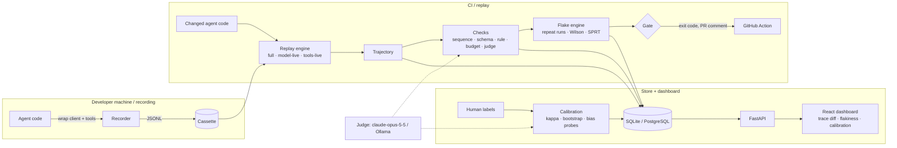

# PLAN.md — Replay: record-and-replay regression testing for LLM agents

Single source of truth for this project. Tick a milestone only when its
definition of done is met and CI is green. Last updated: 2026-10-21 (evolution round 1).

## Goal

**Problem.** Teams shipping LLM agents cannot test them the way they test other
software. Every run is different (sampling, tool results that change, clocks),
so a passing test proves little and a failing test might be noise. Teams either
skip tests, hand-mock each tool (brittle, misses drift), or run live against the
API on every PR (slow, expensive, still flaky). When a judge model is used to
score outputs, nobody checks whether the judge agrees with humans, so CI gates
on a number nobody has validated.

**Users.** Developers of tool-using agents built on the Anthropic SDK (or any
Python agent that can wrap its model and tool calls), who want a PR check that
says "this change broke the agent" and means it.

**What Replay does.**

1. **Record** a real agent run: every model call, tool call, clock read and
   random draw, with usage, cost and latency, into a JSONL *cassette*.
2. **Replay** it with *cut points* you choose: everything from the cassette
   (`full`, zero network, bit-stable, tests the orchestration code), or the
   model live with tools mocked from the cassette (`model-live`, tests prompt
   and model changes against a frozen world), or the reverse (`tools-live`).
3. **Check** the trajectory: tool-call sequence and arguments, structured-output
   schema, Python rule predicates, cost and latency budgets against a baseline,
   and a rubric-driven LLM judge.
4. **Gate CI statistically.** A scenario is not pass/fail from one run. In
   `model-live` mode Replay re-runs it, estimates the pass probability with a
   Wilson interval, stops early with a sequential test when the verdict is
   clear, and distinguishes *flaky* from *failing*.
5. **Calibrate the judge.** Judge checks are *advisory* until the judge has been
   measured against human labels on a golden set: Cohen's kappa with a bootstrap
   confidence interval, repeat-run self-consistency, and bias probes (position,
   verbosity, self-preference). Only a calibrated judge may fail a build.
6. **Show it.** A React dashboard with run history, trace viewer, aligned trace
   diffs between baseline and candidate, flakiness trends and the calibration
   report. Shipped as `pip install agent-replay`, a GitHub Action, and a Docker
   Compose dashboard.

**What makes it impressive.** Several small open-source projects now do
VCR-style replay of agent runs (`pytest-agentreplay`, `replayproof`, `chronicle`,
`pytest-agent-trace`). None of them measures the two things that decide whether
an agent test suite is trustworthy: *is the judge right* and *is the failure
real*. Replay's hard core is exactly that, with numbers the repo re-runs:
judge-human kappa with CIs, judge accuracy on an adversarial judge benchmark
(LLMBar), flake rates with intervals, model calls saved by sequential testing,
and a mutation study showing which injected regressions each check type
catches. Every number rests on a small, independently tested statistics
module.

## Architecture

### Components

| Component | Language / libs | Responsibility |
|---|---|---|
| `agent_replay.record` | Python 3.12, `anthropic` 1.x, `ollama` | Wrap the Anthropic / Ollama clients and tool functions; emit envelopes to a cassette. Capture `now()` and `random()` through helpers. |
| `agent_replay.cassette` | pydantic 2 | Cassette schema v1 (JSONL): header + envelopes with `kind`, `name`, `fingerprint`, request, response, usage, cost, latency, span ids. Canonical JSON for fingerprints. |
| `agent_replay.replay` | Python | Replay engine: cut-point modes, fingerprint match with cursor fallback, unrecorded-call policies (`strict`, `fallback`, `synth`), streaming and async support. |
| `agent_replay.checks` | Python, `jsonschema`/pydantic | `tool_sequence`, `required_tools`, `forbidden_tools`, `max_tool_calls`, `arg_schema`, `output_schema`, `rule`, `budget` (cost, tokens, p95 latency vs baseline), `judge`. |
| `agent_replay.judge` | `anthropic` (claude-opus-5-5), Ollama fallback | Rubric judge with structured outputs; response cache keyed by fingerprint; provider pluggable via `REPLAY_JUDGE_PROVIDER`. |
| `agent_replay.stats` | Python, stdlib only  | Cohen's kappa (unweighted and quadratic-weighted), bootstrap CI, Wilson interval, sequential gate (SPRT). |
| `agent_replay.flake` | Python, `anyio` | Repeated `model-live` runs with concurrency and rate limits; feeds `stats`; flaky vs failing classification. |
| `agent_replay.calibrate` | Python | Golden-set labelling CLI, judge-vs-human agreement, self-consistency, bias probes, LLMBar harness. |
| `agent_replay.diff` | Python | Trace alignment (Needleman-Wunsch over tool-call sequences with per-step cost) producing an aligned diff. |
| `agent_replay.store` | SQLAlchemy 2.1, SQLite (local) / PostgreSQL 16 (server), Alembic | Runs, envelopes, check results, baselines, labels. Same models for both backends. |
| `agent_replay.cli` | Typer, Rich | `replay record | run | ci | flake | calibrate | label | diff | serve | baseline`. |
| `agent_replay.server` | FastAPI 0.143, uvicorn | Read-only REST API over the store for the dashboard (`replay serve`); structured logging (structlog). |
| `dashboard/` | React 19, TypeScript strict, Vite 8, TanStack Query 5, Tailwind 4, Vitest | Runs, run detail, trace viewer, trace diff, flakiness trend, calibration report. |
| `action.yml` | GitHub composite action | `uses: TheAsianFish/agent-replay@v1`: installs, runs `replay ci`, posts a PR comment, uploads the report, fails on regression. |
| `examples/retail_agent` | Python | Demo agent on τ-bench retail tasks and tools (MIT, vendored subset) with objectively checkable outcomes (final DB state). |

### Data flow



### Key design decisions (alternatives considered)

1. **Intercept at the SDK boundary, not the HTTP transport.** `replay.wrap(Anthropic())`
   returns a proxy whose `messages.create/parse/stream` (sync and async) are
   recorded; tools are wrapped with `@replay.tool` or `replay.tools(...)`.
   *Alternative:* an httpx transport that records raw HTTP, as VCR does. Rejected
   because `anthropic` 1.x runs on `httpx2` while other SDKs use `httpx`, so one
   transport cannot cover both, and SDK-level interception gives typed messages,
   usage and streaming accumulation for free. Any other provider can be covered
   with the generic `@replay.model_call` decorator.
2. **Cut-point replay rather than stub-everything.** Recording every
   non-deterministic boundary and choosing per run which ones to serve from the
   cassette follows the idea published as "cut-point replay" (Chronicle,
   arXiv:2609.20625). `full` mode tests orchestration code with zero model calls
   and is bit-stable; `model-live` mode is the mode that catches prompt and model
   regressions and is where flakiness lives. *Alternative:* record only model
   decisions (langchain-replay style) and always run tools live. Rejected: tools
   that hit real systems make CI non-hermetic.
3. **Fingerprint matching with cursor fallback and explicit unrecorded-call
   policy.** A replayed call is matched by a canonical-JSON hash of the request
   with volatile fields removed; if none matches, the engine falls back to the
   next unconsumed envelope of the same kind and name and marks the step
   `approximate`. Tool calls the cassette never saw follow a policy: `strict`
   fails the run, `fallback` calls the real tool, `synth` returns a schema-valid
   stub. *Alternative:* strict cursor replay only. Rejected because a live model
   reorders calls often enough to make strict replay useless in `model-live`.
4. **Flakiness is a statistics problem, not a retry loop.** A scenario's result
   is a pass-probability estimate with a Wilson lower bound; the gate compares the
   bound to a threshold. A sequential probability ratio test stops repeating
   as soon as the verdict is clear, which is where the model-call savings come
   from. *Alternative:* fixed `k` runs and majority vote. Kept as the measured
   baseline.
5. **Judge checks are advisory until calibrated.** A judge check can only fail a
   build if a calibration report for that rubric shows kappa's lower CI bound at
   or above `REPLAY_JUDGE_MIN_KAPPA` (default 0.6). *Alternative:* trust the
   judge. Rejected; it is the whole point of the project.
6. **Structured outputs for the judge, no forced tool choice.** The judge uses
   `output_config.format` (JSON schema) and `claude-opus-5-5`. `tool_choice: any`
   is rejected by that model, and prefill is gone, so schema-constrained output
   is the only robust path. Rubric text goes first in the prompt so prompt
   caching applies across traces.
7. **One SQLAlchemy model set, two backends.** SQLite in `.replay/` for the CLI
   with no setup; PostgreSQL for the shared dashboard. *Alternative:* Postgres
   only. Rejected: the CLI must work in a fresh CI job.
8. **Trace diff by sequence alignment.** Baseline and candidate trajectories are
   aligned with a Needleman-Wunsch dynamic programme where substituting a step
   costs more when tool names differ than when only arguments differ. This gives
   "inserted a verification call" rather than "everything after step 3 moved".
9. **Pluggable providers, offline tests.** `anthropic` and `ollama` adapters
   share one protocol. Every test runs with a deterministic fake model and
   committed cassettes; nothing in `pytest` touches the network.

## Evaluation

All numbers in README.md come from a command in this repo (`make eval` /
`make bench` for the offline ones) and are recorded in RESULTS.md with dataset,
method, command and raw output. Anything needing an
API key is built, run on what the runner can do, and listed under "To measure"
with the exact command.

### Datasets

| Id | Dataset | Source | Labels | Used for |
|---|---|---|---|---|
| D1 | **Golden traces**: ~120 recorded runs of `examples/retail_agent` on τ-bench retail tasks | Recorded with an API key (`replay record`), committed under `eval/golden/` | (a) objective: final DB state equals expected state (τ-bench reward); (b) human: pass/fail labels per rubric criterion with `replay label` (target 100+ traces, ~2 hours) | Judge calibration (kappa vs human and vs objective), rubric iteration |
| D2 | **LLMBar** (419 pairwise instances, Natural + Adversarial, gold labels, MIT) | `princeton-nlp/LLMBar` on GitHub, vendored in `eval/data/llmbar` at a pinned commit (`make data-llmbar` re-fetches and verifies) | Gold preference 1/2 | Judge accuracy and position-bias probe on an adversarial benchmark with published numbers to compare against |
| D3 | **Flake suite**: 30 scenarios from D1, replayed `model-live` 20 times each | Generated by `make bench-flake` (needs key) | Pass/fail per run from objective + sequence checks | Flake rate with CIs, SPRT savings vs fixed k |
| D4 | **Mutation suite**: 25+ scripted mutations of `examples/retail_agent` (skip a verification tool, swap an argument, drop the confirmation step, change output field, loosen a guard) | `eval/mutations/` in the repo, runs offline in `full` and `model-live-from-cassette` modes | Known-bad by construction | Detection rate per check type; cut-point vs stub-everything baseline |
| D5 | **Synthetic cassettes** from the fake model | Generated deterministically in tests | n/a | Unit and integration tests, replay fidelity benchmark |

### Metrics and how each number is measured

| Claim | Metric | Method | Command | Needs key |
|---|---|---|---|---|
| Judge agrees with humans | Cohen's kappa (unweighted, pass/fail) per rubric criterion, with 95% bootstrap CI (2000 resamples), plus raw agreement and confusion matrix; majority-class baseline reported alongside | D1 human labels vs judge verdict, judge run 3× per trace to also report self-consistency kappa | `make eval-judge` (labels with `replay label`; D1 from `make record-golden`) | yes |
| Judge is robust | Accuracy on LLMBar Natural and Adversarial subsets, with and without position swap; position-bias rate = fraction of pairs where swapping order flips the verdict | D2, both orderings | `make eval-llmbar` | yes |
| Replay catches regressions | Mutation detection rate per check type and per mode; false-alarm rate on 5 benign refactors | D4, offline | `make eval-mutations` | no |
| Flakiness is quantified | Per-scenario pass rate with Wilson 95% interval; suite flake rate; single-run false-pass and false-fail rates relative to the 20-run estimate | D3 | `make bench-flake` | yes |
| Sequential testing saves calls | Model calls used by SPRT gate vs fixed k=20 at the same error targets (alpha=beta=0.05), on D3 and on a simulated Bernoulli grid (offline) | D3 for the real number; simulation offline | `make bench-sprt` | partial |
| Recording is cheap, replay is fast | Recorder overhead per boundary (µs, median and p95) and wall-clock full replay vs recorded live duration | D5-style synthetic calls and the six live retail recordings (D1 proper once recorded) | `make bench-replay` | no |
| Stats are correct | Property tests: `stats.cohens_kappa` matches scikit-learn `cohen_kappa_score` and `wilson_interval` matches statsmodels on random inputs (dev deps only) | Hypothesis | `make test` | no |

Baselines kept in the repo: raw agreement (vs kappa), fixed-k majority vote
(vs SPRT), stub-everything replay (vs cut-point), single-run pass/fail (vs
interval gate). A small local model through Ollama is the labelled offline
judge baseline when available; it is never presented as the headline judge.

## Release

**How users get it.**

- `pip install agent-replay` (PyPI; name verified free on 2026-10-08). SDK
  (`agent_replay`) and CLI (`replay`). Python ≥ 3.12. Built with `uv`, published
  by a GitHub Actions workflow using PyPI trusted publishing, guarded by
  `if: github.repository == 'TheAsianFish/agent-replay' && startsWith(github.ref, 'refs/tags/v')`.
- `uses: TheAsianFish/agent-replay@v1` GitHub Action (composite, `action.yml`
  in the repo root). Fails the job on regression and comments a Markdown
  summary on the PR. A `v1` moving tag is documented in RELEASE.md.
- `docker compose up` for the dashboard (FastAPI + PostgreSQL + static React
  build). One image, multi-stage Dockerfile.
- Optional hosted demo (read-only dashboard seeded with D1 and the mutation
  results) described in RELEASE.md with exact steps for Fly.io or Render.

**Maintainer steps** (listed in RELEASE.md):
create the PyPI project and trusted-publisher binding; add `ANTHROPIC_API_KEY`
as a repository secret for the manual-dispatch `eval-live` workflow; record D1
and label it (`make record-golden`, `replay label`); tag `v1.0.0`; optionally
publish the Action to the Marketplace and deploy the demo.

## Statistics core

`agent_replay/stats.py` (stdlib only) holds the statistics every headline
number depends on:

```python
def cohens_kappa(a: Sequence[int], b: Sequence[int], *, weights: Literal[None, "linear", "quadratic"] = None) -> float
def bootstrap_ci(stat: Callable[[Sequence[int], Sequence[int]], float], a, b, *, n_resamples: int = 2000, alpha: float = 0.05, seed: int = 0) -> tuple[float, float]
def wilson_interval(successes: int, trials: int, *, confidence: float = 0.95) -> tuple[float, float]
class SequentialGate:  # Wald SPRT on Bernoulli outcomes
    def __init__(self, p_fail: float, p_pass: float, *, alpha: float = 0.05, beta: float = 0.05, max_runs: int = 20) -> None
    def update(self, passed: bool) -> Literal["continue", "pass", "fail"]
```

A naive `stats_baseline.py` (raw agreement, normal-approximation interval,
fixed-k gate) ships first behind the same interface. `tests/test_stats.py`
covers hand-computed cases, edge cases (empty input, constant raters, k=0,
k=n) and Hypothesis property tests against scikit-learn and statsmodels as
oracles; `eval/sprt_sim.py` plots expected runs against the true pass rate.
`REPLAY_STATS_IMPL=baseline|core` selects the implementation.

## Risks

| Risk | Impact | Mitigation |
|---|---|---|
| Crowded space: several 2026 OSS tools do VCR-style agent replay | Looks like a clone in a 5-minute look | README leads with the measured calibration and flakiness numbers and the mutation study; prior art cited honestly in design decisions |
| `model-live` replay diverges from the cassette (model reorders or invents tool calls) so mocks miss | Mode is useless in practice | Fingerprint + cursor fallback, `approximate` flag, three unrecorded-call policies, `synth` stubs from tool JSON schema; measured in D3 |
| Headline numbers need an API key the CI runner lacks | Claims without measurements | Harness + offline parts (mutations, SPRT simulation, replay bench, stats tests) run in CI; key-dependent commands listed under "To measure"; never write an unmeasured number |
| Human labelling burden (~100 traces) | Calibration never gets measured | `replay label` TUI makes it ~1 minute per trace; objective τ-bench labels give a second, free reference; rubric kept to 3 criteria |
| Judge cost during evaluation | API spend | Judge cache by fingerprint; prompt caching; cost estimate printed before each eval run; Ollama fallback for development |
| Anthropic SDK churn (httpx2, forced tool choice removed, thinking always on) | Breakage, stale patterns | Pin `anthropic>=1.12,<2`; adapters isolated in `record/anthropic.py`; CONTRIBUTING.md records the API facts |
| Dashboard scope creep | M5 balloons | Five pages, read-only, no auth; everything else is roadmap |
| τ-bench data licensing / size | Repo bloat | MIT; vendor only the retail domain data and tool functions with attribution |
| Replay of thinking-enabled conversations | Recorded assistant turns with thinking blocks are model-bound | `full` mode never contacts the API; `model-live` never injects recorded assistant turns; documented limitation |

## Evolution round 1 (2026-10-21)

Every v1 milestone is merged. This round asks what is worth proving next,
starting from the directions set on 2026-10-20: make Replay real on a popular
open-source agent, get live data from a small open model through Ollama, show
the Action failing a real PR and the dashboard in a recorded walkthrough, and
grow like a product that real agent teams adopt, with free tools only.

### Where the project stands (measured in this round)

- `make check`: ruff and mypy clean; 1085 passed, 22 skipped, 58 xfailed in
  90 s. The xfails are `agent_replay/stats.py`, still a specification, so no
  judge criterion can gate and the SPRT savings stay unmeasured.
- `make eval` (43 s) and `make bench` (17 s) reproduce every committed result
  byte for byte; `make ui-check` passes 97 Vitest tests after `npm ci`.
- **The strict configuration fails a healthy task on every real run.** In all
  25 live `model-live` runs of `transfer_swapped_refunds` (20 Haiku, 5 Opus,
  `eval/results/m4_flake_*.json`) the `transfer_to_human_agents` call is an
  `approximate` step, because its free-text `summary` is worded differently
  each run; 24 of the 25 passed every check. So the "8/8 tool bugs with
  `fail_on_approximate`" row costs more than the 1/5 benign false alarm the
  mutation study shows: on live traffic it fails 1 of 6 tasks 100% of the
  time. The flag compares the *request bytes* of the next model call, which
  is the wrong signal for tool bugs; the roadmap's drift check compares the
  tool's *result*.
- **A local model drives the unchanged agent through the Anthropic SDK.**
  Ollama 0.40.6 serves an Anthropic-compatible `/v1/messages` (tools,
  `tool_result`, streaming, `system`, `output_config.effort` supported;
  `tool_choice`, `cache_control` and `count_tokens` not). With
  `Anthropic(base_url="http://localhost:11434", api_key="ollama")` and a
  subclass that only changes `model`, `replay run --mode model-live` recorded
  and checked the retail agent on this 4-vCPU runner with no change to the
  wrapper. qwen2.5:3b: 53 prompt tok/s, 15.5 generation tok/s; runs of 37,
  79 and 94 s; 0/3 passed (it skipped lookups or asked the user a question).
  qwen2.5:7b: 59 and 180 s; 0/2 passed `tool_sequence` in `exact` mode, yet
  on `lookup_latest_order_total` it answered the correct total ($829.43) after
  fetching one order instead of Opus's three. The exact sequence check
  measures agreement with the recorded path, not correctness; a local-model
  suite needs `in_order` sequences and the ground-truth rules.
- **The matcher serves a recording for a different argument.** Two of the
  3b runs called a tool with an argument the cassette never saw (a guessed
  user id) and were served the recorded result as `approximate`, because it
  was the only envelope of that kind and name at that level. The fake model
  never exercised this; a real one does on the first run.
- **The first real framework does not record.** pydantic-ai 2.58.0 (MIT,
  released several times a week) accepts an injected
  `AsyncAnthropic` through `AnthropicProvider(anthropic_client=...)`, so
  `replay.wrap()` can sit on it, but it calls
  `client.beta.messages.create(..., stream=..., betas=[...])` and
  `client.beta.messages.count_tokens`, and the wrapper refuses the `beta`
  surface. smolagents, mini-swe-agent, aider, OpenHands and crewai go through
  litellm or the `openai` SDK, which Replay has no adapter for;
  langchain-anthropic uses the anthropic SDK with a configurable base URL.
- An unpriced model's calls cost `None`, which `replay flake` reports as
  `$0.0000`; a local-model report would print a measured-looking zero.
- The Action's comment path has run only against a fake HTTP layer and in
  dry-run CI; no real PR has ever carried its comment.

### What comes next, and why

**M8: the Action on a real failing PR, and a recorded dashboard walkthrough**
(question 3; steer item 3). *Hypothesis:* the composite Action posts exactly
one sticky comment on a real pull request that seeds a regression and fails
the check, with no path the fake-HTTP tests missed. *Measured as:* the PR URL
and comment permalink in RESULTS.md, a screenshot in `docs/screenshots/`,
and a walkthrough video of runs, aligned diff and flakiness pages recorded
with Playwright from `make demo-data`, replacing the terminal GIF. The
regression PR is closed once the evidence is captured; the comment stays.

**M9: dogfood on pydantic-ai through Ollama** (question 1, first half; steer
items 1 and 2). *Hypothesis:* once the wrapper records the beta messages
surface, a pydantic-ai tool-using agent records on a local model and replays
in `full` with 0 approximate steps and in `model-live` against the same
model, with no change to the framework. *Measured as:* a committed cassette
naming the model (qwen2.5:7b), `make eval-pydantic-ai` running `replay ci` in
both modes, and a RESULTS.md section listing every surface that broke on
first contact and how it was fixed. Replaying that cassette across upstream
releases, to catch a real regression, is the second half, planned for round 2
once the example exists. The live number is the 10-run `model-live` flake
result per scenario on qwen2.5:7b, the first non-Anthropic live data.

**M10: a tool-result drift check** (steer item 1, "report tool-bug detection
honestly"; the roadmap item). *Hypothesis:* comparing each live tool's result
in `tools-live` with the recorded envelope's response catches the three
read-only tool bugs that only `fail_on_approximate` catches today, without
the JSON-layout false alarm, since those refactors return identical values.
*Prediction:* `tools-live+drift` 8/8 tool bugs, 0/5 false alarms, 0 drift on
the six live cassettes replayed `tools-live`; `drops_error_flag` still
survives. *Measured as:* a sixth column in `make eval-mutations` beside the
v1 columns, byte-stable in CI.

### Review of this round (2026-10-21)

Re-ran: `make check` (1085 passed, 22 skipped, 58 xfailed), `make eval` and
`make bench` (tree unchanged afterwards), the 25 `transfer_swapped_refunds`
outcomes in `eval/results/m4_flake_{haiku,opus}.json` (25/25 with one
approximate step, 24/25 passed; every other scenario 0/25 approximate), the
mutation table (the three read-only tool bugs are caught only by
`no_approximate_steps`; `drops_error_flag` is an agent mutation), the wrapper's
refusal of `beta`, pydantic-ai 2.58.0's `client.beta.messages.create` call and
`AnthropicProvider(anthropic_client=...)`, and a tool round trip through
Ollama 0.40.6's `/v1/messages` with qwen2.5:3b (tool_use, then tool_result,
then end_turn, 13 s for the first call). The 3b/7b pass counts above have no
committed log; they motivate M9 and no number from them enters RESULTS.md.

Changed: M9 now ends in a measured live result (a 10-run `model-live` flake
per scenario on qwen2.5:7b, committed raw), not only a recorded run. M8 states
what happens when the build environment has no GitHub credentials (the regression
PR is one maintainer command, and the milestone stays open until its evidence
is in), and its definition of done records the failing check and its wall time.
M9 integrates a framework with a pydantic-ai agent written here, not yet a
third-party agent; catching a real upstream regression stays round 2's
first item.

### Considered and not chosen this round

- **Q4, the verdict-stability curve on a local model.** Deferred to round 2:
  one run takes 1 to 3 minutes on 4 cores and does not parallelise, the
  retail suite's exact sequences and Opus latency baselines fail a local model
  for the wrong reasons, and the model that passes has to be found first (M9
  does that). The offline part, resampling the committed Haiku outcomes at
  run prefixes, comes with it.
- **Q2, the mutation study on a real model.** Deferred: 12 of the 32
  mutations wrap the fake model's policy and cannot run against a real one,
  the 8 tool bugs cannot act in `model-live`, so only the 12 agent mutations
  apply, and the result is uninterpretable without the baseline pass rate
  from Q4.
- **A scale benchmark (long runs, many runs, bytes per turn).** Deferred to
  round 2 in a reframed form: the suspected quadratic matcher is not one
  (queues are per kind and name), but cassette bytes do grow quadratically
  with turns because each model envelope carries the whole history.
- **A distance threshold on approximate matches.** Rejected: the argument
  distance of a one-field change is the same for the legitimate reworded
  summary and for the guessed user id, so no threshold separates them. The
  successor is per-tool identifying arguments, after M10.
- **An `openai` SDK adapter.** Not yet: pydantic-ai gets to the first real
  framework through the SDK Replay already wraps. The adapter becomes the
  question when the dogfood wants a second framework.

## Milestones

- [x] M1: Scaffolding, CI and a thin vertical slice — `uv` project with ruff, mypy `--strict`, pytest, Hypothesis; GitHub Actions running lint, type-check and tests; `Makefile` targets; cassette schema v1; Anthropic SDK wrapper and `@replay.tool`; `replay record` and `replay run --mode full` on a toy agent driven by a deterministic fake model; the `tool_sequence` check; MIT LICENSE; README quickstart that works. Done when a committed cassette replays offline, the check passes, a mutated toy agent fails it, and CI is green.
  - *M1 notes (2026-10-09).* Built as planned. A few decisions refine the plan:
    (a) replay matching in M1 uses a per-(kind, name) cursor and compares
    fingerprints to label each step `exact` or `approximate`; M2 adds the search
    by fingerprint across the queue and the unrecorded-call policies.
    (b) Before freezing v1, the schema gained `ErrorInfo.module`, so replay can
    re-raise the original exception class. `span_id`/`parent_span_id` are
    populated now, so nested calls are recorded and served through their parent.
    (c) Unknown cassette fields stay rejected (`extra="forbid"`): any additive
    field is a schema bump with a migration, matching the "never change v1"
    rule. (d) `replay run --strict` fails on `approximate` steps, a cheap guard
    until M2's checks land. (e) Streaming, `messages.parse`, `client.beta` and
    async clients raise inside a session instead of going live unrecorded; M2
    records them. (f) Not done: `@tool` on methods (no descriptor support yet),
    and Ctrl-C during a live recording discards the partial cassette.
    (g) Review follow-ups: the trajectory is ordered by call start on both
    record and replay (envelopes stay in finishing order), so parallel tools
    that finished out of order still pass their own cassette; replay decode
    failures, non-finite floats and invalid Unicode are fatal like unrecorded
    calls; sets are recorded in a deterministic order; unrecorded client
    surfaces fail on call, not on `hasattr`. Known limitation for M2: a tool
    that fans out to worker threads from inside another tool records the inner
    calls as top-level (the parent span is not carried into the workers), so
    such a cassette replays with those calls left over.
- [x] M2: Replay engine and checks library — modes `full`, `model-live`, `tools-live`; fingerprint matching with cursor fallback and the `approximate` flag; unrecorded-call policies `strict | fallback | synth`; clock and random capture; sync, async and streaming; Ollama adapter; checks `required_tools`, `forbidden_tools`, `max_tool_calls`, `arg_schema`, `output_schema`, `rule`, `budget`; SQLite store; `replay ci` with exit codes and JSON + Markdown reports; `examples/retail_agent` on vendored τ-bench retail data with fake-model cassettes committed. Done when every mode and policy has integration tests, the example agent records and replays, and `replay ci` fails on a seeded regression.
  - *M2 notes (2026-10-09).* Built as planned, with these refinements:
    (a) **One engine.** Recording and the three replay modes are one
    `Session` class; `SERVED_KINDS[mode]` is the cut point. Clock and random
    calls are served in every replay mode. Every session emits its own
    cassette, so `replay run --save` turns a `model-live` run into a new
    recording.
    (b) **Matching.** A served call takes the first unconsumed envelope with
    the same kind, name and fingerprint (`exact`), else the oldest one at the
    same nesting level (`approximate`): a call made inside a live tool never
    takes a top-level recording as an approximation, or the reverse. Nested
    envelopes are servable only when every ancestor's kind runs live in the
    mode.
    (c) **Policies.** `synth` builds the smallest value that validates against
    the tool's return type. It cannot invent a model reply, so an unrecorded
    model call under `synth` fails as under `strict`. `fallback` without a
    live client fails with a message naming `--client`.
    (d) **Schema v2.** v2 adds the `clock` and `random` kinds. v1 is read
    through frozen v1 models plus a migration; the live toy cassette stays in
    v1 as the proof.
    (e) **Streaming.** Streams are recorded as the final message and rebuilt
    into the SDK's own `MessageStream`, so recording buffers the stream.
    `stream` is not fingerprinted. `messages.parse` records what goes on the
    wire. `client.beta` and the raw-response surfaces still raise.
    (f) **Ollama** records `chat` only (streams as chunk lists, merged for a
    plain call). `keep_alive` and `stream` are not fingerprinted; `options`
    are.
    (g) **Thread fan-out** (the M1 limitation) is fixed for code that submits
    through `ContextThreadPoolExecutor`. A plain `ThreadPoolExecutor` still
    records fanned-out calls top-level; this is documented and tested. With
    several sessions active, a call from a plain pool worker fails all of
    them rather than passing through, which matters for M4's concurrent
    replays.
    (h) **`replay ci`** suites are TOML (stdlib `tomllib`, no new dependency).
    There is a `--cassette-dir` override, and the Markdown summary goes to
    `$GITHUB_STEP_SUMMARY`. Exit codes: 0 passed, 1 regression, 2 broken
    suite, which includes a scenario that could not run at all (missing
    cassette, unimportable agent, bad check, no client); reports carry
    `ran` per scenario and the cassette that was replayed. The store records
    suites, runs, steps and checks. The `budget` check takes absolute limits
    and only bites outside `full` + `strict`; baselines are M3.
    (i) **The retail example** vendors six τ-bench test tasks, single-turn,
    with τ-bench's ground truth as `rule` checks. Committed are fake-model
    cassettes and six live `claude-opus-5-5` recordings, all of which reached
    the expected database; see RESULTS.md for cost and the one model-live run.
    The review before merge fixed eight defects, all with regression tests:
    ambiguous worker-thread calls running live, a swallowed no-client
    fallback passing, cancelled calls leaving no envelope, synth failures
    escaping or producing invalid stubs, tracebacks on bad CLI input, Ollama
    stream/plain mismatches, and two meanings of `envelope_seq`. It also
    covered five claims a mutation sweep showed were untested. A second
    review pass fixed three more: a nested call under a `fallback` parent
    taking a top-level envelope as an approximation, config errors exiting
    1 instead of 2, and reports naming the suite's cassette rather than the
    one replayed; it added tests for the `fail_on_approximate` boundary,
    `choice` length and the tools-live policies.
    (j) **Known limitations.** Retail cassettes are large (60–120 KB each),
    because `system` and `tools` repeat in every model envelope; a
    deduplicated layout would be a v3 with a migration. A `with` block
    around a stream inside a recording drains it on entry. `@tool` on methods
    is still unsupported.

- [x] M3: Judge, cost and the stats interface — `judge` check with rubric YAML, `claude-opus-5-5` through structured outputs, Ollama fallback, fingerprint cache, "advisory until calibrated" semantics; pricing table and cost/latency baselines (`replay baseline`); `stats.py` interface with `NotImplementedError` bodies, `stats_baseline.py`, `tests/test_stats.py` (hand cases, edge cases, oracle property tests), `eval/sprt_sim.py`. Done when judge checks run offline against a fake judge in tests, cost deltas gate correctly, and the stats tests pass against the baseline where applicable and are marked expected-fail for the unimplemented module.
  - *M3 notes (2026-10-09).* Built as planned, with these refinements:
    (a) **Advisory results.** `CheckResult` gained `advisory`; a failed
    advisory check is reported (CLI `ADVISORY FAIL`, a Markdown "Advisory"
    list, the store's new column, added in place to older local databases)
    but never fails a scenario.
    (b) **Judge.** `agent_replay/judge/`: a YAML rubric (1 to 10 criteria,
    content fingerprint), a transcript built from the run's top-level tool
    calls and output (never the agent's model turns; values clipped at 2000
    characters), and providers behind one protocol: Anthropic, Ollama, a fake
    and `module:factory`. The Anthropic judge uses `messages.create` with the
    JSON-schema `output_config` that `messages.parse` would send, because in
    SDK 1.12 `parse` raises on a refused or truncated answer and hides
    `stop_reason`. Default effort is `low`; the judge id carries provider,
    model and effort.
    (c) **Gating.** Per criterion: a criterion gates only when a calibration
    report matches the rubric fingerprint, the judge id and the judge prompt
    version, and its kappa lower bound is at least `REPLAY_JUDGE_MIN_KAPPA`.
    A judge error is advisory when nothing gates and fails closed otherwise.
    M3 defines the report format; M6 produces reports.
    (d) **Cache.** Content-addressed on judge id, rubric, transcript and
    prompt version. With `REPLAY_JUDGE_OFFLINE=1` a miss raises
    `JudgeCacheMiss` and `replay ci` exits 2, so a stale committed cache
    cannot pass unnoticed (the review found the first version made a miss
    advisory). The live retail suite commits its verdicts.
    (e) **Baselines.** `replay baseline` replays a suite without checks
    (no chicken-and-egg for relative limits) and stores per-scenario medians
    of cost, tokens, model calls and p95 latency. `budget` gained four
    `*_increase_pct` limits; a zero baseline allows only zero; a limit
    without latency samples is skipped and named. `REPLAY_PRICES_FILE`
    extends the price table.
    (f) **Statistics.** `stats.py` is the specification with
    `NotImplementedError` bodies; `stats_baseline.py` (raw agreement,
    normal-approximation bootstrap, Wald, fixed-k majority) runs behind the
    same `StatsImpl` protocol, selected by `REPLAY_STATS_IMPL` (default
    `baseline` until core exists). Tests compare against scikit-learn and
    statsmodels; core tests are `xfail(raises=NotImplementedError)`, so a
    wrong implementation fails for real. `make bench-sprt` simulates the
    gate (baseline only for now).
    (g) **Measured.** On a live `model-live` run, the 25% cost limit passed
    the agent and failed all six tasks of a `no_prompt_cache` mutant (+76%
    to +155% cost, tokens unchanged). The uncalibrated judge agreed with the
    deterministic checks on 23/24 runs (wiring test, not calibration).
    M3 API spend $1.41.
    (h) **Review fixes.** An independent review found six defects, all fixed
    with tests: offline cache misses passing as advisory, calibration
    ignoring the prompt version, spend figures that did not reconcile with
    the artefacts, a baseline file naming the wrong suite, an absolute
    latency limit passing silently without samples, and the Markdown checks
    column counting advisory failures as passed.
    (i) **Known limitations.** A baseline records its mode and policy but
    `replay ci` does not compare them with the scenario's (a `model-live`
    baseline used by a `full` run compares live cost with recorded cost).
    `PROMPT_VERSION` is bumped by hand when the judge prompt changes. With
    one run per scenario, p95 latency moved by up to 36% between runs, too
    noisy to gate tightly before M4's repeats.
    (j) **Independent review.** Fixed on the branch: older stores opened by
    two processes at once could fail on the duplicate column; a cached
    verdict copied under another key was served on its file name alone; the
    stats error tests matched on wording the spec never promised (the spec
    now names the argument); the gate simulation's shared outcome stream did
    not hold for an early-stopping gate; reports took a `$GITHUB_SHA` that
    was not a commit of the checkout; two figures were rounded twice.
- [x] M4: Flakiness engine and mutation study — `replay flake` running repeated `model-live` replays with bounded concurrency and rate limiting; Wilson gate and SPRT early stop through the stats interface; flaky vs failing classification; `eval/mutations/` with 25+ mutations and 5 benign refactors; `make eval-mutations` and `make bench-sprt` (simulation) run offline in CI and write RESULTS.md. Done when RESULTS.md holds measured mutation detection rates per check type and per mode, and simulated SPRT savings, with commands and raw output.
  - *M4 notes (2026-10-10).* Built as planned, with one plan change and
    these refinements:
    (a) **Plan change: SPRT savings wait for `stats.py`.** The definition of
    done asks for simulated SPRT savings, but the SPRT is the statistics core
    (`agent_replay/stats.py`), which is deliberately still a specification.
    M4 ships everything around it: `make bench-sprt` now computes the
    yardstick the savings are measured against (the smallest fixed-sample
    test meeting α = β = 0.05 for 0.6 vs 0.9 needs 24 runs, exact binomial,
    checked against scipy) and prints the SPRT's expected runs as a fraction
    of it as soon as `core` runs. Until then the number is under "To measure",
    and everything else in the definition of done is met.
    (b) **`replay flake`** (`agent_replay/flake.py`). Scenarios run one
    after another; the runs of a scenario run on threads, at most
    `--concurrency` places ahead of the last outcome fed to the gate, and
    outcomes are fed in run order (completion order would let fast failures
    bias the test). Runs in flight at the decision finish and are reported
    `counted=False`. `--gate sprt` uses `SequentialGate`; `--gate wilson`
    runs a fixed number and checks the interval's lower bound. Both go
    through `stats_impl`, and the report names the method that actually ran
    (with `baseline`, a fixed-k majority and Wald intervals).
    `--runs-per-minute` spaces run starts; the SDK retries 429s itself.
    Concurrency defaults to 4, or 1 when tools run for real.
    Classification is `passing` / `flaky` / `failing` / `broken`, separate
    from the gate's decision. Per-run seeds reach client factories that take
    a `seed`, so simulated flakiness is reproducible at any concurrency.
    Runs go to the run store; a flake-level table is left to M5.
    (c) **Mutation study** (`eval/mutations/`, `eval/mutation_study.py`): 32
    mutations (12 agent, 12 model, 8 tool) and 5 benign refactors, five
    configurations (`full`, `tools-live`, `model-live`, `model-live` with
    `fallback`, and `tools-live` with `fail_on_approximate`), byte-stable
    JSON checked in CI. Model regressions are
    simulated by wrapping the fake model's policy, tool bugs by swapping a
    tool behind the same name and schema (`RetailAgent.tools`).
    (d) **State check.** `rule:db_matches_ground_truth` (τ-bench's reward)
    joined the retail suites. It applies only when every tool call ran for
    real. `RetailAgent.run` now resets the database first, as τ-bench does
    per task.
    (e) **Measured.** Stub-everything (`full`) caught 7/32 mutations and
    none of the model or tool ones (20 of the 32 live in a component it never
    runs); `model-live` caught 12/12 model regressions, `tools-live` 5/8 tool
    bugs; 0/5 benign refactors failed in those configurations. Failing on
    `approximate` steps (`tools-live+strict`) caught all 8 tool bugs and the
    stripped policy, at the price of 1/5 false alarms (the JSON-layout
    refactor).
    Live `replay flake`: Haiku 5.5 passed 119/120 runs (one policy breach on
    the refund-swap task), Opus 5.5 30/30. M4 API spend $1.175.
    (f) **Review fixes,** each with a test that fails on the old code: the
    first scheduler bounded only the runs still executing, so a slow first
    run let every later run start even when the gate would decide after one
    (the window now counts finished-but-unfed runs); an agent using a plain
    thread pool failed every run at concurrency above 1 and was reported as
    failing (now `broken`, via a dedicated `UnattributedCallError`, naming the
    fix); `tools-live` and `fallback` runs raced the example's shared database
    at the default concurrency (they now default to one at a time, with a
    warning when forced higher); an unexpected exception in one run dropped
    the others' results and left the stored suite unfinished (it now makes the
    scenario `broken` and keeps the rest). The mutation study now lists every
    configured check type, so `forbidden_tools` shows its 0/32.
    (g) **Known limitations.** One mutation survives every configuration:
    `drops_error_flag` is equivalent to the original on this suite (no
    recording has a failing tool). The three tool bugs that change only a
    tool's output, and the stripped policy, are caught only by failing on
    `approximate` steps, which also fails a benign JSON-layout refactor; a
    drift check that compares a live tool's result with the recorded one
    (rather than the next model request's bytes) is on the roadmap. Three
    `model-live` catches are the fake model crashing on a corrupted
    conversation. `rule:db_matches_ground_truth` cannot apply in
    `model-live`, where served tool calls never touch the database. Tools with
    process-global state must not be forced above `--concurrency 1` in
    `tools-live`. The `parallel_tools` benign refactor orders its trajectory
    by thread start, which Python does not guarantee; it has been stable in
    every study run so far, and CI would show a change as a diff in the
    committed results. `make bench-flake` (D3) waits for the larger golden
    set in M6.
- [x] M5: Dashboard — PostgreSQL + Alembic migrations sharing the SQLite models; FastAPI API with structured logging; React 19 + TypeScript strict dashboard (runs, run detail, trace viewer, aligned trace diff from `diff.py`, flakiness trend, calibration report page reading stored reports); Vitest and Playwright smoke test; Docker Compose; `replay serve`. Done when `docker compose up` shows the example data, API tests and UI tests pass in CI, and screenshots are in `docs/`.
  - *M5 notes (2026-10-10).* Built as planned, with these changes and refinements:
    (a) **Plan change: the server lives in the package.** It is
    `agent_replay/server/` rather than a top-level `server/`, so `replay serve`
    and `pip install 'agent-replay[server]'` ship it. The dashboard build goes to
    `agent_replay/server/static/` (untracked; bundling it in the wheel is M7).
    (b) **Plan change: REST without SSE.** The dashboard shows finished runs,
    so TanStack Query's refetch is enough; live updates are on the roadmap.
    (c) **Migrations.** Alembic revisions `0001` (the M2 to M4 schema) and
    `0002` (flake reports, flake scenarios, calibration reports), applied on
    every open under a lock: `BEGIN IMMEDIATE` on SQLite, a transaction-scoped
    advisory lock on PostgreSQL. DDL runs inside that transaction on both
    backends, so a failed migration rolls back. Pre-Alembic stores gain their
    missing column and are stamped `0001`. Tests compare the models with the
    migrated schema on both backends, run eight concurrent first opens (and
    fail when the lock is removed), and cover downgrade, rollback and a store
    from a newer version.
    (d) **Stored reports.** `replay flake` now stores its report (the
    flake-level table M4 left to M5); `replay db add-calibration` stores a
    calibration report until `replay calibrate` (M6) writes them itself.
    (e) **Diff.** `diff.py` aligns top-level steps with Needleman-Wunsch (0
    identical; 0.5 + 0.5·d for the same call with different arguments, d the
    fraction of top-level request keys that differ, model calls compared on
    their last message; 1 per gap; different names never pair). It is
    available as `replay diff` and `/api/diff`.
    (f) **Demo data.** `make demo-data` runs the repo's own `replay ci` and
    `replay flake` commands (about 480 runs). The demo calibration report
    compares the judge with the deterministic verdicts, not human labels, and
    says so in its `method`.
    (g) **Known limitations.** The API has no authentication (read-only,
    trusted network). Stores are large (about 40 MB for the demo) because
    model requests are stored whole. The diff page fetches the two full
    runs. The demo calibration shows raw agreement in the kappa column until
    `REPLAY_STATS_IMPL=core` exists. The new CI jobs (PostgreSQL, dashboard,
    Playwright, Compose) were run locally step for step; their first GitHub run
    is on the PR.
    (h) **Review fixes,** each with a test that fails on the old code: an
    in-memory store shared one SQLite connection between the server's worker
    threads (concurrent requests corrupted rows or crashed the process; its
    sessions now take turns); timestamps with a non-UTC offset were stored
    shifted on SQLite (normalised to UTC on write); store errors echoed the
    database password (redacted); a half-made pre-migration store got a
    misleading error; the flake trend reversed scenario order within a report;
    `replay flake` lost its verdict when storing the report failed; server
    errors now answer with a JSON 500 carrying the request id, a malformed
    `X-Request-ID` is replaced, and odd paths no longer 500 the dashboard
    fallback; the diff told a `null` value from an absent key, named the first
    earlier message that differs instead of equal message counts, and
    survived backticks in Markdown; the dashboard kept both sides of a long
    changed value readable, recovered from an offset past the end, dropped
    empty filter params, rounded durations and costs before choosing a unit,
    thinned trend labels and showed cycles in a trace; Compose binds to
    loopback by default (`REPLAY_BIND`); the demo seed returns usage errors
    instead of raising. The dashboard's tests grew from 57 to 84, the Python
    suite from 873 to 888.
- [x] M6: Judge calibration — `replay label` TUI, golden-set format, `replay calibrate` (kappa per criterion with bootstrap CI, agreement, confusion matrix, majority baseline, self-consistency across 3 judge runs, position / verbosity / self-preference probes), LLMBar harness (`make eval-llmbar`), calibration gating wired into `judge` checks, calibration page populated. Done when the full pipeline runs end to end on a fake judge offline with tests, and RESULTS.md lists the exact key-requiring commands under "To measure" with cost estimates; if D1 has been recorded and labelled, the measured kappa is in RESULTS.md.
  - *M6 notes (2026-10-14).* Built as planned, with these changes and refinements:
    (a) **Golden sets** (`agent_replay/calibrate/golden.py`). A directory with
    `items.jsonl` (judge transcripts, keyed by their fingerprint, so runs the
    judge would see identically are one item with several sources) and an
    append-only `labels.jsonl` (last line wins per item, criterion, source and
    labeller). A human label carries its criterion's fingerprint, so editing
    one criterion invalidates only its labels. `replay golden add` replays a
    suite *without* its judge and writes objective labels for the whole run
    (`_overall`: finished and every other check passed), since a deterministic
    check does not answer one rubric question. A verdict that differs from an
    earlier build's for the same transcript is reported as a conflict, never
    written. `eval/golden/retail` (`make golden`): 21 items from 24 runs.
    (b) **`replay label`.** A Rich prompt loop (no curses, so it is tested
    through stdin). Labelling is blind: it never shows the judge's verdict, the
    objective label or the run's variant, which would anchor the labeller and
    inflate agreement. Every answer is appended and fsynced at once, so quitting
    or Ctrl-C loses nothing; `b` re-asks the previous question (the new answer
    wins), notes stay with the question they were typed at.
    (c) **`replay calibrate`** (`agent_replay/calibrate/calibrate.py`). Sample 0
    is the verdict a `judge` check would use; it is compared with the reference
    per criterion (kappa with a bootstrap CI, raw agreement, the always-majority
    baseline, the confusion matrix) and for the whole run. Repeats are cached
    under their own keys (sample 0 keeps the M3 key, so committed caches still
    hit) and give self-consistency (unanimous share, mean pairwise kappa). It
    prints a call count and cost estimate before any call (2.3 characters per
    token and 289 output tokens a call, both measured on the committed retail
    verdicts), stops at `--max-cost-usd`, refuses an offline run with missing
    verdicts before calling anything, and gives up if the first three calls all
    fail. Statistics go through `stats_impl`; the report records which ran and
    its `method` says what the numbers are.
    (d) **Probes, as built.** *Position*: a pointwise judge has no answer order to
    swap, so the probe reverses the rubric's criterion order; pairwise position
    bias is measured on LLMBar. *Verbosity*: a fixed, content-free paragraph
    appended to the final output; flips to pass are the bias. *Self-preference*:
    judge leniency (false-pass rate) on runs driven by the judge's own model
    against other models, which needs a golden set with both (D1 records Opus
    and Haiku runs for that reason).
    (e) **Plan change: the gate is stricter.** A criterion gates only when the
    report (i) compares with human labels, (ii) was computed with
    `REPLAY_STATS_IMPL=core` (the baseline puts raw agreement in the kappa
    column; a report that does not name its statistics does not gate either),
    and (iii) has at least `REPLAY_JUDGE_MIN_ITEMS` (default 20) labelled items
    for that criterion, besides the M3 conditions and kappa's lower bound. The
    review showed why: two agreeing items give the bootstrap interval [1, 1].
    The M5 demo report had a criterion "gating" on raw agreement; it cannot now.
    (f) **LLMBar** (D2) is vendored (580 KB, MIT, pinned commit, checksums)
    rather than downloaded by `make data`, so a dry run counts calls on the real
    data and the offline heuristic floors are reproducible; `make data-llmbar`
    re-fetches and verifies it. `agent_replay/judge/pairwise.py` is a pairwise
    judge (structured outputs, cached, offline mode) for the harness and for
    later A/B comparisons.
    (g) **Measured offline.** The real judge's committed verdicts agree with the
    objective labels on 20 of 21 golden items (majority baseline 71%; one false
    pass). On LLMBar the shorter-output heuristic scores 82.0% on Adversarial and
    the longer 18.0%, the floor for any real judge's number. M6 API spend $0.
    (h) **Not measured (no key, no human labels, no `stats.py`):** judge-human
    kappa, self-consistency and probes on real verdicts, D1, and the real judge
    on LLMBar. The commands and cost estimates are in RESULTS.md, "To measure"
    ($1.30, $2.19 and $12.73).
    (i) **Review fixes,** each with a test that fails on the old code: no item
    floor (a two-item report could gate), the statistics check written as a
    blacklist, a misleading summary for advisory reports, four mutants of the
    metrics (confusion orientation, partial repeats in self-consistency, the
    majority tie, the give-up rule) that no test caught, the cost estimate
    assuming a cacheable system prompt under 512 tokens, notes lost on `b`,
    labels colliding across sources, and report paths that changed with the
    working directory.
    (j) **Known limitations.** Human-human agreement (the ceiling for
    judge-human kappa) needs two labellers and is not computed; `calibrate`
    takes one labeller. The verbosity probe has one perturbation. On the
    21 retail items a criterion clears the 20-item floor only if at most one
    item is skipped, and the interval is wide; D1 is the set meant to gate.
- [x] M7: GitHub Action and release readiness — `action.yml` composite action with PR comment and artifact upload, example consumer workflow, `v1` tag procedure; PyPI build and guarded trusted-publishing workflow; Dockerfile and Compose finalised; RELEASE.md with every step and secret the maintainer must add; README complete (what/why, demo GIF placeholder with capture instructions, quickstart, Mermaid architecture, design decisions, results table from RESULTS.md, roadmap); CHANGELOG. Done when `uv build` produces a wheel that installs in a clean venv, the Action runs against the example repo workflow in CI (dry mode), and RESULTS.md is complete with every measured and to-measure number.
  - *M7 notes (2026-10-16).* Built as planned, with these changes and refinements:
    (a) **The Action** (`action.yml`, logic in the stdlib-only
    `action/replay_action.py`) is composite and runs in the consumer's own
    Python, because the agent under test imports only there. `install: action`
    (the default) pip-installs the Action's own checkout, so `@v1` runs exactly
    the tagged code and works before any PyPI release; a pip spec or `skip` are
    the alternatives. One sticky comment per suite, found by a hidden marker
    that must start the body (paged through all comments); a failure to comment
    is a warning, since a fork's token is read-only and the replay verdict is
    what gates. Inputs reach the shell only through `env:`. `dry-run` prints the
    comment and never fails; the `action` CI job runs `uses: ./` that way on the
    retail suite and on a mutant and asserts the outputs. The "example repo" is
    this repository acting as the consumer, with the copyable workflow in
    `examples/github-workflow/replay.yml`; a separate example repository would
    have needed a second repo to keep in sync.
    (b) **Packaging.** Version 1.0.0, set only in `pyproject.toml`
    (`__version__` reads the installed metadata). The wheel bundles the
    gitignored dashboard build as a hatch artifact; the sdist holds only the
    package (327 KB, was the whole 1.99 MB repo). The PyPI description rewrites the
    README's relative links. `make dist` and the `package` CI job install the
    wheel and the sdist in fresh venvs outside the repo and smoke-test them.
    (c) **Release workflow** (`release.yml`): the tag must equal the package
    version and CHANGELOG.md must have a dated section for it, both checked
    before anything publishes; PyPI by trusted publishing, the GitHub Release,
    and the GHCR image, each guarded to tag pushes on this repository.
    (d) **Plan change: the hosted demo is one container.** The Dockerfile's
    `demo` stage bakes the demo data into SQLite at build time and listens on
    `$PORT`, so Fly.io (`deploy/fly.toml`) or Render needs no database service.
    Not deployed (no account).
    (e) **Plan change: `make bench-replay` lands here.** It was in the
    Evaluation table with no milestone. Recorder overhead from paired bare and
    recorded calls; `full` replay against the live recordings' call time.
    Writing it showed that every recording session read the package metadata
    (about 0.9 ms a lookup, measured); now once per process (14 µs per
    session). A run writes to `.replay/`; `make bench-replay-record` rewrites
    the committed JSON. `make eval` and `make bench` run every offline
    evaluation and benchmark, and CI diffs every committed result but this one.
    (f) **Docs.** README: results table, install, the Action, design decisions
    for M7, the demo GIF (scripted, `docs/demo.tape`); RELEASE.md with every
    step and setting; CHANGELOG.md; RESULTS.md gains an index of every claim
    and its status.
    (g) **Verified:** the `action` job with act 0.2.89 (job succeeded; pass exit
    0, mutant exit 1 with 5 of 6 failed), `make dist`, `docker compose up`, the
    demo stage, actionlint on both workflows. GitHub's own first run of the new
    `action` and `package` jobs is on the PR.
    (h) **Not done, and why:** a real PR comment through the API (no token for a
    real pull request here; covered against a fake HTTP layer), publishing to
    PyPI, the `v1` tag and the hosted demo (maintainer steps in RELEASE.md),
    `make bench-flake` (D3; needs a key and the larger golden set). M7 API spend
    $0.
    (i) **Review fixes,** each with a test that fails on the old code: a
    `replay-command` that exited 0 without writing a report passed the check
    (`passed` now needs a readable report and the verdict exits 2 without one);
    the summarize, comment and verdict steps ran outside `working-directory`,
    so a relative `python` broke after `replay ci` had run; an unexpected API
    response failed the comment step instead of warning; the release trigger
    accepted `v1.0.0-rc1` and would have published it as final and `latest`
    (now only a final `X.Y.Z` on `main`); a wheel built without the dashboard
    passed `check_wheel.sh` unless a flag was given (now the default check);
    the Markdown summary's diff fence could be closed by three backticks in a
    tool argument; `make bench` rewrote the committed timings; and four numbers
    in RESULTS.md (load average, duration, the loaded-run and before-the-fix
    timings) had no raw output and were replaced by measured ones. RELEASE.md's
    private-file check matched every example agent and now matches only the
    files it means; it also lists the `pypi` reviewer and a tag ruleset as the
    settings that keep a bare tag push from publishing.
- [x] M8: The Action on a real failing PR, and a dashboard walkthrough — the repository's own `action` CI job keeps its dry run; a script creates a branch that points the retail suite at a seeded mutant and opens a pull request whose workflow runs the Action for real (`dry-run: false`, `pull-requests: write`); the PR is closed after the evidence is captured. The script is one command (`make regression-pr`, using `gh` and the maintainer's own GitHub login, no new secret); where the build environment has no GitHub credentials, the PR body says so and the milestone stays unticked until that command has run and its evidence is committed. A Playwright script records runs, run detail, aligned diff and flakiness pages from `make demo-data` into `docs/walkthrough` (video and a GIF via ffmpeg), replacing the terminal GIF in the README. Done when RESULTS.md links the PR, its failing check run and the comment permalink, records the check's wall time and which scenarios failed, holds `docs/screenshots/pr-comment.png`, the README demo is the walkthrough, and CI is green.
  - *M8 notes (2026-10-21; ticked 2026-10-26).*
    Built: (a) `.github/workflows/replay.yml` on `main`, not only on the
    regression branch: every PR that changes `examples/retail_agent/**` (or the
    Action) runs the Action for real, so the repository gates its own agent the
    way a consumer would, at about a minute only on those PRs; ci.yml's
    `action` job keeps its dry run. (b) `make regression-pr`
    (`eval/regression_pr.py`, `gh` plus git, stdlib only) opens the PR against
    a `regression-demo/base-*` copy of `origin/main` that ci.yml ignores
    (`branches-ignore`), so a PR built to fail does not spend a full CI run;
    it captures the evidence, then closes the PR and deletes both branches.
    (c) `docs/screenshots/pr-comment.png` is the comment's GitHub-rendered
    `body_html`, fetched through the API and screenshotted with Playwright,
    because the PR page of a private repository needs a browser login the
    script does not have. (d) `--rehearse` runs the same edit and the Action's
    `replay ci` command offline, and the job ran under act: both fail 4 of 6
    scenarios (RESULTS.md, M8). (e) `make walkthrough` records the dashboard
    with Playwright and ffmpeg into `docs/walkthrough/`; the terminal GIF, its
    VHS tape and the VHS Dockerfile are gone. Open: the build environment has
    no GitHub credentials, so RESULTS.md has no PR link, check run, comment
    permalink or screenshot yet, and CI on this branch is unobserved. The
    milestone is ticked once `make regression-pr` has run and its evidence is
    committed.
    Since then the passing half ran for real on PR #11 itself (it changes
    `replay.yml`): 6/6 passed and `github-actions[bot]` posted the sticky
    comment, the step act could not exercise (RESULTS.md, M8). PR #12 repeated
    it with the same six rows. On 2026-10-26 `make regression-pr` ran with a
    maintainer login: PR #13 failed the check on 4 of 6 scenarios (all
    `rule:matches_ground_truth`, as rehearsed), the bot posted the failing
    comment, and the evidence and `docs/screenshots/pr-comment.png` are
    committed (RESULTS.md, M8).
- [ ] M9: Dogfood on pydantic-ai through Ollama — the Anthropic wrapper records `client.beta.messages.create` (plain and `stream=True`) with `betas` in the fingerprint, decoding replays to the beta message types pydantic-ai inspects, and names `count_tokens` as unsupported; `examples/pydantic_ai_agent/` holds a tool-using pydantic-ai agent with the client injected through `AnthropicProvider(anthropic_client=replay.wrap(AsyncAnthropic(base_url=...)))`, a `replay.toml` with `in_order` sequences and rule checks, fake-model cassettes for tests, and one cassette recorded on qwen2.5:7b through Ollama (the model named in the cassette and RESULTS.md); `make eval-pydantic-ai` runs `replay ci` in `full` and, with Ollama running, `replay flake` in `model-live` (10 runs per qwen2.5:7b scenario, at most three scenarios, raw report committed to `eval/results/`); unpriced models are reported as unpriced, not `$0`. Heavy recording runs locally or by `workflow_dispatch`, never on pull requests. Done when the committed cassette replays in `full` with 0 approximate steps in CI, RESULTS.md records the `model-live` flake result on qwen2.5:7b (passes out of runs per scenario, approximate steps per run, wall time, the CPU it ran on) beside the v1 Haiku and Opus rows without changing them, and RESULTS.md lists every surface that broke on first contact.
- [ ] M10: Tool-result drift check — `fail_on_tool_drift` beside `fail_on_approximate` in suites and `replay ci`: in `tools-live`, each live tool step is aligned with the cassette's tool envelopes by name and order and its result compared with the recorded response as canonical JSON (per-tool `ignore_fields` for values that legitimately vary); drift is reported like `no_approximate_steps`, with the first differing path; `eval/mutation_study.py` gains the configuration `tools-live+drift`. Done when `make eval-mutations` shows the sixth column beside the five v1 columns (hypothesis: 8/8 tool bugs, 0/5 false alarms), `replay ci examples/retail_agent/replay-live.toml --mode tools-live` with the flag reports 0 drift on the six live cassettes, RESULTS.md and the README results table carry the number beside the v1 ones, and the roadmap entry is removed.
