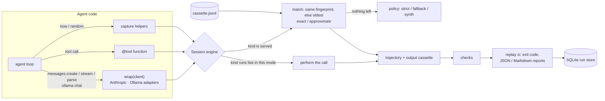

# Replay: record-and-replay regression testing for LLM agents

[](https://github.com/TheAsianFish/agent-replay/actions/workflows/ci.yml)

Replay records a real run of a tool-using agent (every model call, tool call,
clock read and random draw) into a cassette. On each PR it replays that
cassette against the changed code, with the cut point you choose, and asserts
on what the agent did:

- `full`: everything comes from the cassette. Offline, bit-stable, and it
  tests the agent's own orchestration code.
- `model-live`: the model runs for real against tools frozen from the
  recording. This catches prompt and model regressions.
- `tools-live`: the tools run for real against recorded model replies. This
  catches tool regressions without paying for the model.

`replay ci` runs a suite of these scenarios with structural, schema, rule and
budget checks, and fails the build on a regression.

Agents are not deterministic, so later milestones re-run a scenario,
estimate its pass probability with a confidence interval and tell flaky from
broken. Judges are not oracles either, so judge checks will stay advisory
until the judge has been calibrated against human labels (Cohen's kappa with
a bootstrap CI).

**Status: milestone 2 of 7.** Working today:
- recording through the Anthropic SDK (sync, async, streaming,
  `messages.parse`), Ollama, `@tool`, and the clock and random helpers;
- the three cut-point modes, fingerprint matching and the three
  unrecorded-call policies;
- eight checks;
- `replay ci` with JSON and Markdown reports, and a local SQLite run store;
- a τ-bench retail example agent with fake-model and live `claude-opus-5-5`
  cassettes.

The judge, flakiness statistics, dashboard and GitHub Action are planned, not
built. See [PLAN.md](PLAN.md).

## Quickstart

Requires Python 3.12 and [uv](https://docs.astral.sh/uv/). Not on PyPI yet, so
install from source:

```bash
git clone https://github.com/TheAsianFish/agent-replay && cd agent-replay
uv sync
```

The repo ships a customer-service agent adapted from τ-bench's retail domain
(`examples/retail_agent`), with six tasks and one cassette per task. Run its
regression suite. No API key is needed and nothing touches the network:

```console
$ uv run replay ci examples/retail_agent/replay.toml
PASS cancel_pending_laptop (full; 11 exact)
PASS modify_address_suite (full; 8 exact)
PASS return_damaged_bicycle (full; 12 exact)
PASS exchange_waterproof_boots (full; 14 exact)
PASS lookup_latest_order_total (full; 7 exact)
PASS transfer_swapped_refunds (full; 10 exact)
6/6 scenario(s) passed: passed
```

Now replay the same suite against a broken variant of the agent. It changes
one argument of every write action, so the tool names are still right:

```console
$ uv run replay ci examples/retail_agent/replay.toml \
    --agent examples.retail_agent.mutants:wrong_write_argument
FAIL cancel_pending_laptop (full; 1 approximate, 10 exact)
    rule:matches_ground_truth: action #1: expected ('cancel_pending_order',
{'order_id': '#W2417020', 'reason': 'no longer needed'}), got
('cancel_pending_order', {'order_id': '#W2417020', 'reason': 'ordered by
mistake'})
...
2/6 scenario(s) passed: failed
$ echo $?
1
```

The same suite runs against six real `claude-opus-5-5` recordings, offline
(`--cassette-dir examples/retail_agent/cassettes/live`). It can also run with
the model live and only the tools frozen: `--mode model-live --client
anthropic` (needs `ANTHROPIC_API_KEY`). The two runs recorded in
[RESULTS.md](RESULTS.md) passed 6/6, for $0.10 with a warm prompt cache and
$0.29 with a cold one. `make ci-demo` runs the suite in all three modes and
asserts that each of the three seeded regressions makes it exit 1.

A single cassette, with the smaller toy agent:

```bash
uv run replay run examples/toy_agent/cassettes/refund_eligible.jsonl            # full
uv run replay run examples/toy_agent/cassettes/refund_eligible.jsonl \
  --mode model-live --client examples.toy_agent.fake_model:make_client          # model live
uv run replay run examples/toy_agent/cassettes/refund_eligible.jsonl \
  --agent examples.toy_agent.mutants:first_tool_only                            # fails, exit 1
```

Record your own cassette, offline with the deterministic fake model or live:

```bash
uv run replay record examples.toy_agent.agent:run \
  --task "Order A1001 arrived damaged. Can I get a refund?" \
  --client examples.toy_agent.fake_model:make_client -o my.jsonl
uv run replay record examples.toy_agent.agent:run \
  --task "Order A1001 arrived damaged. Can I get a refund?" -o live.jsonl   # needs a key
uv run replay show live.jsonl
```

## Instrumenting an agent

You wrap the client and decorate the tools. With no session active both call
straight through, so the same code runs in production.

```python
import anthropic
import agent_replay as replay


@replay.tool
def lookup_order(order_id: str) -> Order:
    """Look up an order by id."""
    ...


def run(client: anthropic.Anthropic, task: str) -> str:
    today = replay.now()  # recorded, and the same on every replay
    ...  # your usual messages.create / tool_use loop
    ...  # tools=[lookup_order.to_anthropic()] builds the tool definition


run(replay.wrap(anthropic.Anthropic()), "Refund order A1001")
```

- **Agents** are any callable `agent(client, task)`, or `async def`, referred
  to as `module:function` by the CLI.
- **Clients:** `anthropic.Anthropic` and `AsyncAnthropic` (`create`,
  `create(stream=True)`, `stream(...)`, `parse(...)`), and `ollama.Client` /
  `AsyncClient` (`chat`, streaming included; `pip install
  agent-replay[ollama]`).
- **Tools** are plain or `async def` functions decorated with `@tool`.
- **Clock and randomness:** `replay.now()`, `replay.random()`,
  `replay.randint()`, `replay.choice()`, `replay.uuid4()`, plus
  `replay.capture.time()`.

From Python:

```python
from agent_replay import Cassette, replay
from agent_replay.checks import budget, required_tools, tool_sequence

cassette = Cassette.load("cassettes/refund.jsonl")
result = replay(cassette, run, mode="model-live", client=anthropic.Anthropic())
for check in result.check(tool_sequence(cassette.tool_names()), budget(max_cost_usd=0.05)):
    assert check.passed, check.message
```

## Concepts

- **Cassette** (JSONL, schema v2). A header (agent, task, recorder versions),
  then one envelope per call, then a footer with the run's output and status.
  - Each envelope has `kind` (model, tool, clock or random), `name`, request,
    response or error, usage, cost, latency, span ids, and a SHA-256
    `fingerprint` of the canonical request JSON.
  - Transport options (`extra_headers`, `timeout`) are never recorded.
  - Files are written atomically.
  - v1 cassettes from M1 are read through frozen v1 models and migrated in
    memory. The live Opus toy cassette stays committed in v1 to prove it.
- **Cut points.** Each mode is a set of call kinds served from the cassette,
  and everything else runs for real:

  | Mode | Model | Tools | Clock, random |
  |---|---|---|---|
  | `full` | cassette | cassette | cassette |
  | `model-live` | live (`--client`) | cassette | cassette |
  | `tools-live` | cassette | live | cassette |

- **Matching.** A served call looks at the unconsumed recordings with the
  same kind and name.
  - It takes the first one with the same request fingerprint (`exact`).
  - Failing that, it takes the oldest one and flags the step `approximate`.
  - So a reordered run still replays exactly, and a changed request is served
    but visible.
  - A recorded call nested inside another call (a tool that calls the model)
    can only be asked for when its parent runs for real. It is servable only
    in modes where the parent's kind is live; otherwise the parent is served
    whole.
- **Unrecorded calls** follow `--policy`:
  - `strict` (the default) fails the run.
  - `fallback` performs the call for real.
  - `synth` answers a tool call with the smallest value that validates
    against the tool's return type, so a `-> Order` tool returns a real
    `Order`. It understands formats (dates, UUIDs, decimals) and numeric
    bounds. It refuses what it cannot build safely (regex patterns,
    multi-item sets), and the run fails with a message naming `fallback`.
    A model reply cannot be invented, so under `synth` an unrecorded model
    call fails as under `strict`.
- **Failures survive `except Exception`.** These all fail the run even if the
  agent swallows the exception:
  - an unrecorded call under `strict`;
  - a recorded response that no longer fits the tool's return type;
  - a value that cannot be recorded.

  Recorded exceptions are re-raised as instances of the original class.
- **Any replay is a recording too.** `replay run --save out.jsonl` writes the
  replayed run, served calls included, as a cassette that replays like any
  other. That turns a `model-live` run into a new recording.
- **Streaming and async.**
  - Streams are recorded as the final message.
  - Both recording and replay hand the agent a stream rebuilt from that
    message and wrapped in the SDK's own `MessageStream`. So `text_stream`
    and `get_final_message()` behave as usual.
  - The cost: during a recording the agent sees the stream only once the
    model has finished.
  - `stream` is not part of the fingerprint, so switching between streaming
    and non-streaming still matches `exact`.
  - Async tools and `asyncio.gather` keep their spans nested.
  - Thread pools lose the parent span; `replay.ContextThreadPoolExecutor`
    carries it into the workers. A plain pool still works with one active
    session. With several active (parallel replays in one process), a call
    from a plain pool worker cannot be attributed, so it fails every session
    instead of running live.
- **Not recorded:** `client.beta`, `with_raw_response`,
  `with_streaming_response`, and Ollama methods other than `chat`. Inside a
  session they raise a clear error instead of silently going live.

## Checks

| Check | Passes when |
|---|---|
| `tool_sequence(expected, mode="exact" \| "in_order")` | The agent's tool calls match the list (default in a suite: the recorded sequence); prints a diff |
| `required_tools(tools)` / `forbidden_tools(tools)` | Every listed tool was called / none was |
| `max_tool_calls(limit, tool=None)` | At most `limit` tool calls (or calls to `tool`) |
| `arg_schema(tool, schema, must_call=False)` | Every call to `tool` has arguments valid against a JSON Schema or pydantic model |
| `output_schema(schema, parse_json=False)` | The final output validates |
| `rule(fn, **args)` | `fn(run, **args)` returns `True`, `(True, message)` or a passing `CheckResult`; an exception fails the check, never the suite |
| `budget(max_cost_usd=, max_tokens=, max_model_calls=, max_p95_latency_ms=)` | The run is within every limit given. Served steps carry their recorded cost and latency, so in `full` mode under `strict` this re-measures the recording; it bites in `model-live`, or when `fallback` / `synth` let the agent make calls the recording never saw |

## `replay ci`

A suite is a TOML file of scenarios, each a cassette, an agent, a mode, a
policy and checks. Paths are relative to the suite. The retail suite
(`examples/retail_agent/replay.toml`) uses every check type:

```toml
[defaults]
agent = "examples.retail_agent.agent:run"
mode = "full"
checks = [
  { type = "tool_sequence" },
  { type = "rule", ref = "examples.retail_agent.rules:checked_before_writing" },
  { type = "budget", max_model_calls = 8 },
]

[[scenario]]
name = "cancel_pending_laptop"
cassette = "cassettes/cancel_pending_laptop.jsonl"
checks = [
  { type = "rule", ref = "examples.retail_agent.rules:matches_ground_truth", args = { task = "cancel_pending_laptop" } },
  { type = "arg_schema", tool = "cancel_pending_order", must_call = true, schema = { required = ["order_id", "reason"] } },
]
```

`replay ci SUITE`:
- replays every scenario and runs its checks;
- stores each run in the run store (`replay runs` lists them, `replay runs
  ID` shows one);
- writes `--json` and `--markdown` reports, and appends the Markdown summary
  to `$GITHUB_STEP_SUMMARY` when that is set;
- exits `0` when everything passed, `1` on any regression, `2` when the suite
  itself is broken.

A scenario that cannot run (a missing cassette, an unimportable agent, a bad
check, no client for `model-live`) is reported with the reason, the rest still
run, and the command exits `2`: that is a broken suite to fix, not a
regression to bisect. `--agent`, `--mode`, `--policy`, `--client` and
`--cassette-dir` override the suite for every scenario.

In `model-live`, an `approximate` tool step means the live model asked
something the recording never saw and got the oldest unused reply for that
tool instead. Set `fail_on_approximate = true` (or pass `--strict` to `replay
run`) when a wrong answer there would make the rest of the run meaningless;
leave it off when the drift is in free text, such as a summary argument.

## CLI

| Command | What it does |
|---|---|
| `replay record AGENT -t TASK -o FILE [--client anthropic\|module:factory] [--force]` | Run the agent for real and write a cassette |
| `replay run CASSETTE [--mode full\|model-live\|tools-live] [--policy strict\|fallback\|synth] [--client REF] [--agent REF] [--expect a,b] [--strict] [--save FILE] [--json]` | Replay one cassette and run `tool_sequence`; `--strict` also fails on `approximate` steps |
| `replay ci SUITE [--agent] [--mode] [--policy] [--client] [--cassette-dir DIR] [--json FILE] [--markdown FILE] [--no-store] [--db URL]` | Replay a suite and gate on it |
| `replay runs [RUN_ID] [--limit N] [--scenario NAME] [--db URL]` | List stored runs, or show one |
| `replay show CASSETTE` | Print a cassette's header, envelopes and outcome |

Exit codes: `0` passed, `1` a check failed or the agent raised, `2` bad input
(missing cassette or suite, unimportable agent, invalid config, missing
credentials).

## Configuration

| Variable | Default | Meaning |
|---|---|---|
| `ANTHROPIC_API_KEY` | — | Used by `--client anthropic` (recording, `model-live`) and `make test-live` |
| `REPLAY_DB_URL` | `sqlite:///.replay/replay.db` | Run store (SQLAlchemy URL). The SQLite file is a local cache until migrations land with PostgreSQL in M5 |
| `REPLAY_LOG_LEVEL` | `WARNING` | structlog level for the CLI (`DEBUG` shows every recorded or replayed step) |
| `REPLAY_LOG_FORMAT` | `console` | `console` or `json` (one JSON object per line on stderr) |

## Architecture



The hard part of M2 is making replay trustworthy when only some of the world
is frozen. In `model-live` mode a live model reorders calls, asks for things
the recording never saw, and words arguments differently. Three mechanisms
deal with that, so a replay can follow a run that has drifted:
- fingerprint search with a flagged fallback;
- an explicit policy for unrecorded calls;
- the reachability rule for nested calls.

Every drift stays visible in the trajectory, and the checks decide whether it
matters. The harder parts are later milestones: a judge measured against
humans before it may fail a build, and failures told apart from flakes with
statistics rather than retries. PLAN.md has the full component map.

## Design decisions so far

- **Intercept at the SDK, not HTTP.** `anthropic` 1.x runs on `httpx2`, so
  HTTP-level recorders built for `httpx` never see its traffic. Wrapping the
  client gives typed messages and usage, and keeps credentials out of
  cassettes. Providers sit behind a `ProviderAdapter` protocol (Anthropic,
  Ollama).
- **One engine, modes as data.** Recording and the three replay modes are
  one session class. Each mode is just the set of kinds it serves, so every
  mode shares the same matching, policies, spans and output cassette. The
  alternative, a separate session class per mode, would duplicate the subtle
  parts.
- **Fingerprint search before cursor order.** Matching by fingerprint first
  makes reordered parallel calls `exact`, and falling back to the oldest
  unconsumed recording keeps a drifting live run going instead of crashing.
  The `approximate` flag (and `--strict` / `fail_on_approximate`) keeps that
  honest. Cut-point replay follows Chronicle (arXiv:2609.20625).
- **Streams recorded as the final message.** Recording the final message,
  not the raw events, keeps cassettes small and means the stream can be
  rebuilt and replayed whether or not the agent streamed. The price is that
  recording buffers the stream.
- **Schema versions are frozen.** v2 added the clock and random kinds as a
  new version with a migration, not by editing v1.
- **The fake model returns real SDK objects** and reports itself as
  `fake:<model>`, so its synthetic token counts are never priced as real
  spend.
- **Committed cassettes are regenerated, not hand-edited.** Drift tests
  re-record the toy and retail cassettes and fail if they changed (`make
  cassettes`, `make retail-cassettes`).

## Development

```bash
make check             # ruff check + format check, mypy --strict, pytest (offline, sockets blocked)
make demo              # toy quickstart: replay passes, the mutant fails
make ci-demo           # retail suite in all three modes; every seeded regression fails
make test-live         # live tests against claude-opus-5-5 (needs a key; a few cents)
make cassettes         # re-record the toy agent's cassettes (Anthropic and Ollama fakes)
make retail-cassettes  # re-record the retail agent's cassettes with the fake model
```

See [CONTRIBUTING.md](CONTRIBUTING.md) for conventions and [RESULTS.md](RESULTS.md)
for every measured number.

## Roadmap

1. ~~Scaffolding, cassette v1, recorder, `full` replay, `tool_sequence`~~
2. ~~Cut-point modes, fingerprint matching, unrecorded-call policies, clock and
   random capture, async and streaming, Ollama, the checks library, SQLite
   store, `replay ci`, the τ-bench retail example~~ (this milestone)
3. LLM judge (structured outputs), cost and latency baselines, statistics interface
4. Flakiness engine (Wilson interval, SPRT early stop) and a mutation study
5. FastAPI + React dashboard with aligned trace diffs
6. Judge calibration against human labels (kappa, bootstrap CI, bias probes, LLMBar)
7. GitHub Action, PyPI release, Docker Compose

## Prior art

VCR-style replay for agents exists in `pytest-agentreplay`, `replayproof`,
`chronicle` and `pytest-agent-trace`. The cut-point idea (choosing which
boundaries to serve from the recording) follows Chronicle (arXiv:2609.20625).
The retail example's data, tools and tasks come from τ-bench (Yao et al.,
2024, MIT). Replay aims to differ on measurement: judge calibration,
statistical flakiness gating and a mutation study.

## License

MIT, see [LICENSE](LICENSE). The vendored τ-bench subset keeps its MIT
license in `examples/retail_agent/data/LICENSE-tau-bench`.
