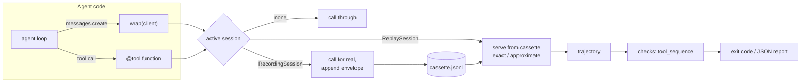

# Replay: record-and-replay regression testing for LLM agents

[](https://github.com/TheAsianFish/agent-replay/actions/workflows/ci.yml)

Replay records a real run of a tool-using agent (every model call and tool call)
into a cassette. On each PR it replays that cassette against the changed code
and asserts on what the agent did. The planned feature set goes further:
replay with chosen cut points (the model live against a frozen world of
recorded tool results, to catch prompt and model regressions), structured-output,
rule, cost and latency checks, and a rubric-driven LLM judge. Agents are not
deterministic, so Replay will re-run a scenario, estimate its pass probability
with a confidence interval and tell flaky from broken. Judges are not oracles
either, so judge checks stay advisory until the judge has been calibrated
against human labels (Cohen's kappa with a bootstrap CI).

**Status: early (milestone 1 of 7).** What works today: recording through the
Anthropic SDK and `@tool`, the v1 cassette format, `full` replay (zero
network), the `tool_sequence` check, and the `replay` CLI. Everything else in
this README's roadmap is planned, not built. See [PLAN.md](PLAN.md).

## Quickstart

Requires Python 3.12 and [uv](https://docs.astral.sh/uv/). Not on PyPI yet, so
install from source:

```bash
git clone https://github.com/TheAsianFish/agent-replay && cd agent-replay
uv sync
```

The repo ships a toy support agent (`examples/toy_agent`) that looks up an
order, checks the refund policy and maybe refunds. It also ships cassettes
recorded from it, one of them recorded against `claude-opus-5-5`. Replay one.
No API key is needed and nothing touches the network:

```console
$ uv run replay run examples/toy_agent/cassettes/refund_eligible.jsonl
Replaying examples/toy_agent/cassettes/refund_eligible.jsonl (mode full) against
examples.toy_agent.agent:run
#  kind   name                       status  request
0  model  anthropic.messages.create  exact   "1 message(s)"
1  tool   lookup_order               exact   {"order_id":"A1001"}
2  tool   get_refund_policy          exact   {}
3  model  anthropic.messages.create  exact   "3 message(s)"
4  tool   issue_refund               exact   {"amount":42.5,"order_id":"A1001"}
5  model  anthropic.messages.create  exact   "5 message(s)"
PASS tool_sequence: 3 tool call(s) match the expected sequence (exact)
passed
```

Now replay the same cassette against a broken variant of the agent. The
variant handles only the first tool call of each turn, a common bug with
parallel tool use:

```console
$ uv run replay run examples/toy_agent/cassettes/refund_eligible.jsonl \
    --agent examples.toy_agent.mutants:first_tool_only
...
2  model  anthropic.messages.create  approximate  "3 message(s)"
...
2 step(s) were served approximately: the request differed from the recording
1 recorded call(s) never made: get_refund_policy
FAIL tool_sequence: tool call #2 differs; missing get_refund_policy
      lookup_order
    - get_refund_policy
      issue_refund
failed
$ echo $?
1
```

Record your own cassette, offline with the deterministic fake model or live
against the API:

```bash
# offline: a scripted model that behaves like a well-behaved agent
uv run replay record examples.toy_agent.agent:run \
  --task "Order A1001 arrived damaged. Can I get a refund?" \
  --client examples.toy_agent.fake_model:make_client -o my.jsonl

# live: claude-opus-5-5 at low effort (needs ANTHROPIC_API_KEY; $0.014 in the run in RESULTS.md)
uv run replay record examples.toy_agent.agent:run \
  --task "Order A1001 arrived damaged. Can I get a refund?" -o live.jsonl

uv run replay show live.jsonl
uv run replay run live.jsonl
```

`make demo` runs the passing and failing replays and asserts both exit codes.

## Instrumenting an agent

You wrap the client and decorate the tools. Nothing else changes, and with no
session active both call straight through, so the same code runs in
production.

```python
import anthropic
from agent_replay import tool, wrap


@tool
def lookup_order(order_id: str) -> Order:
    """Look up an order by id."""
    ...


def run(client: anthropic.Anthropic, task: str) -> str:
    ...  # your usual messages.create / tool_use loop, using lookup_order(...)
    ...  # tools=[lookup_order.to_anthropic()] builds the tool definition


run(wrap(anthropic.Anthropic()), "Refund order A1001")
```

From Python, without the CLI:

```python
from agent_replay import Cassette
from agent_replay.checks import tool_sequence
from agent_replay.runner import replay

result = replay(Cassette.load("cassettes/refund.jsonl"), run)
[check] = result.check(tool_sequence(["lookup_order", "get_refund_policy", "issue_refund"]))
assert result.ok and check.passed, check.message
```

An agent is any callable `agent(client, task) -> output`. The CLI refers to it
as `module:function`, importable from the working directory.

## Concepts

- **Cassette** (JSONL, schema v1). A header (agent, task, recorder versions),
  then one envelope per call (`kind` model or tool, `name`, request, response
  or error, usage, cost, latency, a SHA-256 `fingerprint` of the canonical
  request JSON), then a footer with the run's output and status. Transport
  options (`extra_headers`, `timeout`) are never recorded. Files are written
  atomically.
- **Full replay.** Every model and tool call is served from the cassette. Each
  call name has its own cursor: the n-th `lookup_order` call gets the n-th
  recorded result. The request fingerprint is then compared with the
  recording. A match is `exact`, a mismatch is `approximate` (served, but
  flagged). A call with nothing left to serve stops the run with an
  `UnrecordedCallError` that tells you to re-record. The run fails even if
  the agent's own `except Exception` swallows that error. Recorded exceptions
  are re-raised as instances of the original class (when it is already
  imported) with the original message, so `except KeyError:` and error
  tool results replay exactly.
- **Nesting and threads.** A call made inside another intercepted call (a tool
  that calls a tool or the model) is recorded with a `parent_span_id`. On
  replay the parent is served whole and its body does not run. Tools run from a
  thread pool are still intercepted: when a worker thread has no session in its
  context and exactly one session is active, that session is used.
- **Not recorded yet:** streaming, `messages.parse`, `client.beta` and async
  clients. Inside a session they raise a clear error instead of silently
  going live.
- **Checks.** `tool_sequence(expected, mode="exact" | "in_order")` compares the
  tools the agent called with the expected list and prints a diff. The CLI
  defaults to the sequence in the cassette.

## CLI

| Command | What it does |
|---|---|
| `replay record AGENT -t TASK -o FILE [--client anthropic\|module:factory] [--force]` | Run the agent for real and write a cassette |
| `replay run CASSETTE [--agent REF] [--task TEXT] [--expect a,b,c] [--sequence-mode exact\|in_order] [--strict] [--json]` | Replay in `full` mode and run `tool_sequence`; `--strict` also fails on any `approximate` step |
| `replay show CASSETTE` | Print the header, the envelopes and the outcome |

Exit codes: `0` passed, `1` a check failed or the agent raised, `2` bad input
(missing cassette, unimportable agent, missing credentials).

## Configuration

| Variable | Default | Meaning |
|---|---|---|
| `ANTHROPIC_API_KEY` | — | Used by `replay record --client anthropic` (the default) and `make test-live` |
| `REPLAY_LOG_LEVEL` | `WARNING` | structlog level for the CLI (`DEBUG` shows every recorded or replayed step) |
| `REPLAY_LOG_FORMAT` | `console` | `console` or `json` (one JSON object per line on stderr) |

## Architecture



The hard part, which later milestones build out, is making replay trustworthy
when the model is live. The judge has to be measured against humans before it
may fail a build, and a failing scenario has to be told apart from a flaky one
with statistics rather than retries. PLAN.md has the full component map.

## Design decisions so far

- **Intercept at the SDK, not HTTP.** `anthropic` 1.x runs on `httpx2`, so
  HTTP-level recorders built for `httpx` never see its traffic. Wrapping the
  client also gives typed messages and usage, and it keeps credentials out of
  cassettes: headers never reach the recorder.
- **Per-name cursors with a fingerprint comparison** rather than one global
  cursor. A reordered but otherwise equivalent run still replays, and anything
  that differs from the recording is flagged `approximate` instead of failing
  silently or crashing. Searching the queue by fingerprint and the policies
  for unrecorded calls (`strict | fallback | synth`) come next.
- **The fake model returns real SDK `Message` objects** and reports itself as
  `fake:<model>`, so agent code cannot tell it apart, and its synthetic token
  counts are never priced as real spend.
- **Committed cassettes are regenerated, not hand-edited.** A test re-records
  the toy cassettes and fails if they drifted from the code (`make cassettes`).

## Development

```bash
make check       # ruff check + format check, mypy --strict, pytest (offline, sockets blocked)
make test-live   # the one live test: record with claude-opus-5-5, replay offline (needs a key)
make cassettes   # re-record the toy agent's committed cassettes with the fake model
```

See [CONTRIBUTING.md](CONTRIBUTING.md) for conventions and [RESULTS.md](RESULTS.md)
for every measured number.

## Roadmap

1. ~~Scaffolding, cassette v1, recorder, `full` replay, `tool_sequence`~~ (this milestone)
2. `model-live` and `tools-live` cut points, fingerprint search, unrecorded-call
   policies, async and streaming, more checks, SQLite store, `replay ci`, a
   τ-bench retail example agent
3. LLM judge (structured outputs), cost and latency baselines, statistics interface
4. Flakiness engine (Wilson interval, SPRT early stop) and a mutation study
5. FastAPI + React dashboard with aligned trace diffs
6. Judge calibration against human labels (kappa, bootstrap CI, bias probes, LLMBar)
7. GitHub Action, PyPI release, Docker Compose

## Prior art

VCR-style replay for agents exists in `pytest-agentreplay`, `replayproof`,
`chronicle` and `pytest-agent-trace`. The cut-point idea (choosing which
boundaries to serve from the recording) follows Chronicle (arXiv:2609.20625).
Replay aims to differ on measurement: judge calibration, statistical flakiness
gating and a mutation study.

## License

MIT, see [LICENSE](LICENSE).
